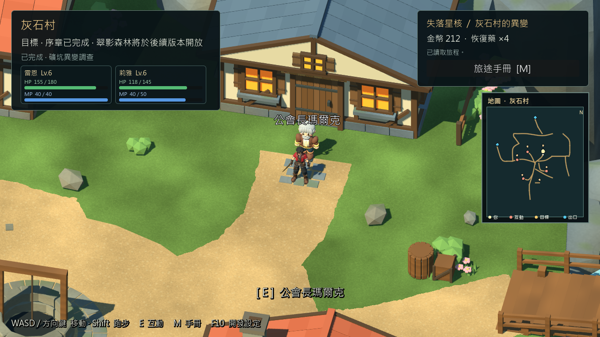
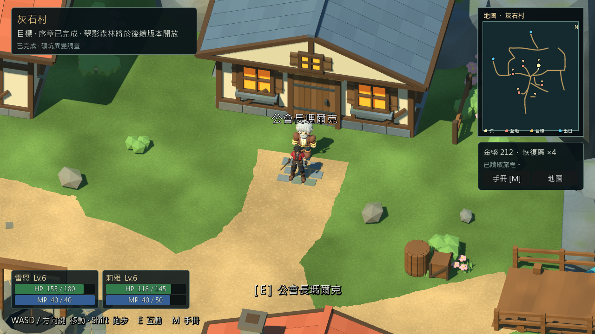
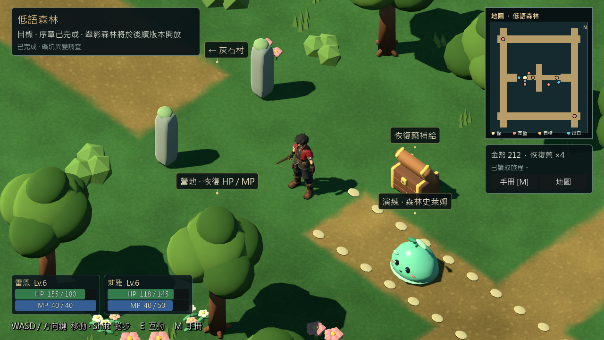
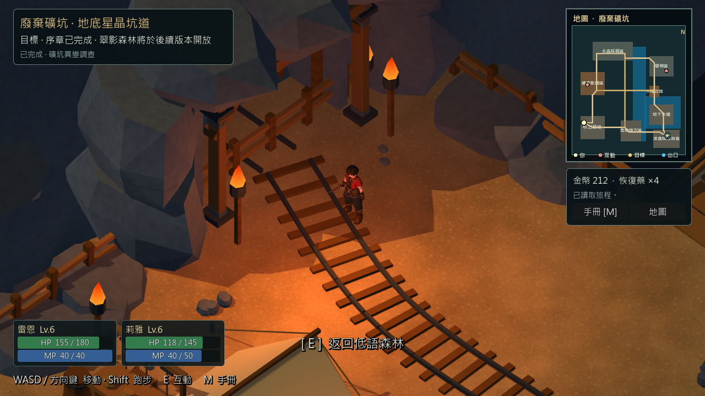
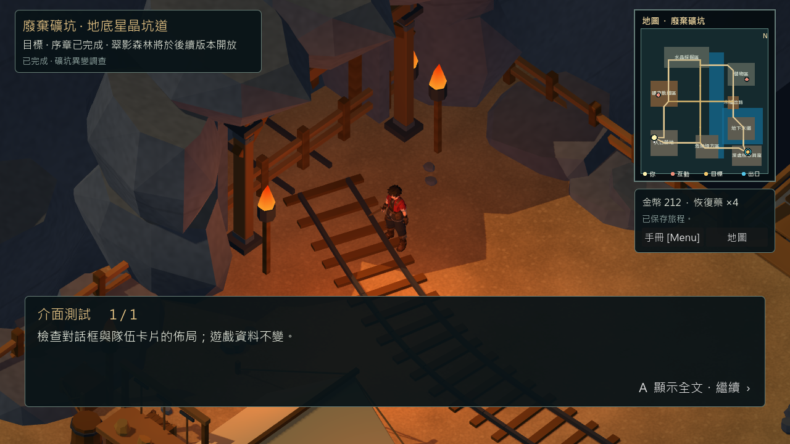

# 探索介面修正與存檔回歸 — 2026-10-30

工作位置 `D:/RPGGAME`，分支 `feature/greystone-g06`，基線 `c08bad720c0451ae67c40f4f12341d247b690252`。Godot `4.7.2.stable.official.ed1daf0bf`，Windows、Compatibility。舊 worktree 保留；本輪沒有修改地形、角色數值、劇情 ID、獎勵帳本或存檔 Schema。

## 實際修正

- 新版探索介面：左上顯示地點／目標，左下顯示雷恩與莉雅的真實 HP/MP；右上集中小地圖，下方顯示物資、保存結果、手冊和地圖入口。
- 狀態卡數值字體由11增至14，名稱由14增至16；數值疊在22高的狀態條內，保留數字而非只靠顏色。
- 重用既有手冊、地圖和存檔訊號；畫面不直接修改遊戲資料。Menu/M 和 B/Esc 繼續沿用既有選單流程；跑步仍是 Shift／LB。
- 對話時隱藏底部隊伍卡，結束恢復。場景淡入淡出仍覆蓋卡片；森林標籤避開新增卡片區域。
- 縮小重複標題和邊距，隱去常駐 F10 開發提示；F10 功能仍由序章回歸確認可用。只在 enable_navigation 的新版整合入口啟用，正式 main.tscn 不切換。

1280×720 的同一已完成序章位置，常駐面板矩形總面積從 **23.707% 降至17.378%**，減少6.329百分點（約26.7%）。這是面板覆蓋估算，不是渲染效能；不含短暫互動提示與對話框。小地圖尺寸維持228×278。

## 圖形證據

修改前：

修改後：

已查看上述實際遊戲截圖。測試視窗1280×720、960×540、1024×768、1920×1080；使用專案既有1280×720內容縮放，不宣稱任意解析度／TV可讀性皆合格。

## 測試與重現

在專案根目錄執行 `./tools/godot.ps1 -Mode <下列模式>`。預期各模式零失敗；實際如下：

| 模式 | 實際結果 | 範圍 |
| --- | --- | --- |
| Check | 通過 | Godot 專案載入／腳本解析 |
| TestCompactHud | 298／0 | 三區×四視窗尺寸、面板邊界及重疊、真實HP/MP、手冊／展開地圖、Menu/B、六次縮放後保存、讀檔旗標及收據、對話顯隱 |
| TestWorldLabels | 258／0 | 森林標籤與新HUD排除區、輸入、場景切換 |
| TestPrologueAreaMap | 77／0 | 點擊地圖、手冊地圖、輸入鎖與返回 |
| TestExplorationLocomotion | 68／0 | 步行、Shift/LB跑步、選單輸入與讀檔 |
| VisualMineReferenceStory | 94／0 | 圖形模式真實序章／戰鬥／回村交付／單次獎勵／保存 |
| VisualMineReferenceStoryReload | 25／0 | 新程序讀取上一列的同一個圖形存檔 |
| TestPhase5 | 69／0 | 正式舊入口的無頭序章回歸，不代表畫面驗收 |
| TestMineEdges | 23案例，0破口／0失敗 | 圖形模式邊緣實走，確認本輪仍無下墜 |

功能斷言合計 **889／0**，另23個礦坑邊緣案例。沒有重跑30分鐘長測或宣稱實體手把人工驗收。測試只使用工具隔離的 user:// 測試存檔，不接觸玩家存檔。

建議依序執行 VisualMineReferenceStory → VisualMineReferenceStoryReload → TestCompactHud；HUD測試需要第一步產生的已完成序章存檔。缺檔或旗標不完整會明確失敗，不自行偽造完成資料。原始輸出保留 `artifacts/compact-hud-*.txt`，不提交日誌與存檔；[面板量測](evidence/compact_hud_20261030/report.json)隨文件保存。

## 本輪抓到的驗收缺口

第一輪HUD 262／0；加強真實數值比較後，前置序章重跑留下的圖形存檔停在Boss戰後，HUD測試 **291／1**（缺chapter_departure_done）。舊序章測試只確認檔案存在；既有 headless 重啟模式又讀另一個story.json，因此不能證明圖形保存完整。

新增「磁碟中的完成旗標」和「讀回後金幣212／E008收據」斷言；圖形滑鼠測試在縮放後等實際畫面排版完成；新增 VisualMineReferenceStoryReload 對同一story_visual.json做新程序讀取。最新94／0＋25／0，HUD六次縮放保存及讀回也通過。

原始偶發點擊失效的精確原因尚未證實：補等待前的獨立序章重跑已通過。因此這是**測試可靠性／驗收缺口修正**，不宣稱發現並修復正式存檔程式損毀；SaveManager與Schema均未修改。[失敗摘要](evidence/compact_hud_20261030/initial_failure.json)保留。

## 檔案與限制

- `scripts/ui/exploration_interface.gd`：候選探索HUD排版與既有入口。
- `tests/compact_hud_test.gd`、`.uid`：圖形HUD及縮放保存驗證。
- `tests/greystone_story_test.gd`：真實最終存檔斷言與圖形點擊排版等待。
- `tools/godot.ps1`：新增TestCompactHud／VisualMineReferenceStoryReload入口。
- 本報告、證據、README、TASKS、CHANGELOG。

固定RC4包／ZIP沒有替換，啟動開發來源用 `./tools/godot.ps1 -Mode RunPrologueCandidate`。碰撞、防墜與區域地圖先前已實作，本輪驗證礦坑23例並未重新製作。礦坑小地圖文字仍偏密；新莉雅拓樸、交易／戰鬥效能尖峰仍未完成。人工終驗、Android／iOS及第一章持續暫停，不能把本報告當作序章最終發布通過。
