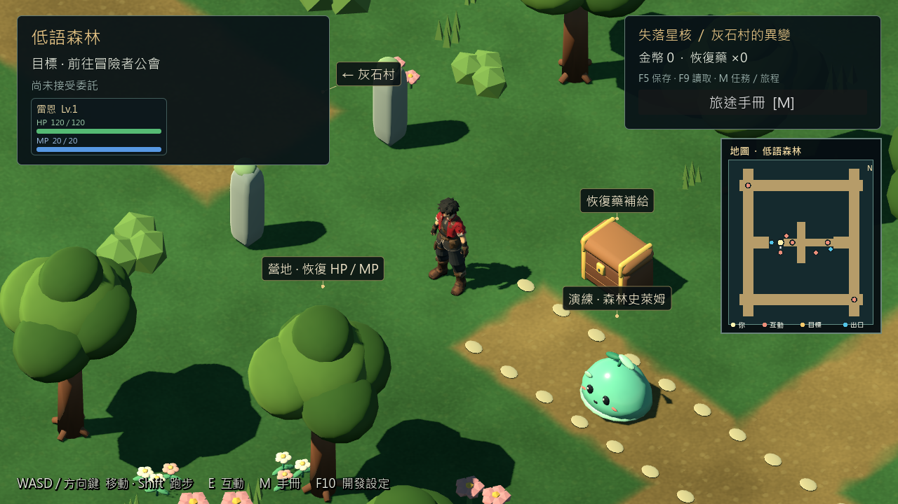
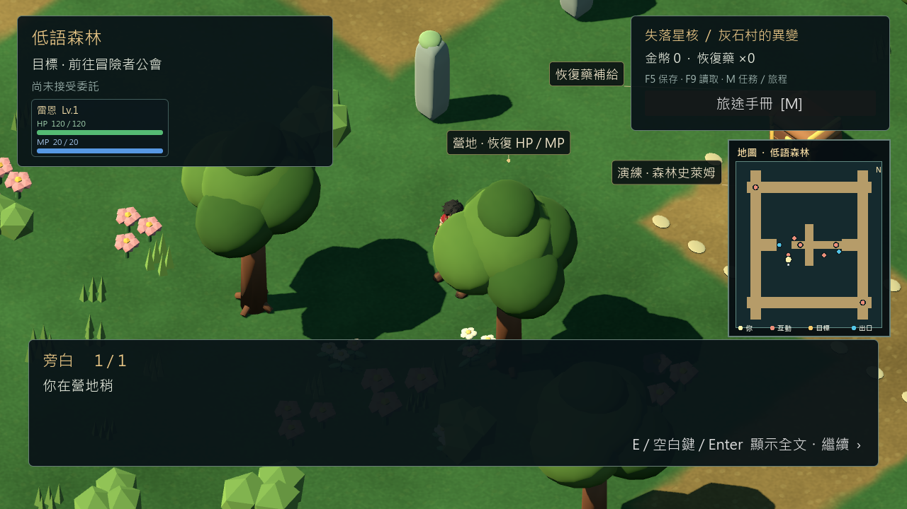

# 森林標籤／HUD遮擋修正 — 2026-10-29

## 問題及修改

固定RC4森林入口「←灰石村」被左上HUD遮掉；營地、補給及演練的大型3D文字擁擠。新WorldLabelLayer讀取既有WorldInteractable下的Label3D文字與位置，在畫面中排列提示卡和位置連線，避開實際HUD、對話框、互動提示、人物及其他標籤。保留深度遮擋檢查、隱藏目標不顯示、場景更換清除舊文字；不截取滑鼠或修改RPG狀態。

只對啟用新版導航的森林生效；村莊／礦坑保留既有標籤，正式v0.6.1入口不改。沒有採用標籤的地圖不做逐幀排版。若整個畫面沒有足夠空間，個別卡片仍可能省略；互動提示和地圖保留。四個測試尺寸均確認灰石村出口可見，沒有以隱藏所有標籤當作修正。

## 實際驗證

Godot 4.7.2.stable.official.ed1daf0bf、Windows、Compatibility／RTX3080；隔離artifacts測試存檔。

| 指令（tools/godot.ps1 -Mode） | 結果 | 範圍 |
|---|---:|---|
| TestWorldLabels | 232／0 | 圖形：1280×720、960×540、1024×768、1920×1080；HUD不重疊、出入口可讀、E對話、InputMap移動、隱藏目標、跨圖返回 |
| TestPrologueAreaMap | 77／0 | 圖形：三區展開地圖、焦點、模擬手把與讀檔 |
| VisualMineReferenceStory | 93／0 | 圖形序章、主線戰鬥、返回、單次獎勵 |
| TestMineReferenceStoryReload | 24／0 | 無頭新程序讀檔；沒有圖形截圖斷言，故與RC4圖形重啟25項不同 |
| TestPhase5 | 69／0 | 無頭正式舊序章／存檔回歸 |
| Check | exit0 | 專案匯入／腳本載入 |

功能斷言合計495／0。首次批次在77項地圖測試通過後，外層誤用未由ProcessStartInfo更新的LASTEXITCODE而停止；Godot工具已驗證退出0且無錯誤。確認後改用工具自身例外結果執行其餘回歸，沒有把外層非零隱藏為遊戲故障或重跑冒充首次成功。

[尺寸與標籤矩形證據](evidence/forest_labels_20261029/report.json)／[回歸結果](evidence/forest_labels_20261029/regression_results.txt)。已實際檢視1280、960、對話與RC4修正前畫面；測試使用真實場景的自動輸入，不是人工鍵鼠或Xbox驗收。

## 版本及限制

修改scripts/ui/world_label_layer.gd及exploration_interface.gd，新增tests/world_label_layout_test.gd和tools/godot.ps1測試模式；保留Godot UID。角色模型、碰撞、戰鬥數值、劇情旗標及存檔Schema均未改。

這是90adeac後的來源修正，**不在已凍結RC4 EXE／PCK／ZIP內**；RC4的30分鐘結果不能替本修改做長測。新版來源以 `./tools/godot.ps1 -Mode RunPrologueCandidate` 啟動。後續包需另建版本，不覆蓋RC4。

未完成：整體HUD佔屏仍偏大、森林營地樹冠可遮擋人物、礦坑小地圖標示密度、角色美術及效能尖峰。這次不宣稱UI整體美術驗收完成；人工驗證、Android／iOS和第一章維持暫停。
