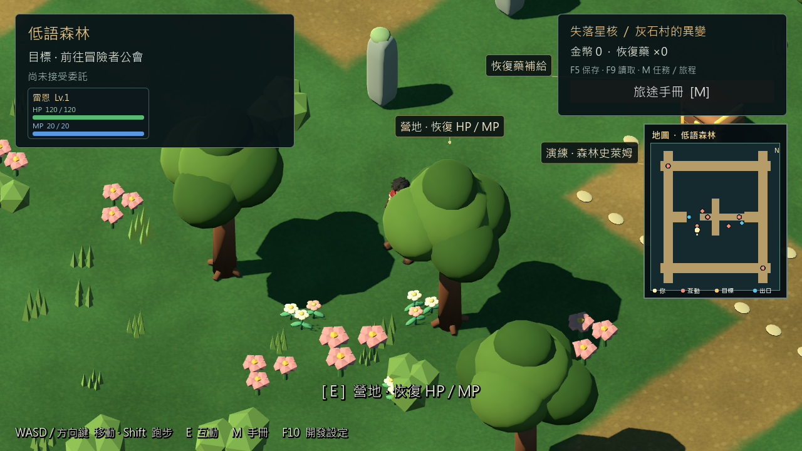
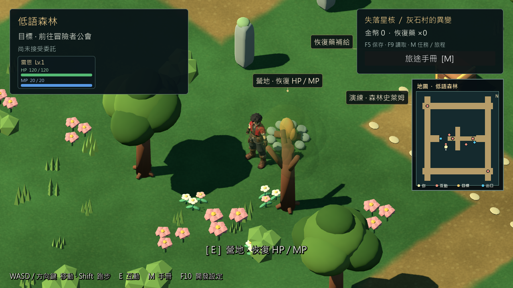

# 森林樹冠遮擋修正 — 2026-10-29

## 問題與結果

在真實低語森林營地附近 `(-7, 0, 4.3)`，前景樹冠遮住雷恩大半身體。既有ExplorationOcclusion只處理礦坑橫樑，森林未註冊。修正前圖形重現4項檢查中1項失敗；修正後26／0。已檢視原生修正前／後與移動畫面，雷恩身體和營地重新可見。

## 實作

重用ExplorationOcclusion，不新增第二套攝影機。森林完成材質配置後，明確註冊24個樹冠網格及其葉面材質索引。使用原有正交鏡頭平行射線／本地包圍盒與遲滯邊界，在角色腿、身體、頭部三個高度檢查遮擋。

僅遮擋中的樹冠複製每實例材質，約0.22秒淡至12%不透明度，移開後恢復原材質；樹幹、樹的位置、角色大小、地形、碰撞和共享GLB／材質均不改。關閉元件、探索角色隱藏、鏡頭切走及換圖恢復原狀。礦坑仍沿用原本的shadow-only橫樑處理。未開新版探索的正式v0.6.1入口不受影響。

## 驗證

Godot 4.7.2.stable.official.ed1daf0bf、Windows Compatibility、RTX3080，1280×720原生畫面；隔離測試存檔。

| tools/godot.ps1 -Mode | 結果 | 範圍 |
|---|---:|---|
| TestForestOcclusion | 26／0 | 真實營地、E對話、InputMap走動、角色隱藏／恢復、30／60 FPS淡化與復原、森林→礦坑→森林、碰撞尺寸／變換／層與共享材質不變 |
| TestG08Accessibility | 18／0 | 台階／斜向走動、11個礦坑橫樑、陰影保留、停止遮擋與換圖復原 |
| TestExplorationLocomotion | 68／0 | Shift／LB、走跑速度、動畫腳距、村莊坡階、存讀檔、焦點前置修正後重跑 |
| TestWorldLabels | 232／0 | 標籤避讓與四種解析度 |
| VisualMineReferenceStory | 93／0 | 圖形主線戰鬥、序章交付與一次性獎勵 |
| TestMineReferenceStoryReload | 24／0 | 無頭新程序讀取序章存檔 |
| Check | exit0 | 匯入／載入檢查 |

合計 **461／0**，不是人工Xbox認證或30分鐘效能長測。[結果](evidence/forest_occlusion_20261029/test_results.txt)／[位置與淡化數量](evidence/forest_occlusion_20261029/report.json)。營地案例只淡化一棵樹的兩個葉面，其他樹維持實心。

首次舊移動測試67項中「LB不改焦點」1項失敗。舊測試對預設隱藏的開發按鈕直接grab_focus，沒有先驗證可見性／焦點所有者；獨立有無LB短探針均未重現實際輸入衝突。現在先用F10打開面板，確認可見且可用的按鈕確實取得焦點，再保留原LB斷言，通過68／0。自動測試視窗設unfocusable，輸入由測試注入，避免依賴桌面搶焦點。不能將首次失敗確診為樹冠修正或玩家輸入問題；[原始失敗與探針](evidence/forest_occlusion_20261029/first_failure.txt)保留。

## 範圍與後續

- 修改：scripts/world/exploration_occlusion.gd、forest_presentation.gd、tests/exploration_locomotion_test.gd、tools/godot.ps1；新增tests/forest_occlusion_test.gd及UID、報告和證據。
- 淡化會使樹冠陰影減弱；本次優先保留人物辨識，未建立另一份陰影網格。測試確認森林碰撞保留，但不表示所有地圖任意角度已完成美術驗收。
- 包圍盒判定較實際葉面保守，視線擦過樹冠也可能淡化；此版本不處理建築／岩壁或未註冊的新模型。
- 修改僅在來源，固定RC4 EXE／PCK／ZIP保持不變。來源啟動：`./tools/godot.ps1 -Mode RunPrologueCandidate`。下一包需重新匯出和包內驗收。
- HUD整體佔屏、礦坑小地圖密度、新莉雅模型和戰鬥／交易尖峰仍待。人工、Android／iOS及第一章仍暫停，序章最終驗收未完成。
