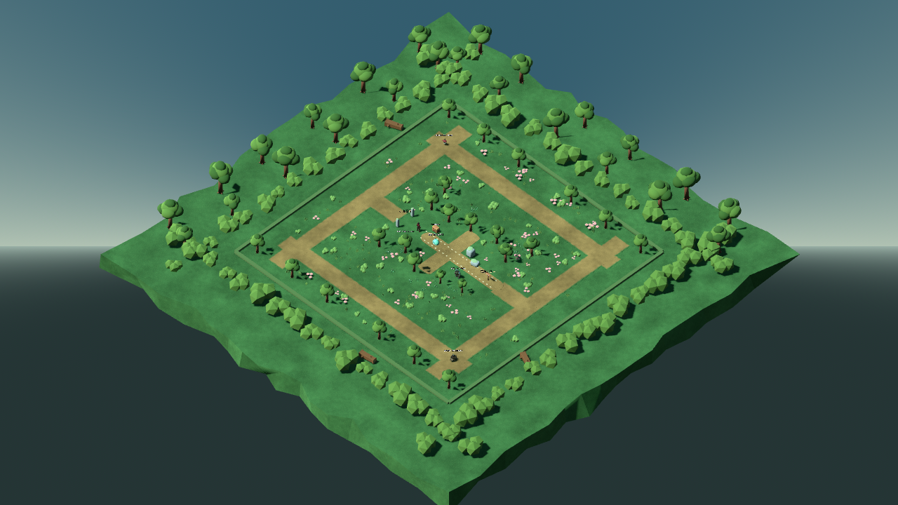
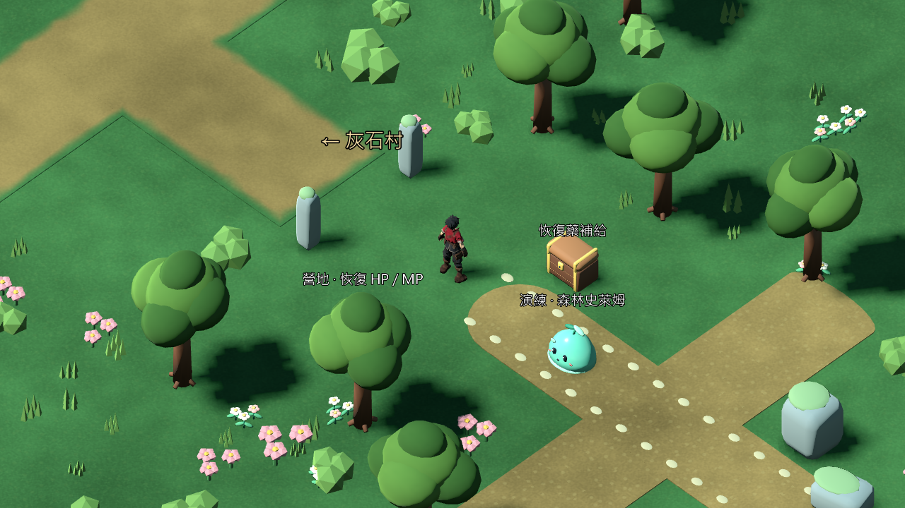
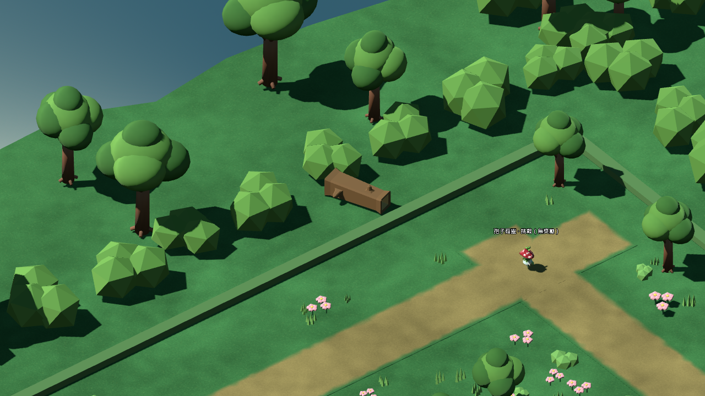

# 低語森林畫面整合與修整

2026-10-26，承接 f82b80f21eae2c31db77ce4ffded4e103815955f。沿用「先完成所有畫面修整」及人工驗收暫停的指示；礦坑已完成上一輪清單，本輪處理任務表中森林視覺仍未整合的缺口。沒有匯出新包。

## 實際變更

- 擴充森林增加獨立 `Presentation` 子場景；正式 v0.6.1 原森林與 main.tscn 不變。
- 重用既有圓樹及 G04 灌木建立背景地裙：24株背景樹、72組灌木、不規則外緣。新增一個 GLB，共52,576三角形／5個surface。背景全部在可走邊界外；不作可走地形、不新增碰撞。
- Blender保留可編輯背景主檔、重建腳本、固定隨機種子261026及來源SHA。這是背景造景主檔，中央玩法場景仍由原Godot場景管理，不冒稱整片森林已在Blender重建。
- 地面、舊路面及外圍地裙套入既有草土粒紋Shader；六個擴充道路模組共用新增草土漸變路緣Shader，交叉處依實際模組矩形聯集計算，避免路口出現草帶。
- 樹冠改為較深的兩層綠色，本地共用材質override，不改寫原GLB材質。草、花、灌木以三組MultiMesh加入：141叢草、45組灌木、47組花；離主路與互動點預留範圍。
- 隱藏原中央小地圖的裝飾石列，避免擴充森林仍像被方形圍牆隔開；所有物理形狀保留。原樹、營地、寶箱、敵人、礦坑／村莊出口及三根ENV02倒木保留。
- 第一版過長橫樑經實景檢查後撤除，沿用原礦坑告示。地面薄片關閉不必要的投影；薄片側面在近景仍有細邊，保留為後續收邊項目。

## 測試與保護

Windows／Godot4.7.2.stable.official.ed1daf0bf、OpenGL Compatibility、RTX3080；Blender5.2.2 LTS。

| 項目 | 檢查／失敗 |
|---|---:|
| 原生森林畫面、真實InputMap走跑與前後契約 | 26／0 |
| 最新參考村莊完整序章 | 68／0 |
| 最新參考村莊新程序讀檔 | 7／0 |
| 原礦坑整合入口完整序章 | 68／0 |
| 原礦坑整合入口新程序讀檔 | 7／0 |

合計176項／0失敗，另完成Check資源匯入。森林測試使用真正CharacterBody與InputMap跑過中央主線道路及完整外圈，13個途經點全部到達且落地。每條路線僅在起點定位，沒有逐點瞬移冒充行走。

37個碰撞形狀的世界transform、形狀AABB、layer/mask及disabled逐項比對；互動ID／位置／戰鬥ID／必要旗標、出生點與Marker相同。main.tscn、原forest.tscn、expanded_wilderness.gd、SaveCodec及序章事件JSON的正規化SHA保持一致。新增GLB所有頂點在可走邊界外，六段道路使用實際路緣材質，233組植栽離主路與互動預留區；這是明確範圍的幾何／位置檢查，不能推論全場景連續遮擋認證。

序章回歸涵蓋NPC／任務、莉雅加入、教學戰與Boss勝利、場景返回、單次獎勵及獨立程序重啟讀取。角色ID、數值、旗標、獎勵及存檔Schema均未變更。

初次材質重構曾有GDScript縮排錯誤，導致地面Shader和植栽檢查2項失敗；修正後以相同判準重跑通過，保留[失敗數據](../source_assets/forest_visual_finish_20261026/evidence/failed_palette_audit.json)。沒有把資源節點存在當成材質成功。

最終森林短取樣2036幀，平均60.04FPS、平均16.657ms、P95 16.766ms、P99 16.889ms、最大17.573ms。路線途經點Draw Calls 72–503，引擎靜態記憶體120.63–120.69MiB。Debug／60FPS上限、約34秒，包含測試成本；不是GPU時間、程序RSS、Release長測或手機數據。

## 實景與限制

已逐張查看6張修改前、8張修改後原生視圖及Blender背景渲染。局部Agent Vision評分（0–2）：COMP-DEPTH-LAYERS 2，背景樹與前景低灌木分層；COMP-LEAD-ENV 2，中央與外圈路線可辨識；COMP-SILHOUETTE 2，兩個玩家視角的角色與敵人可讀；LIGHT-KEY-FILL 1，沿用原日照，樹影仍較硬。局部7／8不是整體美術或參考還原度合格證明。

目前森林仍沿用49m平坦探索佈局，外圈道路走向偏規則，舊中央路面與外圈的收邊形式仍不同；本輪沒有新的森林參考圖，不宣稱已完成參考式地形重建。仍需後續整體美術審查，不能把礦坑圖套作森林還原依據。原低矮外牆可見，作為現有可走邊界提示。完整森林多高差重建若需改碰撞，須另走layout與存檔遷移流程。

人工美術／鍵鼠／Xbox驗收依使用者要求維持暫停；Blender即時場景正處於SCULPT模式，本輪未切換或改動使用者正在操作的礦坑預覽，使用背景程序製作。Android／iOS及第一章未開始。既有Windows RC2／RC3固定包不含本輪來源，未覆寫。

## 檔案與重現

- 背景主檔：[forest_dressing.blend](../source_assets/forest_visual_finish_20261026/forest_dressing.blend)。
- 重建：Blender CLI `--background --factory-startup --python-exit-code 1 --python scripts/tools/forest/build_forest_dressing.py`。
- 原生動線：Godot `--path D:/RPGGAME --script res://tests/forest_visual_finish_test.gd`，使用專案隔離APPDATA；`--baseline`只供未改場景第一次記錄，存在時拒絕覆寫。
- 匯入：`./tools/godot.ps1 -Mode Check`；序章模式依上表；進入最新場景：`./tools/godot.ps1 -Mode RunReferenceVillage`，經正式出口進入森林。
- [測試收據](../source_assets/forest_visual_finish_20261026/evidence/tests.json)、[最終數據](../source_assets/forest_visual_finish_20261026/evidence/after.json)、[建模來源](../source_assets/forest_visual_finish_20261026/build_receipt.json)、[逐檔SHA](../source_assets/forest_visual_finish_20261026/asset_receipt.json)。

下一個可執行項目是三張序章場景的鏡頭／材質整體巡檢，按實際重現缺陷修整；本輪不是新增玩法或打包Gate。
