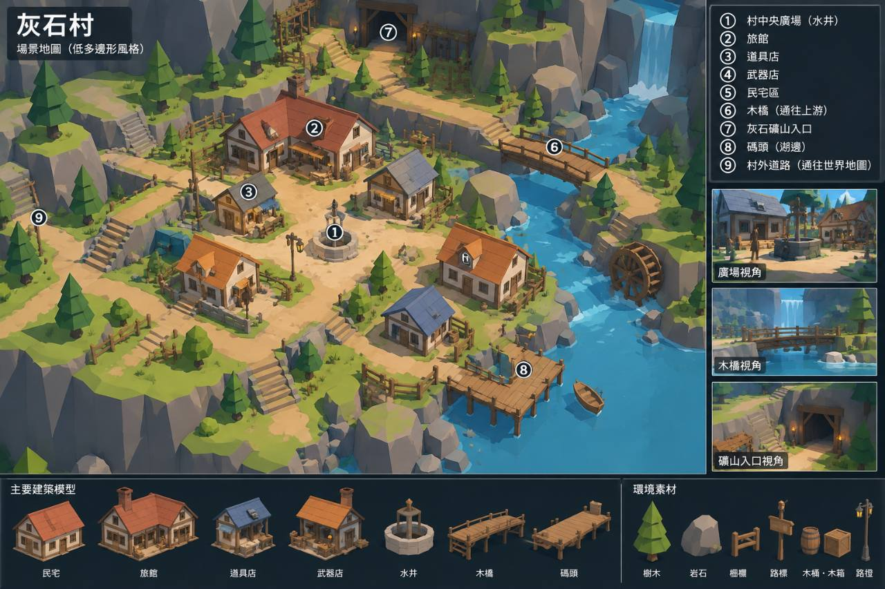
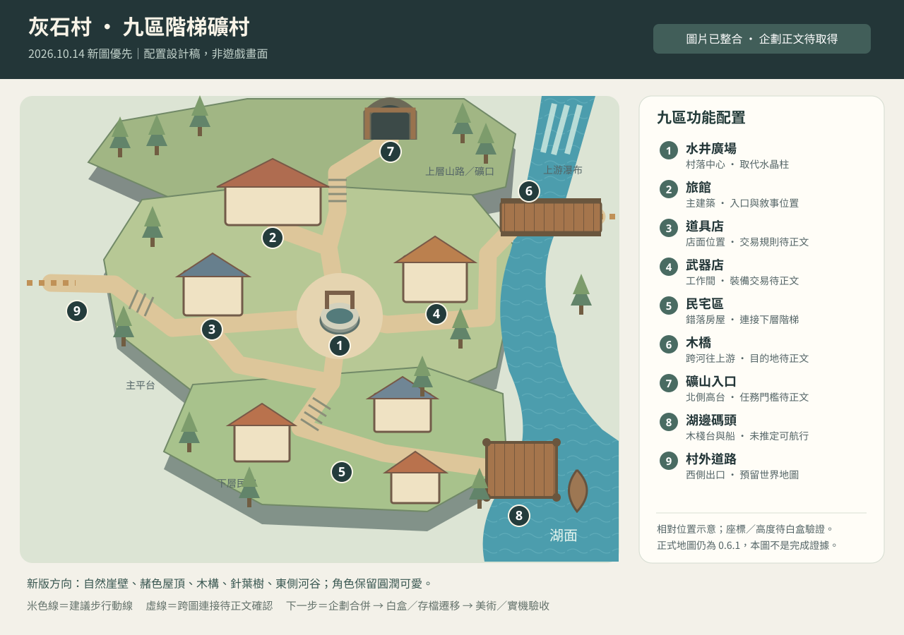

# 灰石村新版場景設計 — 九區階梯礦村

> **2026-10-14 正文合併更新（優先於本檔較早條款）**：新企劃已由使用者貼文取得，不再待正文。灰石村採 120×120m、Q 版低面數切面、北側公會/西北農田/東北礦坑/東河/南入口/西出口；平台 Windows + Android，iOS 預留。執行以 [GREYSTONE_VILLAGE_SPEC.md](GREYSTONE_VILLAGE_SPEC.md) 與 [GREYSTONE_BUILD_TASKS.md](GREYSTONE_BUILD_TASKS.md) 為準。G01 獨立佔位預覽，不替換正式0.6.1存檔；G06再遷移位置及串接劇情/觸控。本檔舊「待正文」、PC限定、圖片未列公會、固定舊碰撞等描述保留為歷史，不是目前限制。

依據 2026-10-14 使用者提供的新圖，優先於 0.6.1 的水晶廣場／藍頂公會版本。**這是場景設計與施工安排，尚未替換正式場景。** 全部系統／故事規劃仍須與尚待取得的新企劃正文核對，見 [合併紀錄](PLAN_MERGE_2026_10_14.md)。

## 配置與視線

示意圖採「畫面上方＝礦山、右側＝河谷」，僅表示相對位置與連通關係。樓高、座標、地塊比例是待白盒測試的設計建議，不冒充圖片提供的精確尺寸。

| 圖例 | 區域 | 配置與外觀 | 預留用途及限制 |
| --- | --- | --- | --- |
| ① | 中央廣場／水井 | 主平台中間，矮圓井、屋架／繩輪，四周自然土路；保留角色繞行空間 | 村落辨識中心；不沿用水晶柱。井不自動等同存檔／補血功能 |
| ② | 旅館 | 廣場上方偏左，較大的二層淺牆木構、赭紅屋頂、門廊、招牌、煙囪 | 可保留 E001 起始敘事位置；住宿、室內和公會長任務位置待新正文 |
| ③ | 道具店 | 廣場左側、旅館下方，灰藍屋頂、淺棚布、小型貨物陳列 | 交易入口位置；商品／價格／購買帳本未定，不用假商店 UI 代替系統 |
| ④ | 武器店 | 廣場右上側、河岸內側，木構工作間、暖瓦、武器招牌與工作道具 | 此位置依建築關係配置，圖中編號不清晰；交易與裝備預覽待正文 |
| ⑤ | 民宅區 | 廣場下方分散民宅，橘瓦與灰藍瓦錯落，矮木欄、柴堆／木桶、菜圃 | 下層住宅接階梯和碼頭，不排列為整齊外牆一圈；居民事件另排 |
| ⑥ | 木橋／上游 | 村莊右上連河對岸，木板、立柱、欄杆；上游可見瀑布 | 通行寬度需支援玩家膠囊、相機與手把；通往哪個地區／開放條件待正文 |
| ⑦ | 灰石礦山入口 | 北側最高平台，木支架礦口、坑燈、岩壁、礦車軌道、山路 | 作為真實可辨認入口；與原森林教學戰／礦坑事件串接需一起修訂 |
| ⑧ | 湖邊碼頭 | 右下低處，石階下接木棧台、木樁、繫繩、小船；河道向湖面展開 | 湖水保持不可落入邊界；乘船功能不得從造景直接推定 |
| ⑨ | 村外道路／世界地圖 | 左側山道，階梯接主平台，轉角路標與護欄；避免與矿口混淆 | 預留世界地圖連接位置。正式功能和序章範圍待新企劃正文決定 |

## 地形與尺度建議（待白盒驗證）

- 主廣場作高度基準 0；旅館和主街可同層，北部礦山路分段升高約 3～5 單位；住宅下層約 −1.5，碼頭約 −3。實際高度由鏡頭與移動測試決定。
- 每條主要動線淨寬先取 2.4～3.0 單位；水井周圍至少可雙向繞行。靠近店門保留角色轉向與互動提示空間。
- 階梯外觀與實際行走面分離，碰撞用連續坡面／規則平台驗證，避免膠囊每級卡住、鏡頭上下抖動。不得靠提高瞬移頻率掩飾階梯问题。
- 岩壁以大面分層、局部倒角；樹木依新圖改分層針葉輪廓，降低前景遮擋。人物仍沿用圓潤可愛，不能從環境圖自行替換主角風格。
- 河谷集中在右側，瀑布在上游、湖面在下游；水車依河流落差嵌入岩岸。移除舊版包圍村莊的方形水道與連續石牆設計。
- 建築採赭紅、橘褐與灰藍屋頂；路面採土路加入口少量石板。取消高飽和藍色公會塔樓和大面積奶黃圓形鋪面。
- 固定斜 45 度相機先保留；不得為追求同一張總覽把人物縮到無法操作。廣場、橋、礦口各有正常遊玩鏡頭檢查，必要的區域縮放另驗。

## 原創模組清單

第一組：水井、旅館、道具店、武器店、兩種民宅。第二組：岩壁／草頂平台、石階、坡面、針葉樹、矮木欄。第三組：木橋、碼頭、繫船樁、小船、水車、瀑布、礦口坑木／燈／短軌。第四組：路標、木桶、木箱、柴堆、門燈、招牌與少量花草。

優先重新使用可匹配的原創建築零件與木材材質；不為保留 0.6.1 模型而維持錯誤的地形或構圖。新商店建築與既有功能的接線分開記錄。每一資產維持來源、修改與面數紀錄。

## 施工與驗收

1. 新企劃正文比對完成後，先建立九區白盒和新版碰撞／落點契約，再做正式美術。既有 16 碰撞基線僅作歷史參考，不成為限制新圖的理由。
2. 走通村外道路→廣場→旅館／兩店→民宅→碼頭，以及廣場→橋／礦口；所有跨圖目的地與任務門檻可辨識。
3. 依最新劇情安排重定位 NPC／事件，但保留穩定 ID 或提供明確遷移；B001／B002 勝利與獎勵不得因捷徑重複發放。
4. 保存位置增加地圖佈局版本與新高度範圍；對舊版村莊存檔做明確安全點遷移，保留旗標、隊伍、裝備、消耗品和金幣。新版合法位置不可每次讀檔都重設。
5. 用 1280×720、960×540 實際遊玩視角查看井邊、樓梯、橋、礦口、碼頭；走動與互動用真正輸入和物理；讀檔與任務用整合測試，最後驗 Windows 匯出。

目前成果：可檢視的九區配置與差異決定。尚未完成：新正文合併、3D 白盒、場景建造、新功能及新版圖形／碰撞驗收。
