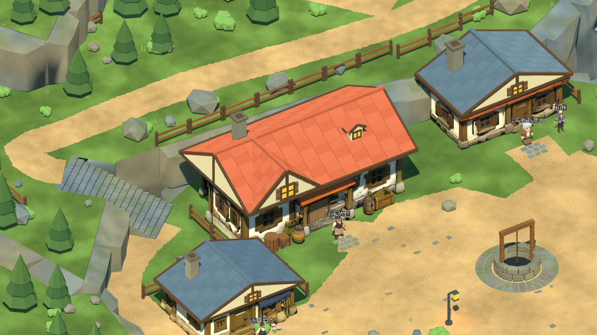
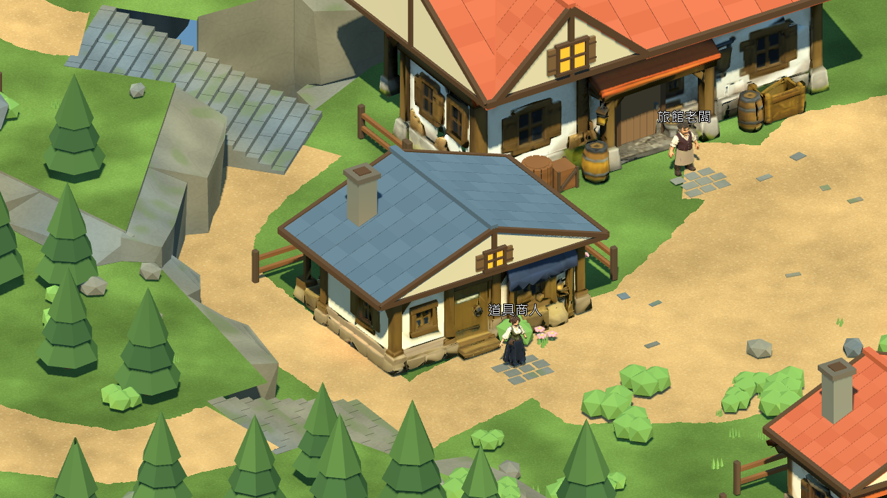
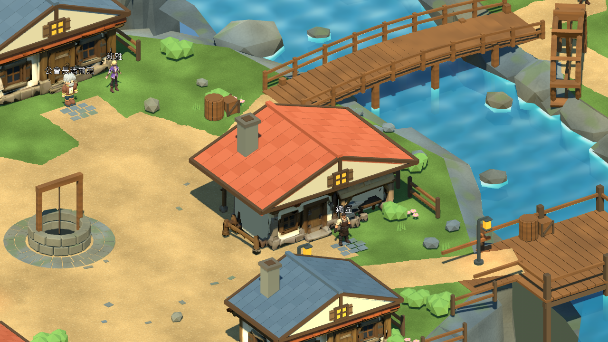

# 灰石村建築輪廓修整 — 2026-10-25

本輪依最新參考圖修整旅館交錯屋頂及五種建築模組的山牆；六處建築位置、NPC與既有RPG流程保留。這是建築美術進度，不是完整場景美術通過。原始專案用 `./tools/godot.ps1 -Mode RunReferenceVillage` 查看，正式v0.6.1與rc2-122891e固定包未改。

## 已完成的修改

- 旅館正面新增與主屋脊垂直的山牆，屋面依相交平面裁切，保留右側老虎窗。窗框、木百葉與木構邊條皆為實際網格。
- 道具店、武器店、住宅及公會使用共用模組的山牆窗框；沿用既有帶貼圖屋身，沒有重新生成角色或貼圖。
- 所有屋瓦底下增加連續封閉底板，避免狹縫漏光。六棟屋頂18,029條BVH射線檢查無缺面；這驗證屋頂覆蓋，不代表整棟建築拓樸完全無瑕疵。
- 建築碰撞改用前版已驗證的六個固定Body資料，不再隨屋頂／窗框外緣重算。首次核對確實抓到五棟碰撞偏移，修正後與66b4cfd主檔比較，Terrain／Paths／Bounds的世界Transform、頂點及面索引雜湊完全相同。
- 增加三個無HUD建築檢視鏡頭，僅存在截圖測試內；玩家探索鏡頭、LB跑步、存檔位置layout 4及Schema皆不變。

本機Blender MCP可連線，但即時檔是未儲存的預設Cube場景；採Blender 5.2.2 LTS背景腳本重建專案主檔，未清除或修改該即時場景。沒有下載素材、呼叫付費生成或升級外掛。

五種可重用GLB仍有六處實例。全場景視覺三角面 **172,435**，前版 **170,703**；視覺Mesh節點 **1,208**。本輪只重新匯出Buildings_Candidate，其餘分區GLB沿用前版。

## 驗證結果

Windows／Godot 4.7.2.stable.official.ed1daf0bf／RTX3080／OpenGL Compatibility。使用tools/godot.ps1的隔離測試存檔，探索與序章／交易為原生圖形模式與自動輸入。人工鍵鼠／Xbox驗證依使用者指示繼續暫停。

| tools/godot.ps1 -Mode | 通過／失敗 |
|---|---:|
| Check | 載入／匯入通過 |
| TestReferenceVillage | 70 / 0 |
| VisualReferenceStory | 68 / 0 |
| TestReferenceStoryReload | 7 / 0 |
| VisualReferenceCommerce | 53 / 0 |
| TestReferenceCommerceReload | 5 / 0 |
| TestReferenceMigration | 80 / 0 |
| TestReferenceMigrationReload | 6 / 0 |
| CaptureReferenceVillage | 15張真實渲染畫面 |

上述回歸共289項，包含兩座橋／五段階梯、NPC互動、森林與礦坑Boss、返回村莊、商店／旅館、遷移及獨立程序重啟讀檔。沒有用無頭測試代替畫面觀察。

11個玩家視角各120幀的短樣本（60 FPS上限）：平均 **16.42–16.58 ms**、P95 **16.68–16.72 ms**、P99 **16.70–16.77 ms**；Draw Calls最大值範圍 **607.00–1377.00**。引擎靜態記憶體 **352.47–353.43 MiB**、渲染顯存估算 **902.79–903.08 MiB**。這不是程序RSS、GPU計時或30分鐘穩定性驗收。三張建築細節圖沒有另做效能採樣。

重建及檢查命令（Blender使用本機已安裝5.2.2）：

```powershell
blender --background --factory-startup --python-exit-code 1 --python scripts/tools/greystone/build_reference_v5.py
blender --background --factory-startup --python-exit-code 1 --python scripts/tools/greystone/export_reference_v5.py -- --only Buildings_Candidate
blender --background --factory-startup --python-exit-code 1 --python scripts/tools/greystone/audit_reference_roofs.py -- --output artifacts/reference_architecture_20261025/roof_audit.json
blender --background --factory-startup --python-exit-code 1 --python scripts/tools/greystone/audit_reference_finish.py -- --baseline artifacts/reference_architecture_20261025/baseline.blend --output artifacts/reference_architecture_20261025/geometry_audit.json
```

最後一項baseline.blend是修改前由66b4cfd保留的主檔，不是任意新檔。可從該提交的source_assets/greystone_reference_20261024/greystone_master.blend重取。背景程序均檢查完成標記與退出碼；來源與輸出雜湊保存於證據。

證據：[測試結果](../source_assets/greystone_reference_20261024/evidence/architecture_20261025/tests.json) · [屋頂射線](../source_assets/greystone_reference_20261024/evidence/architecture_20261025/roof_audit.json) · [碰撞核對](../source_assets/greystone_reference_20261024/evidence/architecture_20261025/geometry_audit.json) · [資產清單與雜湊](../source_assets/greystone_reference_20261024/evidence/architecture_20261025/asset_receipt.json) · [短樣本效能](../source_assets/greystone_reference_20261024/evidence/architecture_20261025/metrics.json)。

## 實際Godot畫面及未完成項目







目前仍有差距：舊屋身貼圖帶有烘焙暗部，門廊與店面陳列尚未完整重做；庭院密度、自然岩壁外輪廓、廣場留白與參考圖不一致。下一項應修整門廊／庭院邊界與植栽，沿用固定碰撞與NPC淨空檢查。不能把屋頂測試通過當作全場景還原通過。

人工驗證、新Windows固定包及新30分鐘長測均未執行；Android／iOS／第一章維持暫停。沒有修改角色ID、數值、旗標、獎勵或存檔Schema，沒有合併main。

## 修改檔案

- `scripts/tools/greystone/reference_art_pass.py`、`build_reference_v5.py`；新增`reference_building_collisions_v4.json`、`audit_reference_roofs.py`。
- `assets/models/greystone/reference_v5/buildings/`的五個GLB與分區manifest；主.blend、來源manifest及layout 4的建造器雜湊。
- `tests/village_visual_repair_test.gd`增加三視角；本報告、TASKS、GREYSTONE_BUILD_TASKS、CHANGELOG、ASSET_CREDITS、README及獨立evidence資料夾。
