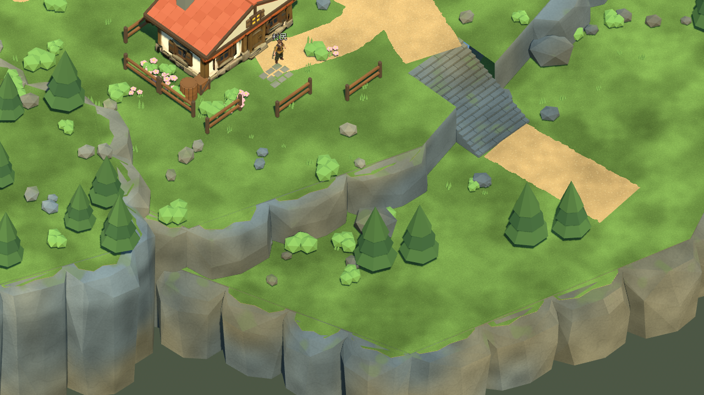

# 灰石村岩壁陰影與接縫修復 — 2026-10-26

本輪承接00a394a的岩壁工作。修正草皮下的大片黑色楔形與岩面法線，保留正常投影、主要道路及所有RPG系統。這是場景美術修復，並非完整參考圖還原或人工驗收完成。

## 問題與修正

1. 原岩壁含非共面的四邊面／多邊面，匯出時拆成三角形但沿用原面的平均法線。對照實際Godot畫面，明確三角化與正確平面法線後，大型陰影楔形消失。調低燈光normal bias反而產生細密陰影條紋，沒有採用這項調整。
2. 過大的岩面隨機起伏會產生凹折。改為195塊封閉凸形岩殼，保留不同斜肩與切面；近共面凸包出現0.55／2.15毫米偏差時，清除細碎突出點並重建，沒有放寬凸面檢查。
3. 草皮再次投射到相鄰岩面後，土層上緣也同步更新。最終保留90處草土過渡，拒絕會跨上高台的配置；630個頂點貼地檢查通過，土層頂縫差距為0.000000m。
4. Blender與Godot增加真實幾何回歸：封閉／凸形／三角面、土層接合，以及匯入後三角面法線與實際面向相符。舊主檔執行新幾何檢查會失敗，新主檔通過。

只更新Cliffs GLB及完整Blender主檔；全村視覺三角面 205,429 → **201,603**，Mesh節點 1,239。Terrain／Paths／Bounds的幾何雜湊與00a394a一致，未修改存檔Schema、位置版本、角色數值、劇情、獎勵、LB跑步或正式v0.6.1入口。

已透過Blender MCP將最終岩壁同步到既有研究場景，保留原Scene；本機另存`artifacts/reference_cliff_finish_20261025/live_cliff_finish_study.blend`。MCP材質預覽與Godot程序Shader不同，以上述原生遊戲畫面為準。

## 實際測試

Godot 4.7.2.stable.official.ed1daf0bf、Windows／RTX3080／OpenGL Compatibility；Blender 5.2.2 LTS。圖形測試使用原生視窗、自動InputMap操作與隔離存檔，不能算作玩家鍵鼠／Xbox實體驗收。

| 工具模式 | 檢查／失敗 |
|---|---:|
| TestReferenceVillage | 78／0 |
| VisualReferenceStory | 68／0 |
| TestReferenceStoryReload | 7／0 |
| VisualReferenceCommerce | 53／0 |
| TestReferenceCommerceReload | 5／0 |
| TestReferenceMigration | 80／0 |
| TestReferenceMigrationReload | 6／0 |

共 **297項**；包含行走／跑步、樓梯、雙橋、NPC、商店／旅館、教學戰、Boss、回村交付、一次性獎勵、遷移與新程序重啟讀取。資源匯入Check通過，CaptureReferenceVillage產出18張原生畫面。Blender幾何檢查195塊封閉凸殼、630個草皮頂點通過。舊檔預期失敗結果亦保存，以證明回歸檢查能抓到問題。

11個玩家視角各120幀、60FPS上限的短採樣：平均 16.42–16.57ms，P95 16.67–16.71ms，P99 16.68–16.77ms；各視角最大Draw Calls 626.00–1412.00；引擎靜態記憶體 353.16–353.91MiB，渲染顯存估算 910.75–911.04MiB。量測為frame_post_draw間隔，不是GPU耗時或程序RSS，不等於30分鐘長測。

首個陰影診斷曾因未設定專案user目錄而出現shader cache寫入錯誤；已改用專案隔離目錄重新執行，正式匯入及回歸無該錯誤。過程中幾何檢查抓到高台跨越及凸包偏差，修復後重跑，未將失敗算通過。

## 畫面與尚待項目

修復前（00a394a）：


修復後（同一原生鏡頭）：



本輪Agent Vision局部評閱：COMP-LEAD-ENV 2/2（道路、台階可讀）；COMP-DEPTH-LAYERS 1/2（仍偏連續規則台地）；LIGHT-KEY-FILL 2/2（本次岩壁區域的大型錯誤黑塊消失，切面可讀）。這不是整體畫面評分。岩塊之間仍有正常接縫投影；廣場留白、建築烘焙暗部、瀑布形狀及植栽密度仍與參考圖有差距。

人工驗證持續暫停。本輪未重新匯出Windows包，舊rc2-122891e不包含本輪修改；未進行新的30分鐘長測。Android／iOS與第一章不在本輪。下一步優先修整瀑布、河岸及廣場的畫面比例，再整理新的固定候選包。

## 重現方式與檔案

```powershell
blender --background --factory-startup --python-exit-code 1 --python scripts/tools/greystone/build_reference_v5.py
blender --background --factory-startup --python-exit-code 1 --python scripts/tools/greystone/export_reference_v5.py -- --only Cliffs
blender --background --factory-startup --python-exit-code 1 --python scripts/tools/greystone/audit_natural_edges.py -- --output artifacts/cliff_audit.json
./tools/godot.ps1 -Mode Check
./tools/godot.ps1 -Mode TestReferenceVillage
./tools/godot.ps1 -Mode RunReferenceVillage
```

新增幾何檢查可用`--source <blend>`指定舊檔重現。CLI需指定本機Blender執行檔；完整遊戲測試命令和完成標記見[tests.json](../source_assets/greystone_reference_20261024/evidence/cliffs_20261026/tests.json)。

修改`reference_natural_edges.py`、`audit_natural_edges.py`、`reference_v5_preview.gd`、Cliffs GLB／manifest、完整Blender主檔／來源manifest，以及README、TASKS、GREYSTONE_BUILD_TASKS、CHANGELOG、ASSET_CREDITS、本報告與evidence。完整路徑與SHA見[資產收據](../source_assets/greystone_reference_20261024/evidence/cliffs_20261026/asset_receipt.json)。
