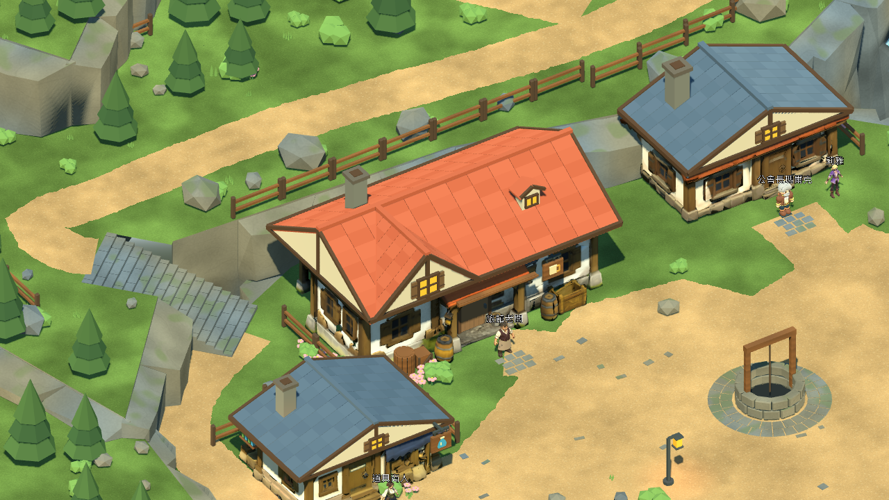
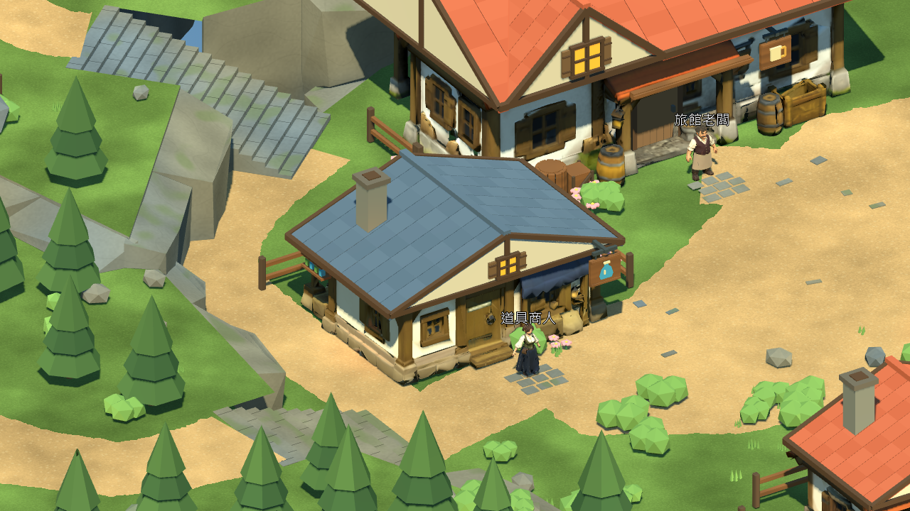
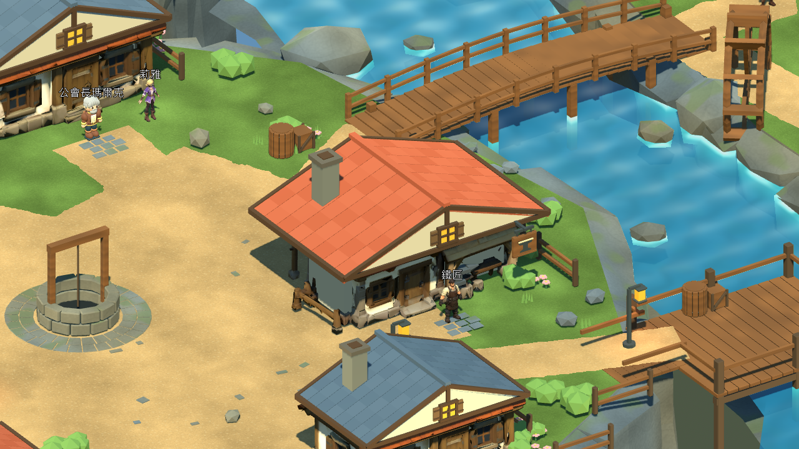

# 灰石村門廊、招牌與庭院 — 2026-10-25

依2026-10-24參考圖，完成旅館門廊補強、三種商店辨識招牌及沿牆植栽。本輪實際使用已連線的Blender MCP建模與檢視，再以同一份可重執行程式整合進完整Blender主檔及Godot。這是場景美術進度，完整畫面仍未達參考圖驗收。

原始專案入口：`./tools/godot.ps1 -Mode RunReferenceVillage`。正式v0.6.1與rc2-122891e固定包保留；舊包不含本輪美術。

## 實作與修正

- 旅館新增門廊橫樑／斜撐；旅館酒杯、道具店藥瓶、武器店鐵砧三種木製懸吊招牌，使用共用材質。
- 道具店側牆新增雙層小瓶陳列架。首次遊戲檢視發現它遮住正面窗戶，已移至側面；武器店招牌原被屋簷遮住，已降低並前移。
- 重用現有Shrub／Flowers網格與材質，沿六棟建築擺放10組花叢／灌木，共90株。每組合併為一個裝飾Mesh，沒有新增道路上的樹或地面碰撞。
- 每次重建只替換本模組標記的15個Courtyard物件。地面、道路、碰撞、六棟建築座標與六個NPC互動點保持原位；Terrain／Paths／Bounds與839c7ed的幾何雜湊相同。
- 新增Godot匯入後的四項檢查：實際Mesh及NPC數量、花圃AABB與道路淨空、六個NPC半徑2.2m淨空、門廊／招牌／陳列離地至少2.2m。

MCP使用獨立`Greystone_Courtyard_Study`場景，保留原本預設Scene並先保存本機備份。安全模式未開放直接讀取.blend，因此先匯入既有GLB，在允許的bpy操作內建模。即時研究檔與MCP匯出留在`artifacts/reference_courtyard_20261025/`；版本控制中的正式來源仍是`source_assets/greystone_reference_20261024/greystone_master.blend`。研究檔的地表／水面顏色僅供Blender預覽，遊戲仍使用既有程序紋理與水體shader。

MCP匯出已限定目前場景及選取物件，驗證不含預設Cube。15個新增Mesh的名稱與三角面數與遊戲匯出一致，共 **29,106** 三角形。全村視覺三角面 **201,541**（前版 **172,435**），視覺Mesh節點 **1,223**。只重匯出Props與Vegetation兩個分區，其餘GLB保留。

## 可執行驗證

Windows、Godot 4.7.2.stable.official.ed1daf0bf、RTX3080、OpenGL Compatibility；Blender 5.2.2 LTS。工具使用隔離測試存檔。探索／序章／交易為原生圖形模式自動輸入，不代表使用者實體鍵鼠或Xbox驗收。

| tools/godot.ps1 -Mode | 通過／失敗 |
|---|---:|
| Check | 資源匯入與專案載入通過 |
| TestReferenceVillage | 74 / 0 |
| VisualReferenceStory | 68 / 0 |
| TestReferenceStoryReload | 7 / 0 |
| VisualReferenceCommerce | 53 / 0 |
| TestReferenceCommerceReload | 5 / 0 |
| TestReferenceMigration | 80 / 0 |
| TestReferenceMigrationReload | 6 / 0 |
| CaptureReferenceVillage | 15張真實渲染畫面 |

回歸合計293項，涵蓋主要建築路線、五段階梯、雙橋、NPC、教學戰／Boss、回村、商店／旅館、舊檔遷移與獨立程序重啟讀取。另有庭院快速檢查4／0。

首次驗證發現SceneState路徑含`./`前綴，修正後確實讀到六個NPC。測試也重現了GLES3資源生命週期問題：載入含天空材質的PackedScene後同幀釋放，退出時出現兩筆349,524 bytes貼圖洩漏訊息。檢查程式改為等待frame_post_draw再釋放；快速重現對照及完整重跑均乾淨退出。未忽略錯誤或修改遊戲材質來繞過檢查。

11個玩家視角各120幀的短採樣，60 FPS上限：平均 **16.40–16.41 ms**、P95 **16.81–17.47 ms**、P99 **16.86–17.89 ms**；各視角最大Draw Calls **610.00–1389.00**。引擎靜態記憶體 **352.82–353.75 MiB**，渲染顯存估算 **904.26–904.55 MiB**。採樣期間未執行Blender渲染／MCP截圖；這是frame_post_draw排程間隔，並非GPU計時、程序RSS或30分鐘長測。

重建與驗證：

```powershell
blender --background --factory-startup --python-exit-code 1 --python scripts/tools/greystone/build_reference_v5.py
blender --background --factory-startup --python-exit-code 1 --python scripts/tools/greystone/export_reference_v5.py -- --only Props Vegetation
blender --background --factory-startup --python-exit-code 1 --python scripts/tools/greystone/audit_reference_finish.py -- --baseline artifacts/reference_courtyard_20261025/baseline.blend --output artifacts/reference_courtyard_20261025/geometry_audit.json
./tools/godot.ps1 -Mode TestReferenceVillage
```

baseline.blend為修改前839c7ed的主檔，可從該提交重取。其餘測試命令及輸出標記均記錄於證據。

證據：[測試結果](../source_assets/greystone_reference_20261024/evidence/courtyard_20261025/tests.json) · [幾何核對](../source_assets/greystone_reference_20261024/evidence/courtyard_20261025/geometry_audit.json) · [資產來源與雜湊](../source_assets/greystone_reference_20261024/evidence/courtyard_20261025/asset_receipt.json) · [資源生命週期重現](../source_assets/greystone_reference_20261024/evidence/courtyard_20261025/resource_lifetime_reproduction.json) · [短採樣](../source_assets/greystone_reference_20261024/evidence/courtyard_20261025/metrics.json)。

## 實際Godot畫面







## 差距與下一步

自然山崖外輪廓、廣場留白與高低差的視覺比例、建築屋身烘焙暗部及庭院細節仍與參考圖有差距。下一項應處理自然岩壁輪廓與地表過渡，繼續保護已通過的道路、碰撞及NPC位置；本輪沒有宣稱完整美術還原通過。

未匯出新Windows固定包，未執行新30分鐘長測。人工鍵鼠／Xbox驗證依使用者指示暫停；Android／iOS、第一章維持暫停。角色、技能、戰鬥數值、旗標、獎勵與存檔Schema未改，沒有合併main。

## 修改檔案

- 新增`scripts/tools/greystone/reference_courtyard_pass.py`，更新`build_reference_v5.py`與`reference_v5_preview.gd`。
- 更新Props／Vegetation的GLB、分區manifest、完整Blender主檔及來源manifest；layout 4只更新建造器SHA。
- 本報告、README、TASKS、GREYSTONE_BUILD_TASKS、CHANGELOG、ASSET_CREDITS與獨立evidence資料夾。
