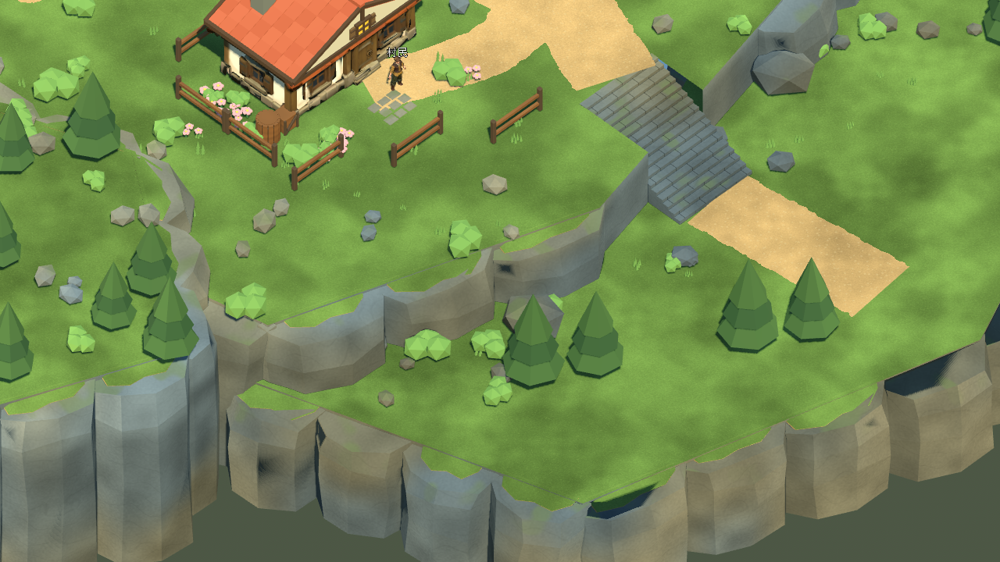
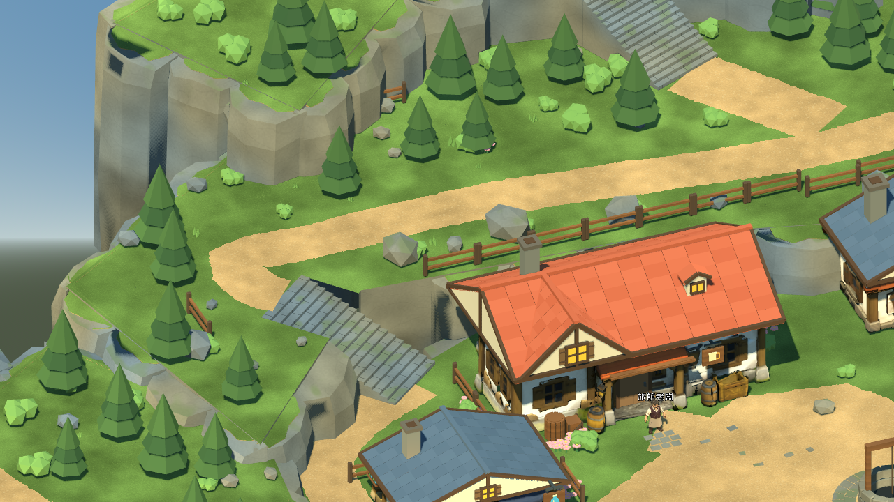
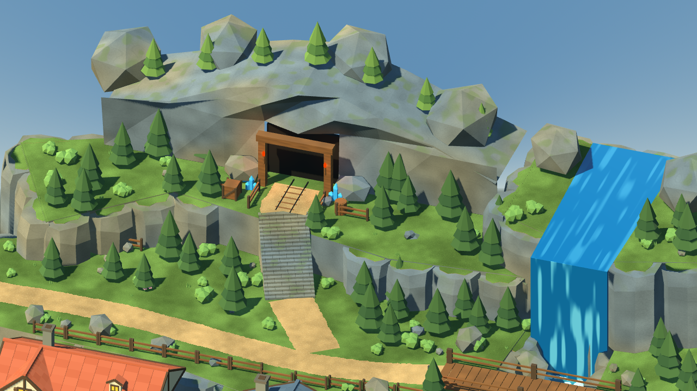

# 灰石村自然岩壁與草皮邊緣 — 2026-10-25

本輪從87e62e3繼續，按最新參考圖調整岩壁、草皮及土層接縫。完整場景仍是候選美術；道路、階梯、橋、NPC及既有序章保留。原始專案使用`./tools/godot.ps1 -Mode RunReferenceVillage`查看，正式v0.6.1入口與rc2-122891e舊固定包未替換。

## 已完成

- 重建195塊岩壁外皮：不對稱切面、斜肩、內縮頂面與冷暖色差，沿用原石材shader。
- 新增 **97** 處斷續草皮及薄土層，按八個地區合併為16個Mesh；使用既有草／土材質，不增加地面障礙。
- 草皮以BVH射線貼合完成後的相鄰岩面；階梯與道路保留淨空，不延伸到較高的鄰接台地。
- Blender Python產生完整主檔、獨立Cliffs GLB；Blender MCP匯入新岩壁供即時檢視，原有Scene保留。即時研究檔位於本機`artifacts/reference_edges_20261025/live_edges_study.blend`，其預覽顏色不代表Godot程序shader。
- 新增南側崖壁、北側台地及礦口三個攝影機，僅用於測試截圖。玩家鏡頭、LB／Shift跑步及存檔Schema未變。

只重匯出Cliffs分區；全村視覺三角面 **205,429**（前版 **201,541**），視覺Mesh節點 **1,239**。

## 發現並修正

第一版草皮只對自己底下的岩塊取樣，西側一點被相鄰岩塊壓住約5.4公分；改為對整片完成後的岩壁重新投射。橋頭回歸也抓到草皮跨上鄰接高台的錯誤，已拒絕這類頂點跨高度的配置。檢查未放寬，失敗修正後重新執行。

岩壁暗部另外做了原光照／關閉陰影／提高bias的實際對照：主要是投影造成，沒有把關閉陰影當成最終解法。原場景光照保留，遠景投影與細縫觀感仍待後續處理。

## 實際驗證

Windows、Godot 4.7.2.stable.official.ed1daf0bf、RTX3080、OpenGL Compatibility；Blender 5.2.2 LTS。測試使用隔離存檔，圖形探索／劇情／交易透過自動輸入操作，不能視為實體鍵鼠／Xbox驗收。

| 測試 | 結果 |
|---|---:|
| Check | 匯入／載入通過 |
| TestReferenceVillage | 77 / 0 |
| VisualReferenceStory | 68 / 0 |
| TestReferenceStoryReload | 7 / 0 |
| VisualReferenceCommerce | 53 / 0 |
| TestReferenceCommerceReload | 5 / 0 |
| TestReferenceMigration | 80 / 0 |
| TestReferenceMigrationReload | 6 / 0 |
| CaptureReferenceVillage | 18張真實遊戲畫面 |
| Blender岩壁／貼地檢查 | 195個封閉岩殼、679個草皮頂點通過 |
| Terrain／Paths／Bounds | 與87e62e3幾何雜湊相同 |

上述遊戲回歸共296項。涵蓋六棟建築、雙橋、五段階梯、NPC、教學戰與Boss、回村、商店／旅館、單次獎勵、舊檔遷移和新程序重啟讀取。新增驗證包含195個岩壁、草土成對批次與正確共用材質。草皮頂點與支撐面相差約1.8公分，是防止共面閃爍的薄覆蓋層；頂點取樣不代表整張美術已通過。

11個玩家視角各120幀短樣本（60 FPS上限）：平均 **16.44–16.57 ms**、P95 **16.68–16.73 ms**、P99 **16.70–16.81 ms**；各視角最大Draw Calls **626.00–1410.00**。引擎靜態記憶體 **353.17–353.92 MiB**，渲染顯存估算 **894.56–905.00 MiB**。這是frame_post_draw間隔，並非GPU耗時、程序RSS或30分鐘驗收；採樣時未同時執行Blender渲染／MCP截圖。

重建與驗證命令：

```powershell
blender --background --factory-startup --python-exit-code 1 --python scripts/tools/greystone/build_reference_v5.py
blender --background --factory-startup --python-exit-code 1 --python scripts/tools/greystone/export_reference_v5.py -- --only Cliffs
blender --background --factory-startup --python-exit-code 1 --python scripts/tools/greystone/audit_natural_edges.py
blender --background --factory-startup --python-exit-code 1 --python scripts/tools/greystone/audit_reference_finish.py -- --baseline artifacts/reference_edges_20261025/baseline.blend --output artifacts/reference_edges_20261025/geometry_audit.json
./tools/godot.ps1 -Mode TestReferenceVillage
```

baseline.blend為87e62e3的主檔副本。所有完成標記與來源SHA保存於[測試紀錄](../source_assets/greystone_reference_20261024/evidence/edges_20261025/tests.json)、[岩壁核對](../source_assets/greystone_reference_20261024/evidence/edges_20261025/natural_edges_audit.json)、[碰撞核對](../source_assets/greystone_reference_20261024/evidence/edges_20261025/geometry_audit.json)、[資產收據](../source_assets/greystone_reference_20261024/evidence/edges_20261025/asset_receipt.json)及[短採樣](../source_assets/greystone_reference_20261024/evidence/edges_20261025/metrics.json)。

## 畫面及限制







依Agent Vision的本輪相關項目評閱：COMP-LEAD-ENV 2/2、COMP-DEPTH-LAYERS 1/2、LIGHT-KEY-FILL 1/2，[理由](../source_assets/greystone_reference_20261024/evidence/edges_20261025/visual_review.json)。這不是全畫面評分或人工認可。遠景岩壁仍偏規則，廣場留白、建築烘焙暗部及植栽層次仍有差距。

下一步應整合上述細節的遊戲鏡頭呈現與遠景投影，並整理可查看的新版候選包。人工驗證依使用者指示暫停，新30分鐘長測及新固定包本輪未執行；Android／iOS、第一章持續暫停，未合併main。

## 修改檔案

- 新增`reference_natural_edges.py`、`audit_natural_edges.py`；更新`build_reference_v5.py`、`reference_v5_preview.gd`、`reference_village_surfaces.gd`與`village_visual_repair_test.gd`。
- Cliffs GLB、分區manifest、完整Blender主檔、來源manifest及layout 4建造器SHA。
- 本報告、README、TASKS、GREYSTONE_BUILD_TASKS、CHANGELOG、ASSET_CREDITS與獨立evidence資料夾。
