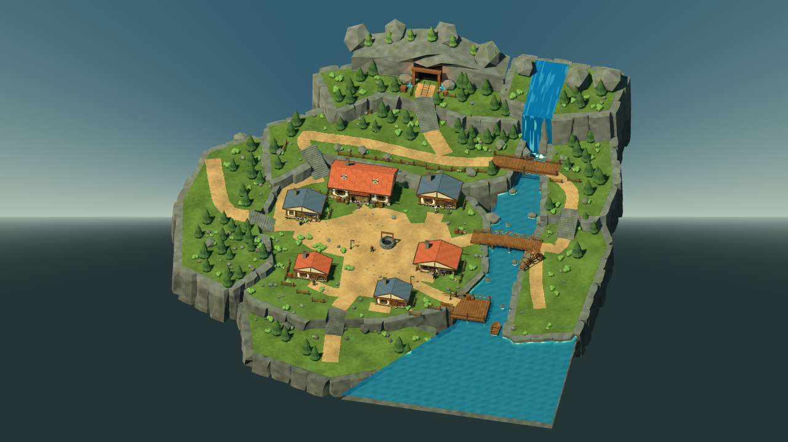
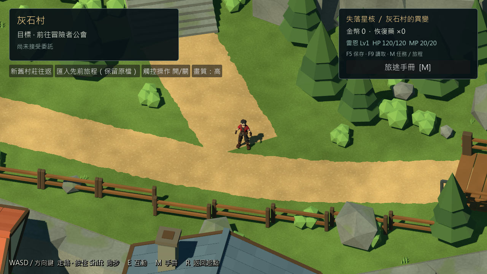
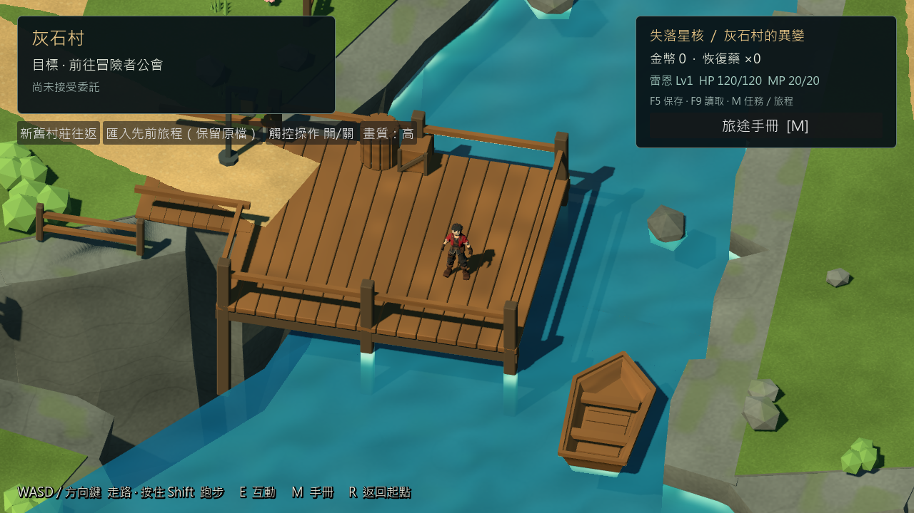

# 灰石村更新參考候選 — 2026-10-24

## 本輪狀態與入口

依使用者更新的 [參考圖](references/greystone_reference_20261024.png) 重建可編輯 Blender 主場景與 Godot 候選。這份是可遊玩的還原修整候選，尚不代表畫面已獲使用者認可。人工驗證按指示暫停；Android／iOS／第一章保持暫停。

源碼啟動：`./tools/godot.ps1 -Mode RunReferenceVillage`。
整合入口：`scenes/main/greystone_reference_integration.tscn`。
正式 `scenes/main/main.tscn` 和先前固定匯出包保留。
固定包已從乾淨提交 `122891e39f73833c6be4253bd03a952a92262e9b` 匯出。啟動 `D:\RPGGAME\builds\greystone-reference\rc2-122891e\candidate\start_reference_village.cmd`，詳細操作見 [啟動指南](GREYSTONE_REFERENCE_20261024_GUIDE.md)。舊 `rc2-8e1d693` 包有橋面裝飾問題，保留診斷用，不作為交付版。

Windows Release圖形序章 **138/0**、新程序重啟 **23/0**，含輸出後橋面淨空、舊Schema1及村莊位置2／3遷移、礦坑位置3遷移、交易／旅館與唯一獎勵。普通啟動觀察 **12.12秒**，視窗有回應、載入就緒，正常關閉後遊戲與啟動器均退出0。初次普通啟動測試遇到CIM存取限制，授權系統程序查詢後重驗通過；不是遊戲崩潰。

候選／QA共用 **1068** 份執行資源SHA一致，候選包無測試／工具／source_assets／本機存檔，必需地圖、GLB與Shader齊全。ZIP **384,576,605 bytes**，只含7個交付檔案，已逐一核對解壓雜湊，無user_test或日誌。ZIP SHA256：`c23e34250755762bde6d47f5f147d33d35f93e18f6201bcdef73842171bf7d93`。

[Windows證據](../source_assets/greystone_reference_20261024/evidence/windows_manifest.json) · [包內容稽核](../source_assets/greystone_reference_20261024/evidence/windows_pack_audit.json) · [交付雜湊](../source_assets/greystone_reference_20261024/evidence/windows_delivery.json)。

## 參考對應與尺度

採 1 unit = 1m，玩家膠囊實高 1.95m。120×120m 是管理範圍，實際地形置於其內。北方為 Blender +Y / Godot -Z。六棟建築的位置如下（Godot X,Y,Z）：

| 區域 | 位置 | 對應 |
|---|---|---|
| 水井廣場 | 0,3,0 | 中央環行空間 |
| 旅館 | -9,3,-16 | 西北、大紅屋頂 |
| 道具店 | -21,3,-7 | 廣場西側藍屋頂 |
| 公會 | 9,3,-17 | 圖中東北小樓，保留既有公會功能 |
| 西民宅 | -15,3,13 | 西南紅屋頂 |
| 武器店 | 13,3,5 | 東側紅屋頂、鄰河 |
| 南民宅 | 5,3,18 | 東南藍屋頂、鄰碼頭 |
| 上游橋 | 27,6.1,-29 | 橫跨東河、連東岸高地 |
| 中央拱橋 | 27,3.7,-6 | 新圖第二座橋 |
| 碼頭 | 23,3,17 | 東南岸、小船在外側 |
| 礦坑 | 0,10,-46.5 | 北面高地、連續道路及階梯 |
| 世界出口 | -44,5,-18 | 西路 |

新版圖主要畫面不擺農舍／農田，不硬塞舊第七棟建築；原資產保留。探索鏡頭俯角45°，新版村莊水平朝向12°以接近正面構圖，其他地圖仍45°。保留先前近距離遊玩縮放；總覽為獨立實際引擎攝影機，不是遊玩鏡頭截圖放大。

## 建模與畫面修整

- 獨立背景 Blender 5.2.2 LTS，沒有清空或改動使用者開啟的其他 Blender 場景。主檔：`source_assets/greystone_reference_20261024/greystone_master.blend`。
- 重用 Pixal3D 牆面和既有 G04 合格模組，修掉屋頂重疊／錯誤煙囪，建立實心屋瓦、屋脊、端牆及旅館小窗。六個實例共用五個建築 GLB；紋理上限1k。
- 保留九組 Collections，視覺為167,113個實例三角形、1,207個Mesh節點（不含碰撞）。Bounds為1,272個簡單碰撞代理、15,264三角形。資料夾 `reference_v5` 是美術迭代名稱，位置版本是4。
- 實心石階替換薄板踏面；五組樓梯使用對齊的連續坡面碰撞。每組有75個可見表面取樣，涵蓋中心與左右邊。
- 清除道路全樹冠範圍內的松樹、校正地面高度；路口、建築入口與 NPC 預留空間不加裝飾阻擋。
- 村內土路、礦坑下方與上方道路相接。土路邊緣窄帶使用世界座標噪聲裁切，露出底下草地；交叉路段不再塗綠邊，避免路中央出現綠縫。薄路面不投出黑色陰影線。
- 岩壁增加錯層切面、崖邊岩塊及林緣；石紋降低高頻顆粒，保留大切面辨識。樹木、灌木、花草及庭院圍欄保持可替換。
- 新增中央拱橋、東岸上下台地及階梯，形成雙橋環行路線；水車移至中央橋南側並轉向可見角度。
- 小船為封閉雙層船殼、木底與座板；內底最低2.16m，高於2.0m水面。拓樸檢查每邊兩面，12個船內下向射線命中木底。
- 河水沿用流動、深度／岸線效果；上游與瀑布使用專用不透明動態材質，去除錯誤淺水白塊。木材由 Godot 共用 shader 補足 Blender 程序材質無法直接匯出的部分。
- Xbox 改為按住 **LB** 跑步，放開走路，LS不跑步；鍵盤Shift保留。探索期間消耗LB的UI傳遞，避免同時移動背景按鈕焦點；選單仍保留肩鍵焦點操作。

## 存檔相容與功能保護

候選村莊 `location.layout_version=4`，Schema仍3 / CH00-G06.4。新槽為 `user://crystal_reference_v4_slot_01.json`；匯入來源預設先前礦坑候選槽。舊版2先在 G06 地形驗證，舊版3先在保留的 Blender 村莊地形驗證，通過後才將複本映射新廣場 (-3,3.1,3)，再次驗證新地圖地板及膠囊。未修改角色ID、屬性、技能、旗標、獎勵、交易或Schema契約。

保留來源檔、隊伍／裝備／經濟／任務／劇情／收據；無效、水中、建物內與未知未來版本拒絕讀取。舊版設定仍拒絕新版位置。礦坑位置4、森林位置3使用現有系統。舊入口與固定包不自動替換。

## 實際驗證

引擎 `4.7.2.stable.official.ed1daf0bf`。測試以獨立 APPDATA 執行，不使用玩家真實存檔。圖形模式在 Windows / RTX3080 / Compatibility 執行，透過 InputMap 操作真實 CharacterBody3D；不等同實體鍵鼠／Xbox人工驗收。

| 命令（tools/godot.ps1 -Mode） | 結果 | 口徑 |
|---|---:|---|
| Check | 載入／匯入完成，無資源錯誤 | 無頭匯入 |
| TestReferenceVillage | 70 / 0 | 原生圖形移動；12組路線、五樓梯、兩橋、六類阻擋、船／樹冠 |
| TestReferenceMigration | 80 / 0 | 舊版2／3、新版位置、保留來源與所有狀態、拒絕無效 |
| TestReferenceMigrationReload | 6 / 0 | 全新程序讀取遷移存檔 |
| TestReferenceStory | 58 / 0 | 無頭序章回歸 |
| VisualReferenceStory | 68 / 0 | 原生圖形序章、對話、森林教學、礦坑Boss、回村交付 |
| TestReferenceStoryReload | 7 / 0 | 新程序保留任務／唯一獎勵 |
| TestReferenceCommerce | 50 / 0 | 交易、旅館、帳本驗證 |
| VisualReferenceCommerce | 53 / 0 | 原生圖形交易、恢復、互動 |
| TestReferenceCommerceReload | 5 / 0 | 新程序經濟／恢復／獎勵 |
| TestExplorationLocomotion | 67 / 0 | 原生圖形走跑、LB放開、LS禁用、焦點、坡面 |
| TestPhase6 | 85 / 0 | 原有P6回歸 |
| CaptureReferenceVillage | 9張實際遊戲畫面 | 8個人物近景＋總覽，直接畫面匯出 |

測試過程的失敗與修復：首次候選腳本繼承了錯誤基底導致空地圖，改回既有整合基底，截圖加入地圖就緒斷言；樹冠及水井放大後公會測試路線須繞井，現為連續實際行走；船內測試由錯把外壁中心當船艙改為實際船艙下向射線。P6第一次84/1是外部QA隔離移除了類比軸，清除該環境變數後85/0；未修改遊戲輸入來掩蓋錯誤。匯入首次60秒逾時，工具上限改180秒後完成。最終三個材質／路面修整有再次原生圖形截圖，碰撞和劇情程式未再改動。

可攜證據：
[測試摘要](../source_assets/greystone_reference_20261024/evidence/source_tests.json)、
[路線結果](../source_assets/greystone_reference_20261024/evidence/routes.json)、
[模型SHA及面數](../source_assets/greystone_reference_20261024/evidence/asset_receipt.json)、
[短時畫面指標](../source_assets/greystone_reference_20261024/evidence/metrics.json)。
原始引擎日誌與測試存檔留在被忽略的artifacts，沒有提交。

上游橋的圖形回看發現裝飾石／草跨上橋面；新增真實網格AABB淨空檢查，先重現失敗，再在Blender完成所有擺放後剔除橋面上方裝飾。未放寬測試。原8e1d693固定包保留作診斷但撤回交付，修復後已以122891e提交重建固定包。[重現與回歸](../source_assets/greystone_reference_20261024/evidence/bridge_clearance_regression.json)。

## 畫面與已知差距

配置、雙橋和高低差已補齊；美術仍有可辨識差距：參考圖岩壁更有機、階梯較不規則，現有屋身部分AI牆面仍有細部變形，植被層次及暖光氛圍未完全一致。這些保留為美術待修項，不以功能測試通過代替畫面合格。後續可在本主檔逐區修形與燈光，不必重做RPG整合。

本次短樣本為每視角120個 `frame_post_draw` 間隔、60FPS上限，約60FPS；實際數據由metrics保存。不是GPU耗時、長時間穩定性或移動效能尖峰驗收。較早截圖曾出現廣場P99約33ms，後續短樣本未再重現，不能據此宣稱已消除偶發尖峰。新場景30分鐘長測未執行。引擎靜態記憶體與渲染估算顯存不等於程序Working Set。

最後一次原生截圖的短樣本（毫秒；記憶體MiB）：

| 視角 | 平均 | P95 | P99 | Draw Calls最大 | 引擎靜態 | 渲染顯存估算 |
|---|---:|---:|---:|---:|---:|---:|
| boat | 16.56 | 16.71 | 16.72 | 826 | 352.7 | 920.4 |
| dock_road | 16.49 | 16.71 | 16.73 | 815 | 352.7 | 920.4 |
| entry_base | 16.47 | 16.71 | 16.76 | 727 | 352.3 | 902.1 |
| entry_top | 16.53 | 16.77 | 16.82 | 879 | 352.4 | 902.1 |
| mine_approach | 16.50 | 16.78 | 16.83 | 840 | 352.5 | 920.4 |
| mine_landing | 16.47 | 16.69 | 16.71 | 610 | 352.6 | 920.4 |
| north_steps | 16.52 | 16.74 | 16.80 | 594 | 352.4 | 902.1 |
| plaza | 16.53 | 16.72 | 16.78 | 703 | 352.7 | 920.4 |

## 修改範圍

- Blender流程：`scripts/tools/greystone/build_reference_v5.py`、`reference_art_pass.py`、`export_reference_v5.py`，新主檔、manifest、來源參考。
- 可玩場景：`scenes/main/greystone_reference_*.tscn`、`scenes/world/greystone_reference_master.tscn`、`scenes/world/reference_candidate/`、`scenes/world/greystone/reference_v5/`、`scripts/core/reference_village_game.gd`、`scripts/world/reference_village_*.gd`。
- 資產：`assets/models/greystone/reference_v5/`、新surface shader／材質、`data/world/greystone_reference_layout_v4.json`。
- 共享小幅修改：`player_input.gd`、`exploration_interface.gd`、`exploration_game.gd`、`save_codec.gd`、`save_manager.gd`、`project.godot`。
- 測試與匯出：新reference測試／預覽，既有locomotion與packaged QA的小幅擴充、`tools/godot.ps1`、Windows匯出／啟動／驗證工具及兩個獨立Export Preset。
- 文件：README、TASKS、CHANGELOG、GREYSTONE_BUILD_TASKS、GREYSTONE_VILLAGE_SPEC、SAVE_FORMAT、ASSET_CREDITS及本報告。
