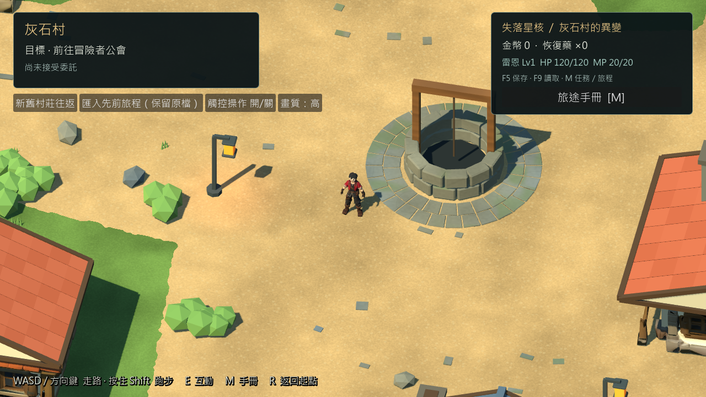
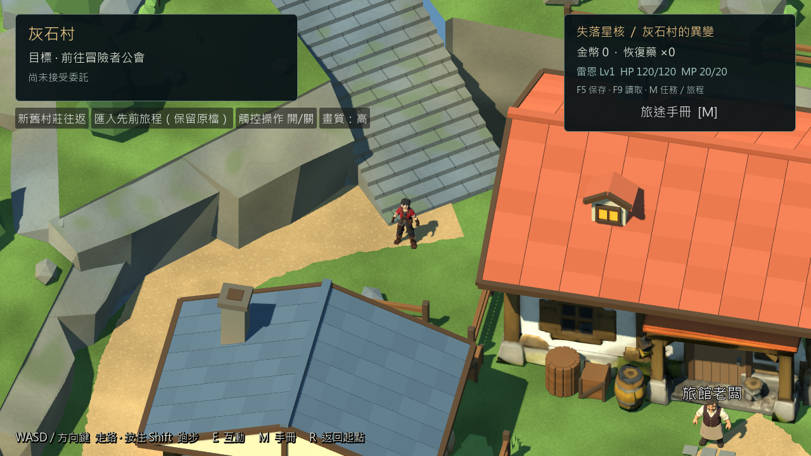
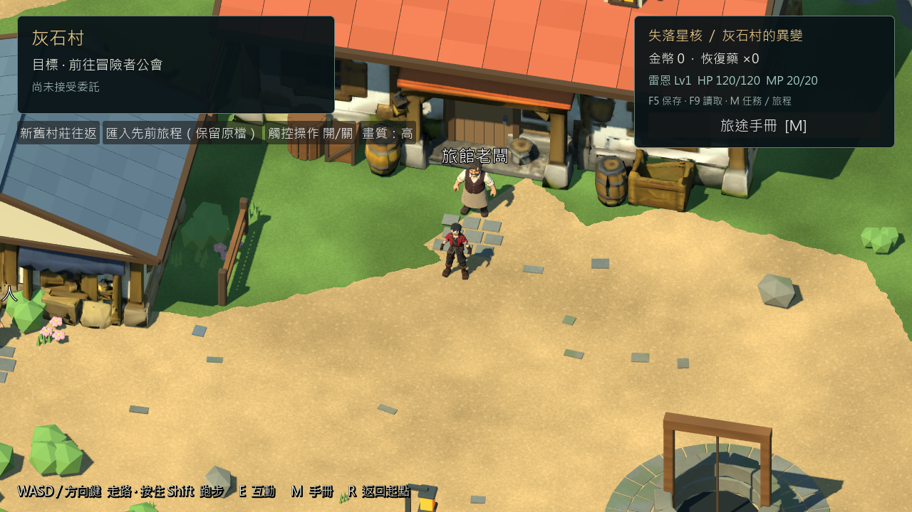

# 灰石村參考圖美術修整 — 2026-10-25

本輪是原始專案的美術修整，沿用位置 layout 4、既有角色／NPC／劇情及存檔 Schema。不是完整參考圖美術驗收，也沒有重新匯出 Windows 固定包。已交付的 rc2-122891e 保持原內容。

目前畫面可用 `./tools/godot.ps1 -Mode RunReferenceVillage` 啟動。入口仍為 `scenes/main/greystone_reference_integration.tscn`，正式 v0.6.1 入口保留。人工鍵鼠／Xbox驗證依使用者指示暫停；Android、iOS和第一章未啟動。

## 實際修改

- 195個既有岩壁裙邊模組改為錯開斷層及高低不一的外緣，保留與草地接合處；材質加入克制的冷暖石色與細粒紋理。
- 水井周邊54塊石板，加上六處入口各9塊，共108塊薄嵌石，合成單一Mesh，未新增行走碰撞。
- 旅館兩扇老虎窗補齊實體屋頂、山牆、窗框及暖色玻璃；現有路燈以原燈芯材質加入低能量、無陰影的暖光。
- 廣場Shader讀取實際網格外邊界，形成不規則草土交界；樓梯增加石塊接縫。交叉道路不塗綠色，避免重新出現路中綠縫。
- 候選村莊使用獨立日光Environment，略降低主光並提高環境補光，森林、礦坑仍由原場景提供環境。

Blender MCP未連線，因此使用本機Blender 5.2.2 LTS背景腳本，沒有操作使用者的即時場景。來源與重複執行腳本保留；本輪沒有下載／購買素材或使用生成圖片掩蓋引擎畫面。

實際視覺三角面 **170,703**（較前版增加3,590）；視覺Mesh節點 **1,208**（增加1）。Terrain、Paths、Bounds在前版提交與目前.blend之間的世界Transform、頂點、面索引雜湊完全相同。新增嵌石位於原地面附近，路面／樓梯／橋／外圍碰撞未改。

## 可重現驗證

引擎：Godot 4.7.2.stable.official.ed1daf0bf；Windows／NVIDIA RTX3080／OpenGL Compatibility。測試使用tools/godot.ps1管理的隔離使用者目錄；移動使用實際CharacterBody3D與InputMap，自動注入不等於實體操作。

| 命令：tools/godot.ps1 -Mode | 通過／失敗 |
|---|---:|
| Check | 載入與Shader檢查通過 |
| TestReferenceVillage | 70 / 0 |
| VisualReferenceStory | 68 / 0 |
| TestReferenceStoryReload | 7 / 0 |
| VisualReferenceCommerce | 53 / 0 |
| TestReferenceCommerceReload | 5 / 0 |
| TestReferenceMigration | 80 / 0 |
| TestReferenceMigrationReload | 6 / 0 |
| CaptureReferenceVillage | 11個人物視角＋1個總覽 |

Blender重建：`blender --background --factory-startup --python-exit-code 1 --python scripts/tools/greystone/build_reference_v5.py`。

分區匯出：同樣的Blender參數，腳本改為 `scripts/tools/greystone/export_reference_v5.py -- --only Cliffs Props Buildings_Candidate`。

前後碰撞核對：`scripts/tools/greystone/audit_reference_finish.py -- --baseline <從0c5946f保留的baseline.blend> --output <結果.json>`，仍使用背景Blender與`--python-exit-code 1`。兩份檔案經Blender重新載入後再比較，非只比較產生器的記憶體狀態。

短樣本：每視角120個frame_post_draw間隔，60 FPS上限；平均 **16.45–16.56 ms**、P95 **16.67–16.70 ms**、P99 **16.68–16.73 ms**。Draw Calls最大值範圍 **595–1370**；包含本輪新增的三個視角，不能直接以總最大值與前版八個視角比較。引擎靜態記憶體 **352.39–353.34 MiB**，渲染顯存估算 **909.10–917.51 MiB**。不是程序RSS、GPU時間或30分鐘長測。

證據：[測試命令與日誌雜湊](../source_assets/greystone_reference_20261024/evidence/finish_20261025/tests.json) · [前後幾何核對](../source_assets/greystone_reference_20261024/evidence/finish_20261025/geometry_audit.json) · [資產雜湊](../source_assets/greystone_reference_20261024/evidence/finish_20261025/asset_receipt.json) · [逐視角效能](../source_assets/greystone_reference_20261024/evidence/finish_20261025/metrics.json)。

## 實際畫面與差距

構圖／光照局部自評（0未滿足、1部分、2清楚滿足；不是使用者評分）：COMP-LEAD-ENV 2，主路與入口可辨；COMP-DEPTH-LAYERS 1，高低差清楚但岩層輪廓仍規則；LIGHT-KEY-FILL 1，暗部較可讀但屋身烘焙陰影仍重；LIGHT-BLOOM-ABUSE 2，未以過亮光暈掩蓋細節。

尚未完成：參考圖的旅館交錯屋頂／建築側面、自然山崖大輪廓、密植庭園層次和整體暖色氛圍仍有差距。目前只補完屋頂小窗，不能稱為重建整棟旅館。下一項是先修建築立面與屋頂輪廓，再依角色尺度回看廣場空間。人工驗證、新固定包及新場景30分鐘長測均未執行。

## 修改檔案

`scripts/tools/greystone/reference_detail_pass.py`、`audit_reference_finish.py`及既有builder／roof模組；`reference_village_surfaces.gd`、ground／rock Shader、候選daylight資源與runtime場景；Cliffs／Props／Inn等受影響GLB、完整.blend及manifest；`village_visual_repair_test.gd`補三視角。TASKS、GREYSTONE_BUILD_TASKS、CHANGELOG、ASSET_CREDITS、README與本報告記錄本輪狀態。
