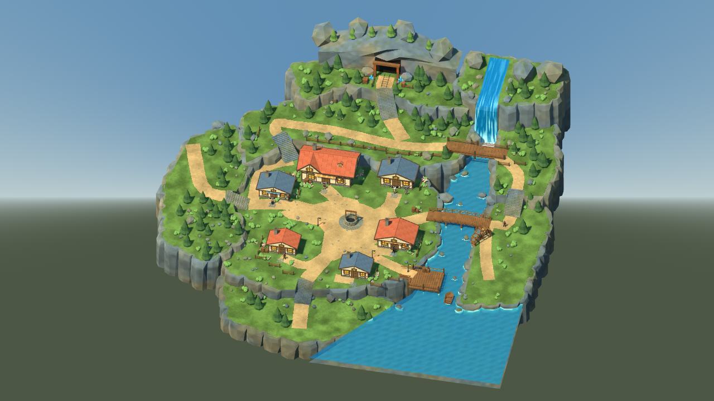
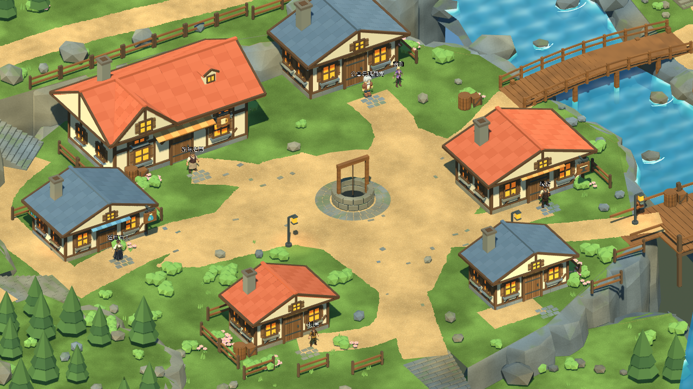
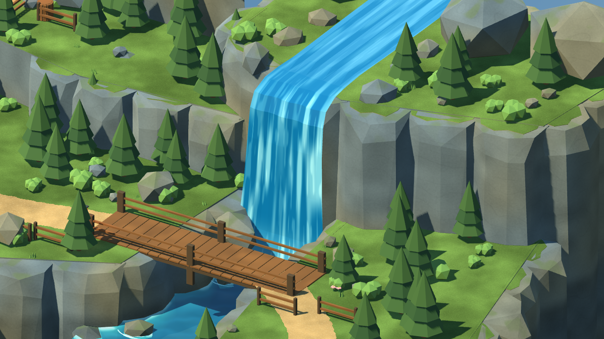

# 灰石村完整場景搭建與 Windows 候選 — 2026-10-26

承接34904d1。本輪完成九區灰石村的場景搭建與原始專案自動驗證：六棟建築、雙橋、水井、碼頭、船、水車、上游瀑布、階梯岩壁、礦坑入口與西側出口。以最新參考圖的空間關係與材質風格為依據，保留序章公會所需的第六棟建築。這是可玩的場景候選；人工美術／鍵鼠／Xbox驗收依使用者指示暫停。

## 本輪完成

- 五個共用建築GLB、六個實例：重建不合格的生成牆面，修掉烘焙黑斑與黏連雜物；保留交錯屋頂／煙囪，加入淺色木框牆、木門、暖窗、遮雨棚與石基。原AI來源檔保留。門、NPC與碰撞位置不變。
- 廣場邊緣改為約3.0–3.34m的草地過渡；圓形水井廣場和獨立道路仍完整。10組花圃增加至150株共用來源植物，旅館西花圃已避開石階。
- 瀑布使用連續彎曲水面與沿曲面流動的UV；崖頂至落水處共有264三角面。17個低面數水沫、14條河石尾流、12塊河岸石與6塊崖口石以批次網格呈現，沒有增加密集碰撞或透明粒子。
- 瀑布對真實岩壁的1031個採樣最小間距0.226m；修正首次原生畫面看到的穿插，以及GLB匯出V軸翻轉造成的流向問題。
- 全村可見三角面 **201,603 → 129,500**；六棟建築合計25,958，可見Mesh節點1,219。地形／Paths／Bounds的幾何雜湊與34904d1完全相同，位置版本仍4。

完整可編輯主檔：[greystone_master.blend](../source_assets/greystone_reference_20261024/greystone_master.blend)。Blender MCP亦已同步到獨立研究場景，保留原Scene；本機另存`artifacts/reference_water_20261026/live_completed_village.blend`。MCP安全模式不允許載入blend資料庫，改用允許的GLB匯入；未停用安全模式。Blender程序材質在Godot使用等效共享Shader，遊戲畫面以下列原生截圖為準。

## 區域完成與實際動線

| 參考區域 | 場景內容 | 驗證 |
|---|---|---|
| ① 中央廣場 | 石井、環形嵌石、土路分支 | 廣場及各建築路線 |
| ② 旅館 | 交錯紅屋頂、暖窗、招牌、花圃 | NPC／住宿／恢復／重啟讀檔 |
| ③ 道具店 | 藍灰屋頂、藍遮棚、藥瓶招牌 | 交易／背包／金幣與存讀檔 |
| ④ 武器店 | 紅瓦木框、鐵砧招牌、鐵匠 | 互動與入口淨空 |
| ⑤ 民宅 | 西南紅頂、南側藍頂、庭院 | 民宅路線與村民互動 |
| ⑥ 木橋 | 上游橋及中央橋、東岸階梯 | 完整雙橋環路及護欄阻擋 |
| ⑦ 礦口 | 岩壁、礦架、火把、連續道路 | 廣場至礦口、教學戰門檻、Boss往返 |
| ⑧ 碼頭 | 木碼頭、封閉船殼、水車、河岸水體 | 船底高於水面、碼頭邊界 |
| ⑨ 村外道路 | 西側台階與森林出口 | 出入口與跨場景回歸 |

## 自動驗證

Godot 4.7.2.stable.official.ed1daf0bf；Windows／RTX3080／OpenGL Compatibility；Blender 5.2.2 LTS。

| 工具模式 | 檢查／失敗 |
|---|---:|
| TestReferenceVillage | 88／0 |
| VisualReferenceStory | 68／0 |
| TestReferenceStoryReload | 7／0 |
| VisualReferenceCommerce | 53／0 |
| TestReferenceCommerceReload | 5／0 |
| TestReferenceMigration | 80／0 |
| TestReferenceMigrationReload | 6／0 |

合計 **307項／0失敗**。圖形模式以真正CharacterBody3D和InputMap自動行走；無頭載入、舊檔遷移與獨立程序重啟測試分開記錄，不能代替人工手把驗收。Check匯入通過；21張原生畫面包含11個玩家鏡頭與建築／瀑布近景。

Blender另通過：195塊封閉凸形岩殼、630個草皮支撐點、18,029條屋頂射線、2,040條牆面射線，以及低矮門窗構件與既有碰撞體的間距檢查。沒有修改角色ID、數值、技能、劇情旗標、獎勵帳本、存檔Schema、LB跑步或正式v0.6.1入口。

水流兩張固定鏡頭相隔0.75秒；水面區域76.0%像素變化超過5/255，旁邊靜態岩壁平均差0.00/255，確認效果確實隨時間變化；不是流體物理模擬。

11個玩家視角各120幀、60FPS上限短採樣：平均16.45–16.55ms，P95 16.68–16.73ms，P99 16.68–16.79ms；各視角最大Draw Calls 626.00–1442.00。引擎靜態記憶體353.10–353.98MiB，渲染顯存估算843.19–843.48MiB。這是frame_post_draw間隔，不是GPU耗時、程序RSS或30分鐘長測。

開發中曾抓到瀑布穿插、UV反向及旅館花圃侵入階梯；已修正並重跑。首次局部水體命令漏帶測試啟動旗標而未進入檢查，已中止並以正確參數重跑8項／0失敗，未把等待中的視窗算通過。

## 實景與範圍







Agent Vision：道路連通與地標可辨識；本輪牆面無原有生成黑斑、瀑布無首次穿插。相對概念圖仍採較寬的可玩通道、公會配置與既有玩家鏡頭，並非逐像素複製或使用者美術認可。完整場景已可探索，人工驗收保持暫停；Android／iOS與第一章沒有啟動。Windows候選包將以本輪提交建立獨立RC3並另記實測結果，舊包保留。

## 重現與修改檔案

```powershell
blender --background --factory-startup --python-exit-code 1 --python scripts/tools/greystone/build_reference_v5.py
blender --background --factory-startup --python-exit-code 1 --python scripts/tools/greystone/export_reference_v5.py -- --only Buildings_Candidate Water Cliffs Vegetation Props
./tools/godot.ps1 -Mode Check
./tools/godot.ps1 -Mode TestReferenceVillage
./tools/godot.ps1 -Mode RunReferenceVillage
```

新增`reference_water_pass.py`、`reference_facades.py`、`audit_reference_facades.py`、`reference_foam.gdshader`；修改完整Blender主檔、五種建築與四區GLB、Shader／材質接入、場景產生器／預覽測試與候選版本設定。完整檔案／SHA見[資產收據](../source_assets/greystone_reference_20261024/evidence/completion_20261026/asset_receipt.json)，實測命令見[測試紀錄](../source_assets/greystone_reference_20261024/evidence/completion_20261026/tests.json)。
