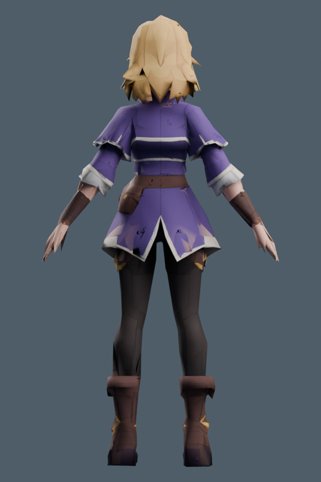
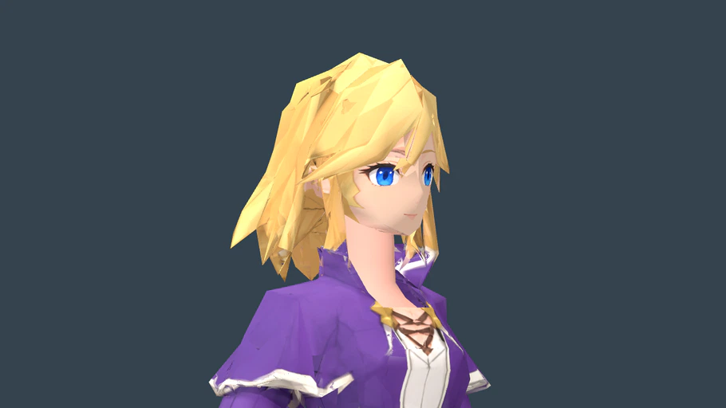

# 莉雅完整材質清理候選 — 2026-10-29

## 結論

髮絲、紫色衣物、皮革與褲子的人工網格線已有明顯減少；新候選仍為 **12554 triangles／1.95m**，GLB 結構與 Godot 靜態圖形檢查 **22／0**。**美術仍 FAIL，未換入遊戲，未綁骨或宣稱動畫合格。** 背裙奶油色邊緣有投影錯位，袖口／手腕有破碎幾何，領口內側開口與偏長頸部仍需實際拓樸修整。

現有可玩莉雅、雷恩、NPC、技能、數值、獎勵、旗標、存檔契約及固定 RC3 均未因本輪改變。

## 實作與來源

沿用已批准的莉雅外觀，輸入為前一輪 `side_surface_v2_20261028/lia_side_surface.blend`。先由真正網格生成前／左／後／右 **正交、無光照 albedo**，以內建 imagegen 修除人工線條，再以 Blender 射線遮擋與角落法線權重回投影至原 4096×4096 UV 貼圖。不是使用 AI 圖冒稱遊戲實景，也沒有重做身體模型。

- `scripts/tools/prepare_lia_material_cleanup.py`：四面原生參考，輸出 baseline／projection.json。
- `scripts/tools/apply_lia_material_cleanup.py`：四面投影、遮擋判定、保護前臉、保留原 alpha、原幾何／UV／法線 SHA 檢查，另存新的靜態模型。輸出資料夾已存在時拒絕覆寫。
- 來源及修整圖：[material_cleanup_20261028](../source_assets/character_rebuild_20261020/lia/material_cleanup_20261028/)；[提示詞、來源與輸出 SHA](../source_assets/character_rebuild_20261020/lia/material_cleanup_20261028/generation_provenance.json)。
- 本機候選：`D:/RPGGAME/source_assets/character_rebuild_20261020/lia/material_cleanup_v2_20261029/lia_material_cleanup.blend`／`lia_material_cleanup.glb`。大體積中間 blend、atlas 與候選 GLB 不進 Git；可由保留的來源／腳本重建。

Blender MCP 當時協定不相符，改用獨立背景 Blender 5.2.2 LTS；沒有修改使用者開啟中的場景。

## 兩輪結果

| 候選 | 實際變更／證據 | 結論 |
| --- | --- | --- |
| v1 | 回投影 4485688 個 atlas 像素；髮衣線條減少，但背裙／肩部仍有漏塗與奶油色污染 | 保留失敗結果；不採用 |
| v2 | 改為每角落遮擋探針，恢復 4238 個中心探針漏判樣本；5337 個實際可見反向法線樣本可上色，加入紫布邊界保護；回投影 7390403 像素 | 改善覆蓋率；仍有背裙錯色、領口／腕部幾何缺陷，visual FAIL |

12554 面由保留身體 12078 面＋已製頸部 476 面構成，低於本專案玩家角色上限 15000。兩版的頂點／面索引／UV／角落法線 SHA 完全相同，證明這輪只改材質；也代表原有拓樸問題沒有被修掉。保護前臉 1926 個 loops，未重畫面部五官。生成圖有部分半透明邊緣，回投影僅取 alpha > .94 且可見的真實網格；原 alpha 保留。即使數值檢查通過，生成圖與衣物邊界仍非逐像素一致，因此不把 v2 說成完整修復。

[兩輪原始收據與畫面 v1](../source_assets/character_rebuild_20261020/lia/material_cleanup_v1_20261029/)／[v2](../source_assets/character_rebuild_20261020/lia/material_cleanup_v2_20261029/)；各輪 builder_snapshot.py 保留當時演算法，原始 receipt 的 PENDING 是產生時狀態，最終視覺結論另記於 [review.json](../source_assets/character_rebuild_20261020/lia/material_cleanup_acceptance_20261029/review.json)。

## 可執行檢查

```powershell
# 下列輸出使用新資料夾，既有成果不覆寫。
& 'C:/Program Files/Blender Foundation/Blender 5.2/blender.exe' --background --factory-startup --python-exit-code 1 --python scripts/tools/apply_lia_material_cleanup.py -- --source source_assets/character_rebuild_20261020/lia/material_cleanup_20261028 --output source_assets/character_rebuild_20261020/lia/material_cleanup_reproduce
python scripts/tools/audit_character_glb.py --input source_assets/character_rebuild_20261020/lia/material_cleanup_v2_20261029/lia_material_cleanup.glb --category player_character --allow-static --output artifacts/lia_material_audit.json
& 'D:/Godot_v4.7.2-stable_win64.exe/Godot_v4.7.2-stable_win64_console.exe' --path D:/RPGGAME --script res://tests/static_character_review.gd -- --raw-glb --id=lia_material_v2 --solid-material=LiaAuthoredSkin --model=D:/RPGGAME/source_assets/character_rebuild_20261020/lia/material_cleanup_v2_20261029/lia_material_cleanup.glb --output=D:/RPGGAME/artifacts/lia_material_review
```

實際使用 Python 為 Codex bundled runtime；原生圖形 Godot 4.7.2／Compatibility／RTX3080。GLB 嚴格索引、數值、UV／面數檢查通過；允許 static 只表示本輪明確沒有骨架，不能算綁骨通過。Godot GLTFDocument 實際匯入、4096 貼圖、實心頸材質、有限數值、地面／高度、重新實例化及 9 張原生圖檢查 **22 checks／0 failures**。

- GLB SHA256：`bd9d5c1c8f016fb12a6e096a4cad642b32b4f728f6e02b393147ab9040b0e5ac`。
- [GLB 稽核](../source_assets/character_rebuild_20261020/lia/material_cleanup_v2_20261029/static_glb_audit.json)／[Godot 報告](../source_assets/character_rebuild_20261020/lia/material_cleanup_acceptance_20261029/godot/report.json)。

下圖是實際候選模型原生渲染，未經 AI 修圖：




## 後續修正

停止盲目重投影同一方案。下一步先量測領口內襯／手腕／衣襬的真實開口與重疊，修理網格邊界，再處理局部貼圖。通過正側背面檢查後才進入骨架、走跑、持杖／施法與正式遊戲回歸；本輪不能把舊可玩模型的動畫結果套用到新候選。人工美術與實體輸入仍依使用者指示暫停。
