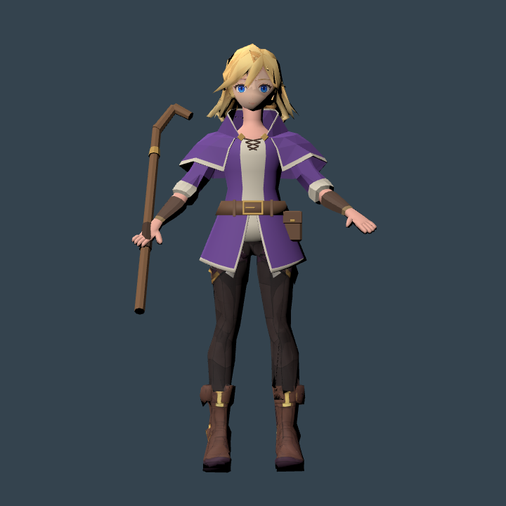
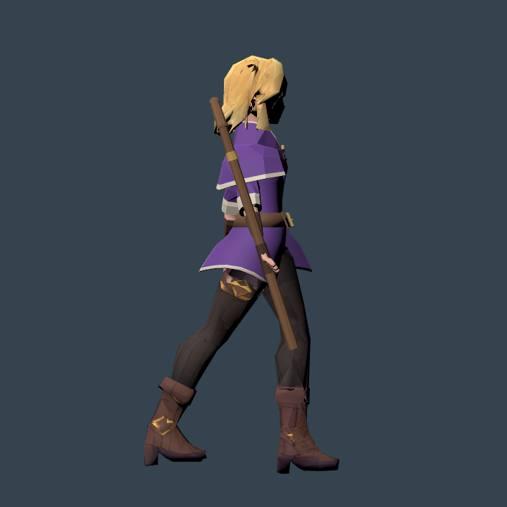
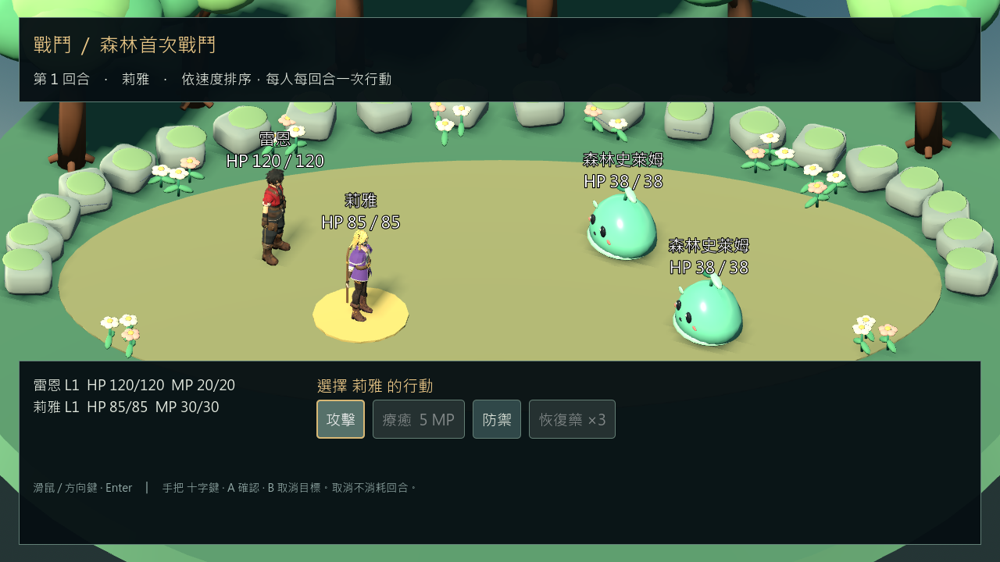

# 莉雅重建候選骨架與序章回歸 — 2026-11-03

## 結果

已為修整後的莉雅建立獨立候選骨架與七段動作，並用既有 female_actor 與完整序章測試執行。候選本體 **6,474 triangles、19 bones**，可換法杖另計 **140 triangles**（同時顯示 6,614）。**尚未替換正式角色，也不代表序章最終完成。**

- 來源：`artifacts/lia-coat-final-20261103/lia_tailored_coat.blend`，SHA256 `2254aeb44c49422d9d2ef098f4037a4ffc077044631dc25fb5ed90261efbbdde`。
- 保留副本：`source_assets/character_rebuild_20261020/lia/rig_candidate_20261103/lia_rigged.blend`、`lia_rigged.glb`、`lia_motion_profile.tres`、`receipt.json`。
- GLB SHA256：`c1ca74967909d0fdcbf745a3ed144d5c6267a6c695dfba560a7b9da0e2c53bb1`。
- Blender 5.2.2 LTS；Godot 4.7.2.stable.official.ed1daf0bf、Windows OpenGL Compatibility、RTX 3080。

## 實作與修正

`build_lia_rebuild_rig.py` 依實測肩、肘、腕、髖、膝、踝建立骨架。分開處理原外袖、重建內袖／手、披肩、領口、衣身、腰帶及裙襬權重；原始頂點座標與 UV 維持相等。每頂點最多四個骨骼影響，權重正規化。動作沿用 walk、run、attack、cast、guard、hit、potion，沒有增加另一套 RPG 管理器。

首版直接沿用骨骼局部旋轉，手臂動作偏向橫擺；改為明確世界方向再轉換至各骨骼的局部方向。首版 Godot 測試亦誤將既有硬式法杖的五個零件列入角色蒙皮／面數，因此 196 項中有 6 項失敗。已改為以實際法杖子樹分別統計，另驗證法杖 140 面，保留 [初次失敗](evidence/lia_rig_candidate_20261103/first_controller_failures.json)，沒有排除任意未綁定角色網格。

新測試透過 GLTFDocument 載入候選，在記憶體中注入當次遊戲已複製的莉雅外觀定義；角色 ID、能力值、旗標、獎勵與 SaveCodec 不變。既有序章測試的莉雅外觀斷言抽出為可覆寫方法，預設仍嚴格要求原 lia_pixal_visual，候選子測試要求候選 PackedScene 本身。兩條測試入口都須驗證。

## 實際驗證

| 檢查 | 結果 | 證據／邊界 |
|---|---|---|
| Blender 重匯入、分類預算、UV、綁定 | PASS、6,474 面、0 退化面 | [gate](evidence/lia_rig_candidate_20261103/gate.json)；保留 NONMANIFOLD_OR_BOUNDARY 警告，不宣稱全網格封閉 |
| Blender 動作評估 | 127 個逐幀取樣有限且在範圍內 | 候選 receipt 的 evaluated_bounds；不是衣物無穿模證明 |
| Godot 原生圖形控制器 | 187／0 | [controller](evidence/lia_rig_candidate_20261103/controller.json)；動作映射、走跑／停止、戰鬥動作返回跑步、死亡／復活、法杖掛點、材料 |
| 新角色完整序章自動圖形回歸 | 112／0 | [結果及本機日誌索引](evidence/lia_rig_candidate_20261103/story.json)；3 次戰鬥實例、E001–E009、敗北重試、單次獎勵、保存／重讀；摘要在 base finish 前是 103 項，最終以日誌 112 為準 |
| 新程序重啟讀檔 | 30／0 | [結果及本機日誌索引](evidence/lia_rig_candidate_20261103/reload.json)；保留最終任務、212 金幣、300 EXP、星印、收據與可實例化角色；摘要在 base finish 前是 21 項 |
| 專案載入 | PASS | `tools/godot.ps1 -Mode Check`，`artifacts/logs/check-20261103-182002-959.log` |
| 原本序章角色回歸 | 94／0 | `tools/godot.ps1 -Mode VisualMineReferenceStory`，[baseline](evidence/lia_rig_candidate_20261103/baseline.json)；仍驗證原莉雅 |

控制器與序章均使用真實圖形模式並已查看實際畫面，但由腳本自動驅動，不是人工鍵鼠／Xbox 驗收，也不是長時間效能或 Android 測試。人工終驗繼續暫停。

## 畫面與未完成事項

- 法杖掛點跟隨手骨，但手指仍為共用彎曲骨；手掌／握杖接觸不夠貼合，未達正式精細握持標準。
- 保留模型的髮根／臉側及腿部飾片／靴口仍粗糙，不能把本輪骨架成功當成美術完成。
- 尚未驗證新莉雅在村莊坡面／台階的實際行走、所有轉向及衣物相交，也未啟用地形 IK。
- 正式 `main.tscn`、原莉雅、RPG 數值與存檔 Schema 不變；RC5 固定包未重新匯出。效能尖峰、候選整合與暫停的人工終驗仍待。

## 重現

在專案根目錄，以新的輸出目錄執行；原始修整 blend 保留於本機來源目錄。Git 中另保留本輪完整候選 blend／GLB，讓檢查與後續修整不依賴重新生成。

~~~powershell
& 'C:/Program Files/Blender Foundation/Blender 5.2/blender.exe' --background --factory-startup --python-exit-code 1 --python scripts/tools/build_lia_rebuild_rig.py -- --input artifacts/lia-coat-final-20261103/lia_tailored_coat.blend --output artifacts/lia-rig-new
& 'C:/Program Files/Blender Foundation/Blender 5.2/blender.exe' --background --factory-startup --python-exit-code 1 --python docs/skills/ai-3d-agent/scripts/check_export.py -- --input D:/RPGGAME/source_assets/character_rebuild_20261020/lia/rig_candidate_20261103/lia_rigged.glb --output D:/RPGGAME/artifacts/lia-rig-new-gate --project-root D:/RPGGAME --category player_character --require-uv --require-rig
$env:APPDATA='D:/RPGGAME/artifacts/lia-rig-new-profile'
$env:LOCALAPPDATA=$env:APPDATA
$env:CRYSTAL_QA_ISOLATE_JOYPAD_MOTION='1'
& 'D:/Godot_v4.7.2-stable_win64.exe/Godot_v4.7.2-stable_win64_console.exe' --path D:/RPGGAME --script res://tests/lia_rebuild_controller_test.gd -- D:/RPGGAME/source_assets/character_rebuild_20261020/lia/rig_candidate_20261103/lia_rigged.glb D:/RPGGAME/artifacts/lia-rig-new-controller
& 'D:/Godot_v4.7.2-stable_win64.exe/Godot_v4.7.2-stable_win64_console.exe' --path D:/RPGGAME --script res://tests/lia_rebuild_story_test.gd -- D:/RPGGAME/source_assets/character_rebuild_20261020/lia/rig_candidate_20261103/lia_rigged.glb D:/RPGGAME/artifacts/lia-rig-new-story
# 使用相同隔離 profile，另開程序驗證重新讀取。
& 'D:/Godot_v4.7.2-stable_win64.exe/Godot_v4.7.2-stable_win64_console.exe' --path D:/RPGGAME --script res://tests/lia_rebuild_story_test.gd -- D:/RPGGAME/source_assets/character_rebuild_20261020/lia/rig_candidate_20261103/lia_rigged.glb D:/RPGGAME/artifacts/lia-rig-new-story --reload
~~~
