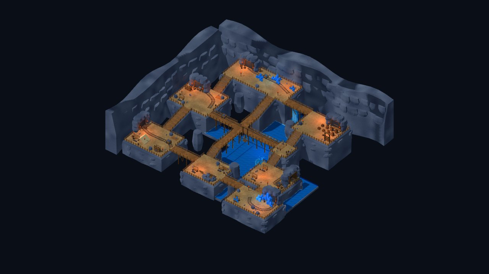
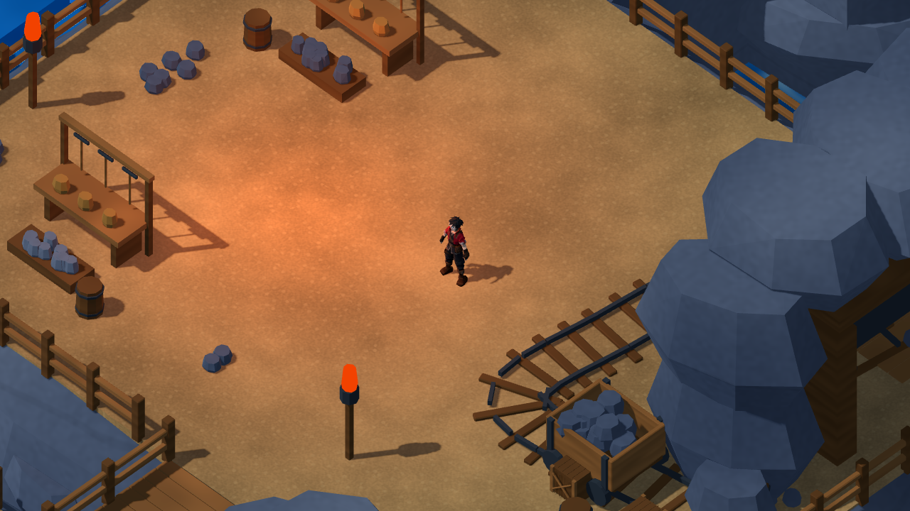
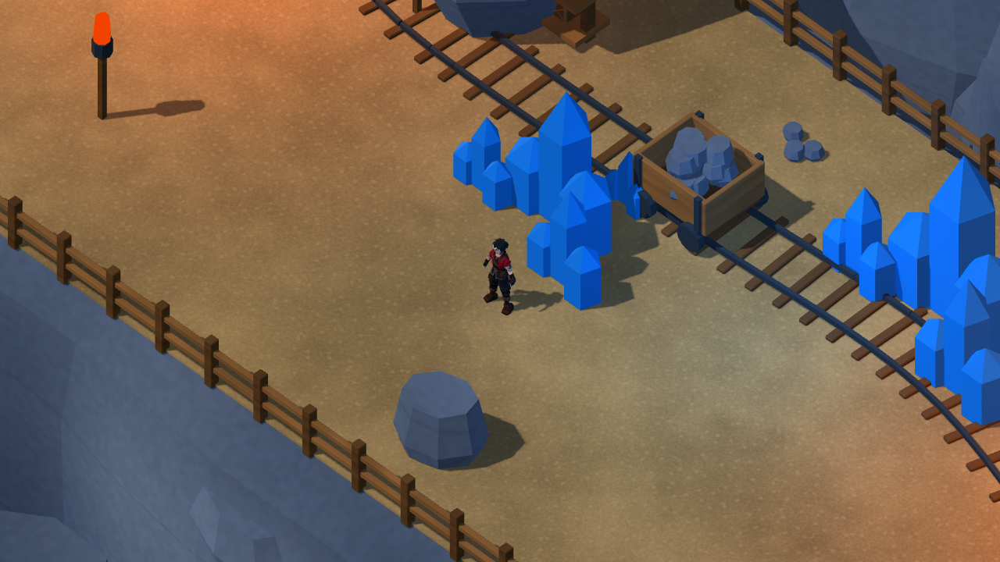

# 礦坑第二輪：連續岩層、彎軌與採掘作業區

2026-10-26，承接6d56a06；本輪依[礦坑參考圖](references/mine_interior_reference.png)與場景Skill，接續第一輪所列的岩層／平台銜接、彎軌和細節。更新原始專案與完整Blender主檔，人工驗收維持暫停。

## 本輪實作

- 八個平台的重複直立石柱，改為各自封閉的連續岩層外殼，外緣帶斜肩與扁平岩板；木階梯下方新增岩座，岩頂依既有階梯／橋面下修留空。大型洞壁改為連續起伏岩面、後退上緣與層疊岩板，移除方形展示底板。
- 五組平滑彎軌：入口、西部礦車區、北部水晶採掘、東部水道與核心洞窟。曲線穿過既有車位錨點；核心增加弧形環繞軌道，中央橋主軌保留。軌道為靜態造景，不增加行車系統。
- 10組採掘工作區：木桌、支腳、掛鎬工具架、金色礦石與礦石箱。配置同時避開玩家主路／劇情點及新彎軌，避免把工作桌擺在軌道上。
- 四段地下水支流接到中央十字橋與南北木橋下，與原水道以邊界接合，不疊加共面水片；水床與水面均無新增碰撞。
- 修正坑門、礦車與箱體細節在旋轉前未更新依賴圖的問題，避免零件被偏到場景外；並增加可見模型水平邊界檢查，舊版2個網格超界、本輪要求0超界。
- 另修正原有核心橋下岩柱穿出橋板的問題；更新依賴圖後讀取真正世界頂點，將岩柱頂部降至橋面以下。

可編輯主檔：[mine_reference_master.blend](../source_assets/mine_reference_20261024/mine_reference_master.blend)。仍有12個分區GLB與4個獨立機械模組；靜態面數170,688→187,032，在現有200,000預算內，未套用角色面數限制。所有新增造景以本專案Blender Python產生，既有箱桶、晶體、車、支架及角色來源保留。

## 位置、碰撞與遊戲契約

既有501個碰撞代理與本輪修改前逐項相同，layout JSON／版本4、互動／出生點、角色ID、數值、劇情旗標、獎勵與Save Schema均未改。純視覺岩座與岩殼沒有新增可走隱形地板，水道邊界仍由既有物理世界約束。

新增[視覺淨空檢查](../scripts/tools/audit_mine_visual_clearance.py)：從實際Blender三角形建立BVH，在主環線／中央橋／南北路線每0.6m，以中心及四個0.28m偏移，檢查腳底以上0.35–1.90m高度。舊版3670次取樣有123次模型命中，其中2次為核心橋下岩柱、其餘為平台岩緣；本輪3670次／0命中。這是模型取樣，不是連續膠囊、全地圖或相機遮擋認證；另外執行真正Player動線。

岩體檢查改為三角化副本的邊配對、相鄰面方向與每個組件正體積，適用於凹形連續岩層；舊版563組件的閉合／方向檢查與本輪636組件均通過。新增邊界檢查另在舊版重現兩個超界網格，保留為失敗基線；最終模型要求全部位於56m範圍加8m裝飾容許帶內。原有相對中心的面法線點積不適用所有凹形表面，故沒有沿用該判準。檢查不改動模型，未將獨立岩塊交疊宣稱為全域無交叉。

## 實際驗證

Godot4.7.2.stable.official.ed1daf0bf、Blender5.2.2 LTS；Windows／RTX3080／OpenGL Compatibility。

| 命令模式 | 檢查／失敗 |
|---|---:|
| TestMineReference | 55／0 |
| TestMineReferenceMigration | 59／0 |
| VisualMineReferenceStory | 68／0 |
| TestMineReferenceStoryReload | 7／0 |
| VisualReferenceStory | 68／0 |
| TestReferenceStoryReload | 7／0 |

合計264項／0失敗；另有Check匯入、16個GLB結構／預算、岩體閉合及3670個模型淨空取樣通過，保存13張原生圖形畫面。兩個整合入口完成序章、戰鬥返回、舊存檔遷移、單次獎勵與新程序讀檔。

完整動線取樣8779幀，60FPS上限；平均59.46FPS，P95 16.73ms，P99 16.83ms，最大246.77ms。Draw Calls 85–168，引擎靜態記憶體42.86–43.04MiB。包含載入／截圖／驗證成本，最大尖峰仍需後續剖析；不是GPU時間、程序RSS、Release或30分鐘長測。

## 實景與剩餘差距

Agent Vision局部審查：COMP-DEPTH-LAYERS 1/2（連續岩殼與岩座補足層次，但區域仍比參考圖分散）；COMP-LEAD-ENV 2/2（各作業區彎軌與主路可辨）；LIGHT-KEY-FILL 1/2、LIGHT-EMISS-HIER 1/2（沿用第一輪光照，尚需深化洞口與核心焦點）。這是4個適用條目的局部審查，不是整體美術合格認證。

與概念圖仍有緊密構圖、岩緣自然程度、坑口深度及細部造景密度差距；本輪完成上述四項技術／造景工作，不宣稱逐像素還原。吊籠、礦車與工具為靜態造景，未新增採礦、升降或列車玩法。人工鍵鼠／Xbox與美術認可維持暫停；Android／iOS與第一章未開發。

Blender MCP同步至既有獨立研究場景，原Scene仍保留；本機另存`artifacts/mine_continuity_20261026/live_mine_preview.blend`。GLB程序材質在預覽中以常色還原，Godot動態水體與光照以下列原生證據為準。

本輪未匯出新Windows固定包；舊包不會自動包含本次美術。以`./tools/godot.ps1 -Mode RunMineReference`查看原始專案，或開啟本輪Blender主檔。

[資產／SHA](../source_assets/mine_reference_20261024/evidence/continuity_20261026/asset_receipt.json)／[測試命令](../source_assets/mine_reference_20261024/evidence/continuity_20261026/tests.json)／[動線與效能](../source_assets/mine_reference_20261024/evidence/continuity_20261026/traversal.json)／[淨空](../source_assets/mine_reference_20261024/evidence/continuity_20261026/visual_clearance.json)／[碰撞保留](../source_assets/mine_reference_20261024/evidence/continuity_20261026/protected_layout.json)。原始日誌及開發時錯誤探測僅留本機artifacts，最終驗收採修正後命令與模型。
