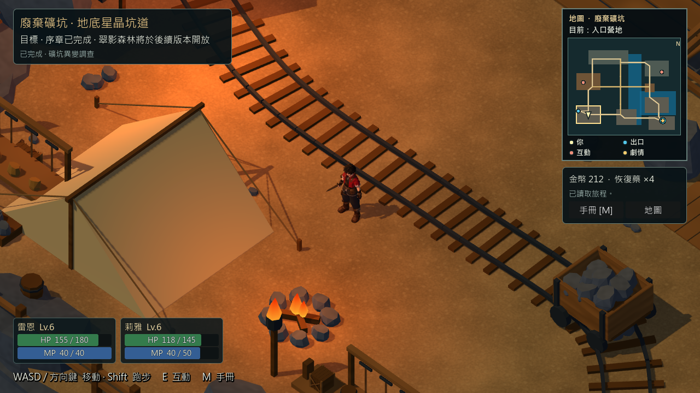
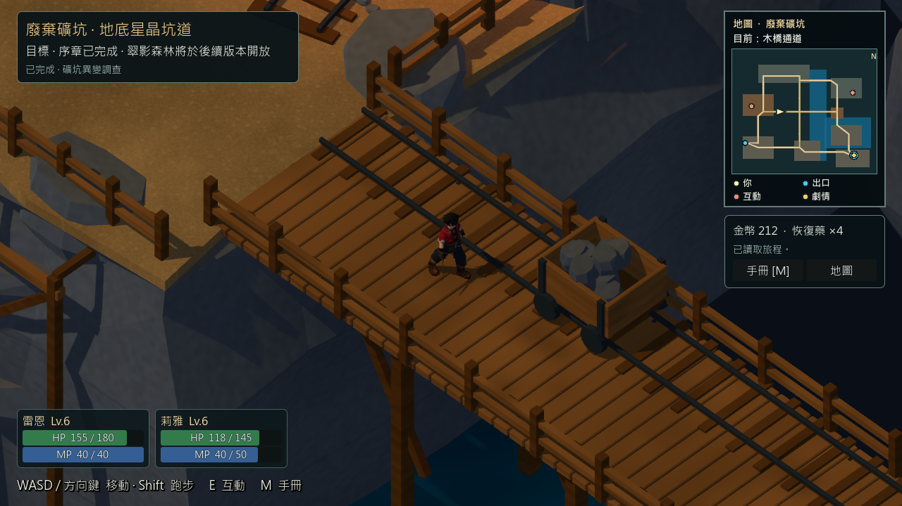
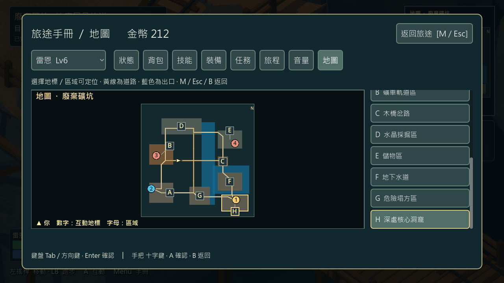

# 礦坑導覽可讀性修正 — 2026-10-30

Windows、Godot 4.7.2；功能分支 `feature/greystone-g06`，基線 `32d73e2190664672de33f303ccd11c3bb45841ed`。改善現有序章候選的小地圖與旅途手冊，不改劇情、物品、獎勵、碰撞或存檔格式。

小地圖改用較大的「目前」文字顯示玩家所在的八個礦坑區域，位於區域之間時顯示木橋或階梯通道；圖中保留道路、地標及玩家面向。放大地圖把區域改成 A–H 標記，並在可捲動清單顯示名稱；原有的數字互動地標及手把操作保留。選取區域會在地圖上框出該區，沒有新增自動尋路功能。

## 驗證

- `./tools/godot.ps1 -Mode Check`：Godot 專案載入及腳本解析通過。
- `./tools/godot.ps1 -Mode TestMineNavigation`：224／0。使用已完成序章的隔離圖形存檔；在八個真實場景區域採樣、檢查角色站地與位置名稱，測試階梯及木橋通道，使用輸入沿木橋移動；三種視窗尺寸檢查區域標記、手把選取、捲動及遊戲狀態保持。這些區域位置以測試移位取得，不代表人工逐步走完整張地圖。
- `./tools/godot.ps1 -Mode TestPrologueAreaMap`：77／0，三張地圖、既有地標、開關地圖及手把操作。
- `./tools/godot.ps1 -Mode TestCompactHud`：298／0，既有介面、存檔和輸入回歸。
- `./tools/godot.ps1 -Mode VisualMineReferenceStory`：94／0，圖形模式序章、戰鬥及回村交付。
- `./tools/godot.ps1 -Mode VisualMineReferenceStoryReload`：25／0，新程序讀取相同圖形存檔。

先執行 VisualMineReferenceStory，產生真實完成序章的測試存檔，之後執行 TestMineNavigation。測試不修改玩家存檔；手把事件為自動輸入，不代表實體手把人工驗收。礦坑區域與道路來自 `data/world/mine_reference_layout.json`，是導覽示意圖，不保證可作精確碰撞或尋路資料。

程式位於 `scripts/ui/exploration_minimap.gd`、`scripts/ui/area_map_panel.gd`，新增測試 `tests/mine_navigation_readability_test.gd` 與 `tools/godot.ps1` 入口。固定 RC4 包未更新；莉雅候選模型、效能尖峰及人工最終驗收仍待。Android／iOS 及第一章暫停。
