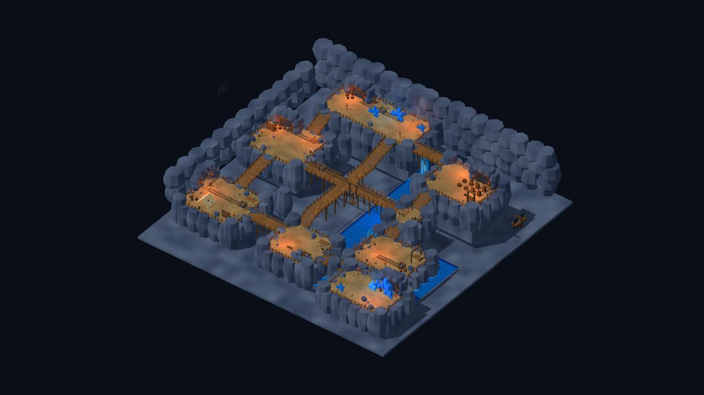
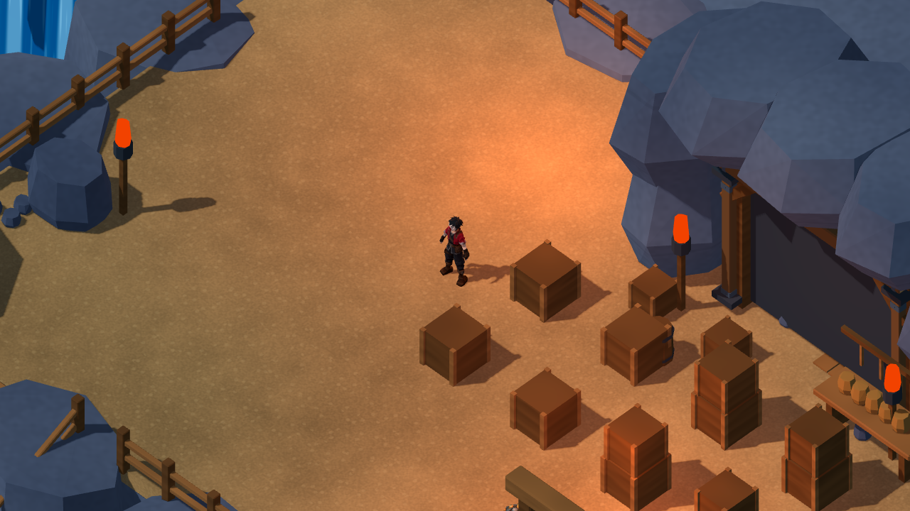
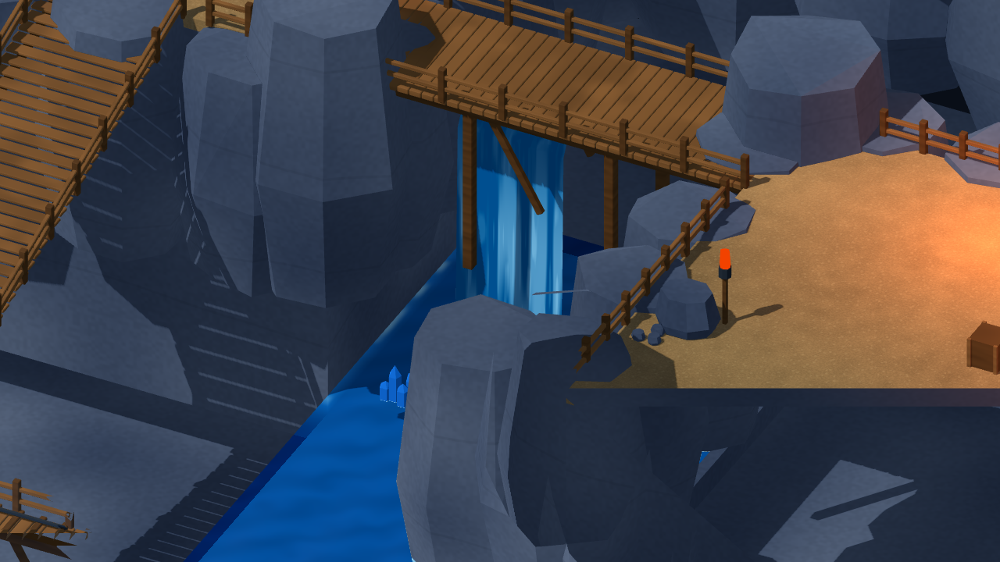

# 礦坑參考場景重建 — 第一輪（2026-10-26）

使用者以更新後的 crystal-scene-builder 指定[本輪參考圖](references/mine_interior_reference_20261026.png)。該圖是先前[完整礦坑參考圖](references/mine_interior_reference.png)的縮小裁切版本，八區關係相同；使用完整圖核對底部模組與場景細節。本輪從5d7e90a接續既有礦坑，實際重建完整Blender主檔與Godot模組，未把既有八區重新命名算作新成果。

## 已完成的本輪建造

- 12個場景分區、4個獨立機械模組；563個實際岩石／岩體封閉組件通過成對邊、非退化面與向外法線檢查。將尖柱式洞壁改為平頂凸形岩塊，增加層疊與錯位。
- 既有坑門外新增岩框、木內襯與入口包覆；貨架、邊緣碎石／箱桶、工作木平台、橋下斜撐共106項配置收據。重用G04箱桶與晶體、既有支架／車／軌道；箱體補接縫與X形木撐，金色包角改為木質材色。原始資產保留。
- 樓梯改為木踏板及承重木梁；移除與踏板穿插的可見斜面，實際連續坡面碰撞維持不變。
- 兩道連續曲面瀑布、落水水沫與Godot動態Shader；岩石採較克制的表面紋理。減少廣泛白光、加強局部暖火把，降低晶體自發光以保留切面。
- 八區仍為入口營地、西部礦車區、中央橋、北部水晶區、東北儲物、東部水道、南部塌方與東南核心；保持既有劇情入口與環線。

完整可編輯主檔：[mine_reference_master.blend](../source_assets/mine_reference_20261024/mine_reference_master.blend)。Blender MCP已同步至`Crystal_Mine_Reference_20261026`，原`Scene`及其3個物件保留；本機另存`artifacts/mine_refinement_20261026/live_mine_preview.blend`。主檔具有原生程序材質，GLB預覽需還原材色，Godot則使用等效Shader；三者動態光照呈現不能視為完全相同。MCP版本較舊但支援必要操作，未更新外掛或停用安全設定。

## 安全整合與實測

既有501個碰撞代理與修改前逐項相同，位置版本仍4，layout JSON與互動／出生點未改。美術石塊仍可能造成視覺遮擋，因此另外走實際路線；不以碰撞雜湊取代動線測試。沿用Player與既有RPG管理系統；角色ID、數值、旗標、獎勵、Save Schema與正式v0.6.1入口均未修改。

Godot4.7.2.stable.official.ed1daf0bf、Blender5.2.2 LTS；Windows／RTX3080／Compatibility。

| 實際執行 | 檢查／失敗 |
|---|---:|
| TestMineReference | 55／0 |
| TestMineReferenceMigration | 59／0 |
| VisualMineReferenceStory | 68／0 |
| TestMineReferenceStoryReload | 7／0 |
| VisualReferenceStory | 68／0 |
| TestReferenceStoryReload | 7／0 |

合計264項／0失敗；Check匯入與16個GLB結構／面數檢查亦通過，另有13張原生檢視畫面。兩個整合入口均完成序章、森林教學、核心／守衛戰、回村單次獎勵及另一程序讀檔。這是自動圖形／資料驗證，人工鍵鼠／Xbox仍暫停。

完整路線走跑取樣8779幀、平均59.50FPS、P95 16.72ms、P99 16.78ms、最大233.93ms；Draw Calls 79–157，引擎靜態記憶體42.42–42.60MiB。60FPS上限、Debug引擎，包含截圖與本機驗證活動；最大尖峰仍須後續剖析。不是GPU時間、程序RSS、Release長測或Android真機驗收。固定鏡頭相隔0.75秒，瀑布ROI有58.51%像素差異超過5/255，靜態岩壁區域差異為0；確認動態紋理有隨時間變化，並非流體物理驗收。

場景靜態面數146,616→170,688，仍在現有200,000預算內；不包含動態人物。這不是角色10,000面預算，且面數合格不代表畫面還原已合格。

## 畫面審查與待完成項目







依已讀Agent Vision構圖／光照條目，COMP-DEPTH-LAYERS 1/2（高低差可辨、區塊仍像分離島台），COMP-LEAD-ENV 1/2（通路可辨、軌道轉彎／銜接仍不足），LIGHT-KEY-FILL 1/2（暖光已區分、部分岩壁層次仍粗），LIGHT-EMISS-HIER 1/2（晶體切面改善、核心焦點仍需加強）。這是本輪4個適用條目的局部審查，不是整體美術認證。

已修正首輪坑口岩框遮住木梁、GLB程序材質在Blender預覽變白，以及樓梯踏板／斜面和中央十字橋板重疊的鋸齒紋。地下水道岩框原本遮擋路上的人物，已將純造景坑口移至東北側並朝向主路；貨物與碰撞位置不變。仍需下一輪重塑連續自然岩層輪廓、緊密銜接平台／河岸、彎曲鐵軌與採掘工具細節，改善與參考圖的畫面差距；不宣稱嚴格還原已完成。水沫存在，但落水區部分被岩塊遮擋，仍需細調。吊籠／車／採礦仍為靜態造景。

## 使用與證據

```powershell
./tools/godot.ps1 -Mode RunMineReference
./tools/godot.ps1 -Mode TestMineReference
./tools/godot.ps1 -Mode VisualMineReferenceStory
./tools/godot.ps1 -Mode TestMineReferenceStoryReload
```

本輪更新來源場景及Blender主檔，舊Windows RC1／村莊RC3固定包不會自動包含新美術；沒有在這個「開始建立場景」任務額外匯出新包。Android／iOS與第一章維持暫停。

[測試命令](../source_assets/mine_reference_20261024/evidence/refinement_20261026/tests.json)／[完整路線與效能口徑](../source_assets/mine_reference_20261024/evidence/refinement_20261026/traversal.json)／[資產與來源SHA](../source_assets/mine_reference_20261024/evidence/refinement_20261026/asset_receipt.json)／[碰撞保留](../source_assets/mine_reference_20261024/evidence/refinement_20261026/protected_layout.json)／[岩體幾何](../source_assets/mine_reference_20261024/evidence/refinement_20261026/rock_audit.json)。原始日誌與試驗產物僅留本機artifacts。
