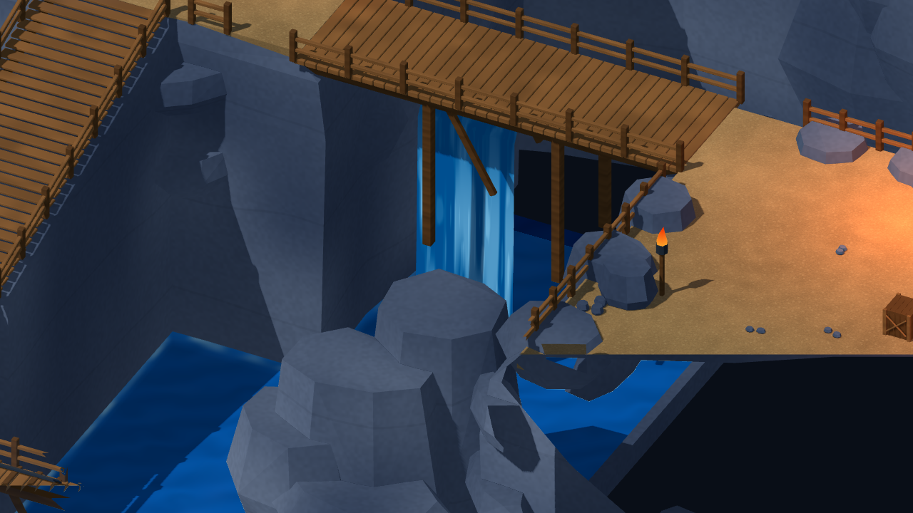
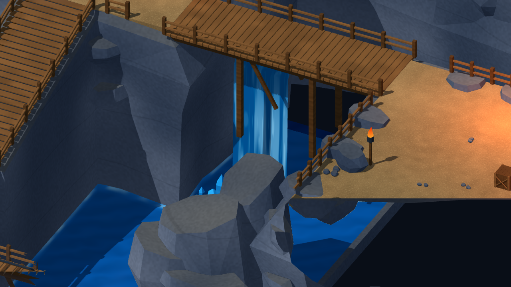
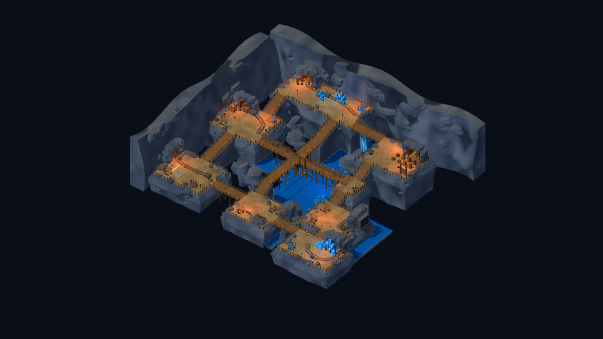

# 礦坑岩壁輪廓與斷頂岩塊修整

2026-10-26，承接 `fc895f006b622bc2e9d15c3dc8d04bd18b571add`，延續[礦坑造景候選](MINE_SCENE_COMPLETION_REPORT.md)。本輪只修整礦坑來源美術，沒有更新Windows RC2包或恢復人工驗收。

## 實際修改

- 八區連續崖殼由四層改為五層，保留可行走頂緣，底下增加中段外凸、切向錯位及上下起伏，縮短長直崖面。
- 北／西洞窟牆由三層改為四層，加入退縮與凹凸斷面；既有嵌入岩塊增加傾斜，原錨點不移動。
- 礦坑岩塊不再使用重複的近似八角平頂，改為不均勻半徑、錯開角度和傾斜斷頂的封閉凸形網格。仍按原本126次配置亂數消耗保護後續擺放，不改碰撞位置。
- 石材Shader依世界法線在向上面混入暖灰積塵色，保留冷灰立面、岩層紋理和礦坑暖光。

來源：本專案原創Blender Python與Shader，沒有新增外部素材、付費生成或角色模型。[完整主檔](../source_assets/mine_reference_20261024/mine_reference_master.blend)、12區＋4機械GLB及[逐檔SHA](../source_assets/mine_reference_20261024/evidence/rock_profiles_20261026/asset_receipt.json)。靜態面數199,112→199,598，預算200,000；這不是角色減面工作。

## 驗證

Godot4.7.2.stable.official.ed1daf0bf、Blender5.2.2 LTS，Windows／RTX3080／OpenGL Compatibility。

| 原始專案命令模式 | 檢查／失敗 |
|---|---:|
| TestMineReference | 55／0 |
| TestMineReferenceMigration | 59／0 |
| VisualMineReferenceStory | 68／0 |
| TestMineReferenceStoryReload | 7／0 |
| VisualReferenceStory | 68／0 |
| TestReferenceStoryReload | 7／0 |

264項／0失敗，含真正CharacterBody與InputMap的完整主路／中央橋／上下階走跑、兩種村莊入口的序章／戰鬥返回、舊檔遷移、單次獎勵及新程序讀檔。另有Check匯入、16GLB結構、908岩體組件閉合／正體積／邊界、3670視覺淨空取樣／0命中與橋頭木板間距檢查通過。501碰撞與layout JSON SHA逐項相同，角色ID／數值／旗標／任務／存檔Schema不變。

14張原生圖形視圖已擷取並對照；岩壁斷面、傾斜頂面及積塵可見。相機取樣不代表全地圖無遮擋認證。動線8778幀，平均59.48FPS、P95 16.73ms、P99 16.81ms、最大247.89ms，Draw Calls 86–170，引擎靜態記憶體42.85–43.03MiB。60FPS上限、Debug，包含測試與截圖成本；不是GPU耗時、程序RSS、Release長測或行動裝置數據。

## 前後畫面與限制

本輪保留平台頂緣、5m通路與整體佈局，沒有把岩壁修整宣稱為參考圖構圖完全還原。平台間距、矩形頂面與部分道具比例仍有差異；人工美術／鍵鼠／Xbox驗收暫停，Android／iOS及第一章未執行。

Blender MCP已同步既有獨立礦坑預覽，原Scene的3個物件保留；本機預覽存於`artifacts/mine_rock_profiles_20261026/live_mine_preview.blend`。GLB預覽採常色替代程序材質，積塵／水體效果以Godot原生畫面為準。

查看最新來源：`./tools/godot.ps1 -Mode RunMineReference`；最新參考村莊入口`RunReferenceVillage`亦使用同一礦坑。Windows RC2仍固定於ef0764c，不含本輪岩壁，不得沿用RC2包內測試認證本輪新模型。

[回歸](../source_assets/mine_reference_20261024/evidence/rock_profiles_20261026/tests.json)、[淨空](../source_assets/mine_reference_20261024/evidence/rock_profiles_20261026/visual_clearance.json)、[碰撞保護](../source_assets/mine_reference_20261024/evidence/rock_profiles_20261026/protected_layout.json)。
