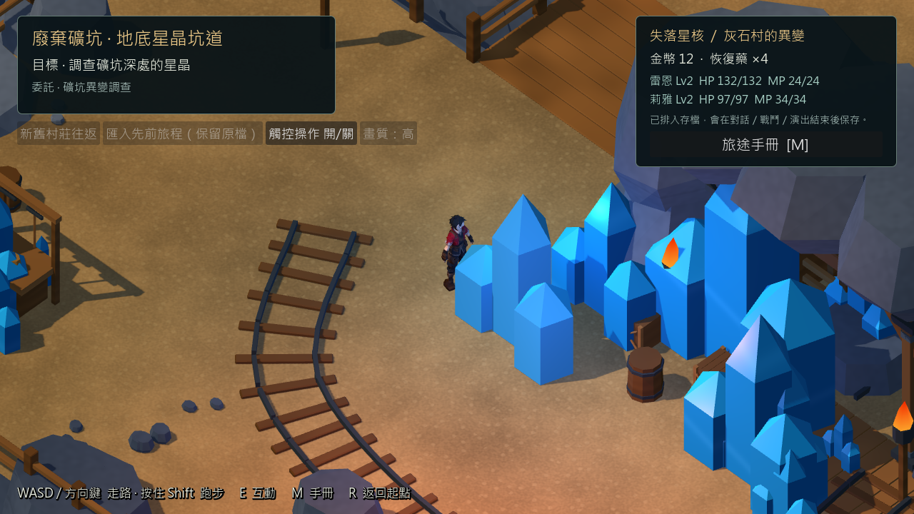

# 礦坑造景整合候選與 Windows RC2

2026-10-26，承接 b617652，依使用者礦坑八區參考與 crystal-scene-builder 完成造景組裝候選。人工美術／實體輸入驗收依使用者指示維持暫停，不能將自動回歸寫成人工認可。

## 交付場景

入口營地、西部礦車軌道、中央木橋岔路、北部水晶採掘、東北儲物、東部地下水、南部塌方、東南核心洞窟均已建置；沿用八區地形、五組彎軌、十組工具工作區、吊籠／支架／礦車、箱桶及地下水系統。

本輪將規則岩牆貼片換為60組錯落岩壁支塊，補113處岩緣、21組坑壁岩座與122塊低矮碎礦石。六處坑道加深至4.35m，具有後退端壁、內側岩襯、三道木肋及延伸鐵軌。22處火焰改為收尖外形與熱度漸層；水晶使用共用切面／反光／微發光Shader，避免單一亮藍色。

實景檢查另發現中央橋東側木板與土平台共面造成鋸齒閃紋；以實際三角形BVH重現29個共面取樣失敗。橋板提高3cm，碰撞不變；修正後至少20個平頂取樣保持2cm以上間距，斜倒角另檢查大於2mm，另核對原生近景。初次診斷錯把斜倒角套用平頂2cm門檻，已按法線區分，並以相同最終判準重跑舊檔，舊檔仍失敗。失敗JSON與畫面保留，未將先前有缺陷的畫面作最終交付。

完整可編輯主檔：[mine_reference_master.blend](../source_assets/mine_reference_20261024/mine_reference_master.blend)。12個場景GLB＋4個獨立機械GLB；靜態場景199,112三角面／200,000預算。模型由專案Blender Python生成，重用既有來源，沒有新增付費或外部素材。

## 遊戲契約及實際驗證

Godot 4.7.2.stable.official.ed1daf0bf、Blender 5.2.2 LTS、Windows／RTX3080／Compatibility OpenGL。501個碰撞、layout4及JSON SHA與修改前一致；角色ID、戰鬥數值、劇情／任務／獎勵及Save Schema未改。新裝飾無碰撞；沒有為水道加入隱形可走平地。

| 原始專案命令模式 | 檢查／失敗 |
|---|---:|
| TestMineReference | 55／0 |
| TestMineReferenceMigration | 59／0 |
| VisualMineReferenceStory | 68／0 |
| TestMineReferenceStoryReload | 7／0 |
| VisualReferenceStory | 68／0 |
| TestReferenceStoryReload | 7／0 |

合計264項／0失敗，包含真正CharacterBody＋InputMap走跑與上下階、兩個村莊整合入口的序章／戰鬥返回／單次獎勵、舊檔遷移及新程序讀取。另完成Check匯入、16GLB結構、908岩體組件閉合／方向／正體積及世界邊界檢查、3670模型淨空射線／0命中，以及14張原生視圖。射線是道路取樣，不等於所有角落或相機無遮擋認證。

動線8780幀、平均59.47FPS、P95 16.71ms、P99 16.79ms、最大244.60ms；Draw Calls 85–169，引擎靜態記憶體42.50–42.68MiB。60FPS限制、Debug原生畫面，含截圖／測試成本；不是GPU時間、程序RSS、Release長測或Android數據。

## 實景與參考偏差

參考的八區鄰接、上下層、中央橋、藍水／暖木構與道具種類已接入；遊戲版保留約5m主通道和鏡頭淨空，因此平台間距、矩形地形邊界、部分岩壁輪廓及道具比例仍與概念圖不同。這是可玩的完整造景候選，不宣稱嚴格逐像素還原或美術人工驗收通過。礦車、吊籠、塌方及坑口為靜態造景；未新增運輸、採礦或額外劇情。正式0.6.1入口保留，Android／iOS與第一章暫停。

## Windows 固定包

固定包來源提交：`ef0764c965741b3f8882c56e4181b50bdb6f77d1`，版本`0.6.1-mine-reference-rc2`。重用乾淨驗證工作樹，執行`tools/build_blender_windows.ps1 -CandidateFamily Mine`及`tools/test_mine_windows.ps1`。匯入／匯出無錯誤，沒有來源正規化差異。

實際Windows Release圖形包：序章／交易／遷移137項、37.81秒；新程序重啟32項、10.80秒；普通啟動器保持12.18秒後正常關閉，遊戲與啟動器退出0。檢查實際Mesh surface使用岩石、木材、水晶、火焰、水面、瀑布與水沫Shader，並確認六個深坑道及501碰撞清單。這些是不同程序的包內檢查，與來源264項分開計算；不是30分鐘長測或實體手把驗收。

啟動：`D:/RPGGAME/builds/mine-reference/rc2-ef0764c/candidate/start_mine_reference.cmd`。ZIP：`D:/RPGGAME/builds/mine-reference/rc2-ef0764c/ProjectCrystal-0.6.1-mine-reference-rc2-windows-x64.zip`，384,251,428 bytes，SHA256 `32fb75268e077daf30d3f1c3c7db6a5814975f86a2fcbaafde72a74601121a17`。明確七檔白名單，CRC及每檔SHA一致；不包含user_test、日誌或存檔。保留RC1及所有正式包。

此礦坑專用包沿用既有Blender村莊入口；最新參考灰石村的來源入口仍是`RunReferenceVillage`，本輪來源回歸已涵蓋該入口與新礦坑，但不能將此包宣稱為最新村莊候選的替換包。人工驗收繼續暫停。

[建置／包內測試收據](../source_assets/mine_reference_20261024/evidence/completion_20261026/windows_rc2/package_receipt.json)、[包內檢查](../source_assets/mine_reference_20261024/evidence/completion_20261026/windows_rc2/manifest.json)、[普通啟動器](../source_assets/mine_reference_20261024/evidence/completion_20261026/windows_rc2/normal_launch.json)。

[資產／SHA](../source_assets/mine_reference_20261024/evidence/completion_20261026/asset_receipt.json)、[測試](../source_assets/mine_reference_20261024/evidence/completion_20261026/tests.json)、[動線](../source_assets/mine_reference_20261024/evidence/completion_20261026/traversal.json)、[碰撞保留](../source_assets/mine_reference_20261024/evidence/completion_20261026/protected_layout.json)。
