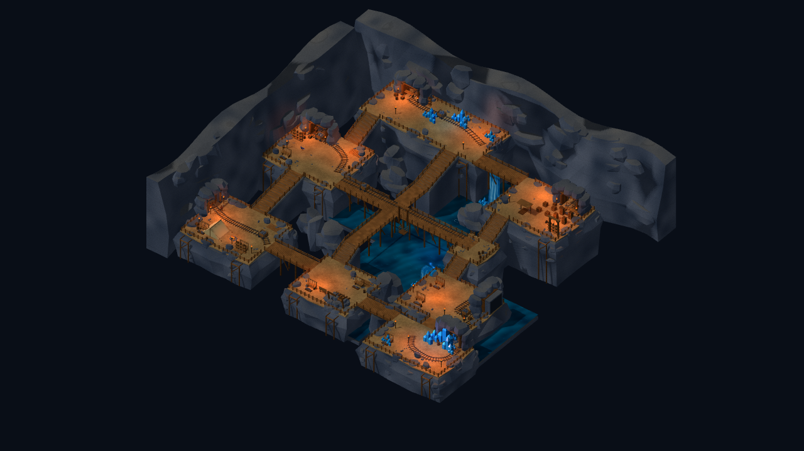
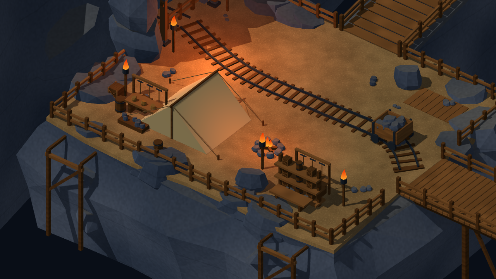
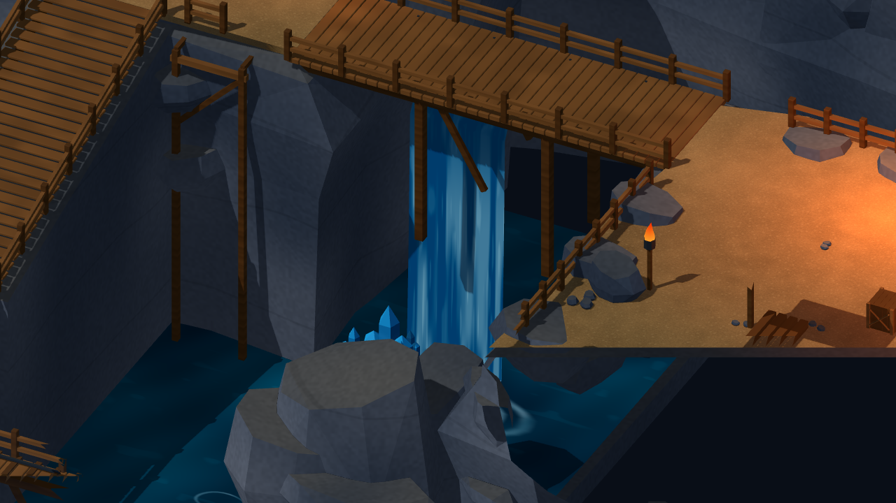
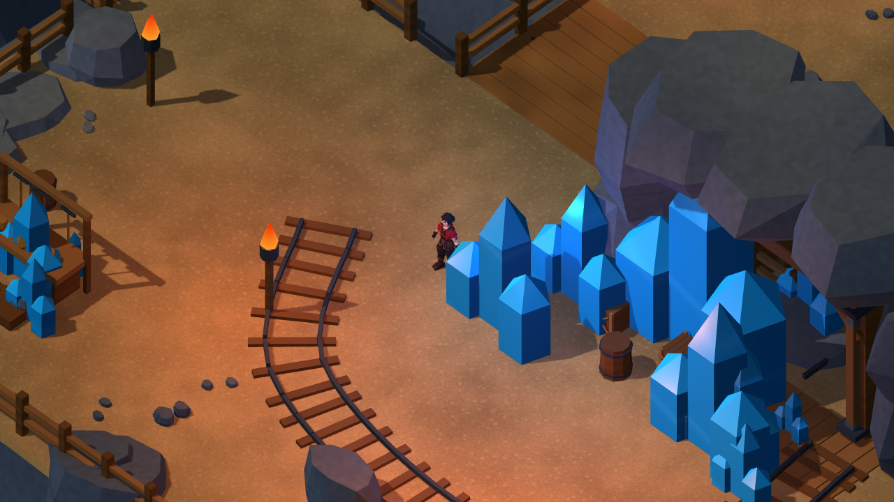

# 礦坑整體畫面修整

2026-10-26，承接 `cb49ea3d54e5459ab4da3f7983337ba6f35068b7`。依使用者「先完成所有畫面修整」，本輪集中完成以下可核對的礦坑畫面清單；原始專案與完整Blender主檔更新，暫不打包，人工認可維持暫停。

## 完成清單

| 項目 | 實際處理 | 證據 |
|---|---|---|
| 八區平台與岩壁 | 增加不規則圍欄外土緣，與岩殼對齊收邊；原地面完整保留 | overview、ledge_detail |
| 木構 | 崖面支架、斜撐、連接梁、橋面鐵釘；調整支架到岩面外側，防止埋在岩內 | ledge_detail、crossing |
| 營地 | 帳篷後片、支柱、屋脊、接縫、繩索、地釘、床卷、可見營火和物資桌 | camp_detail |
| 軌道區與採掘區 | 保留彎軌、礦車、工具架、貨架及礦石；統一材質與洞穴明暗 | rail、crystal、tunnel_depth |
| 儲物區 | 木料棚及堆料，保留原箱桶、吊籠與通道 | storage_detail |
| 塌方區 | 為懸空告示補上支腳／斜撐，增加斷裂坑架 | collapse |
| 核心洞窟 | 兩組火把移出星晶，互動星晶與裝飾星晶共用切面材質 | core、材質實例檢查 |
| 水體 | 礦坑獨立不透明水面Shader、波光、透明柔邊浪花／岩旁尾流與落水波紋；移除深度讀取造成的三角白斑 | water_detail、water_surface、兩幀 |
| 光照 | 降低環境填光與日照，提高局部暖火光，調整藍光並加入營火／核心火把光源 | 全區原生視圖 |
| 視覺穿插 | 修正帳篷內火把、主路火把柱、埋入岩壁的支架、土岩收邊與鋸齒浪花 | 問題畫面、加密身體檢查 |

薄木欄杆與枕木移除1072個小倒角修改器，保留坑口等主要木樑倒角；省下幾何用於實際可見的造景。靜態場景面數199,598→168,959，仍低於200,000預算；沒有降低角色面數。所有新物件與Shader由本專案原創，重用既有箱桶／礦車／星晶來源，沒有外部付費素材。

## 實際驗證

Godot4.7.2.stable.official.ed1daf0bf、Blender5.2.2 LTS；Windows、RTX3080、OpenGL Compatibility。

| 命令模式 | 檢查／失敗 |
|---|---:|
| TestMineReference | 63／0 |
| TestMineReferenceMigration | 59／0 |
| VisualMineReferenceStory | 68／0 |
| TestMineReferenceStoryReload | 7／0 |
| VisualReferenceStory | 68／0 |
| TestReferenceStoryReload | 7／0 |

272項回歸／0失敗（264項遊戲功能＋8項實際Mesh材質檢查）。材質檢查另在畫面擷取流程重跑，總數不重複計入。真正CharacterBody與InputMap走跑主要路線、上下階、中央橋；兩個村莊入口完成序章／戰鬥返回／舊檔遷移／單次獎勵及新程序讀取。材質檢查驗證實際surface使用水面、浪花、岩石、木材、火焰、水晶、瀑布Shader，以及互動星晶材質。

另完成Check匯入、16GLB結構、916岩體組件閉合／方向／正體積與邊界、土面封閉邊配對、原平台1312處地面支撐、24個火焰中心避讓帳篷／水晶、橋頭木板間距，以及58,275身體取樣／0命中。這些是明確範圍的取樣，不能代替全地圖連續膠囊或相機遮擋認證。

原本位於(29,0,36)的火把柱，在加密橫向檢查重現30次取樣命中，代表一根柱，不是30個障礙物。舊垂直射線會從高柱內部開始而漏檢；新檢查增加0.15m路線間距、斜向偏移及三個高度的橫向直徑。整組火把移至(27,0,40)，以相同最終判準重跑後0命中。原始問題主檔SHA、失敗JSON與修正前圖片均保留，未放寬驗證接受穿插。

501個碰撞代理、layout4與layout JSON SHA逐項相同；互動／出生點、角色ID、數值、技能、劇情旗標、任務獎勵與存檔Schema不變。圍欄外土緣為視覺收邊；沒有新增可走隱形水面或改變玩法道路。

動線8777幀，平均59.48FPS、P95 16.71ms、P99 16.82ms、最大247.49ms，Draw Calls 91–180，引擎靜態記憶體42.57–42.75MiB。Debug／60FPS上限，含截圖與測試成本；不是GPU時間、程序RSS、Release長測或手機數據。

18張原生視圖覆蓋八區、整體、坑道、營地／儲物／崖面／水面近景與動態水體。固定鏡頭相隔0.75秒，水面ROI平均RGB差0.589，靜態岩壁ROI 0.000，數值與[方法](../source_assets/mine_reference_20261024/evidence/visual_finish_20261026/water_motion.json)保留；不把影像差當作流體模擬認證。

## 畫面

依Agent Vision的4項適用條目作局部審查（0–2）：COMP-DEPTH-LAYERS 2（前景岩體／中層橋梯／後方洞壁分離）、COMP-LEAD-ENV 2（彎軌與橋梯能指向各作業區）、LIGHT-KEY-FILL 2（道路與人物輪廓可讀）、LIGHT-EMISS-HIER 2（星晶主焦點與較小火源分層）。這是上述條目的局部視覺評分，並非整體美術或參考還原度認證。

Blender MCP預覽已同步至本輪168,959面來源，原Scene的3個物件保留；本機另存`artifacts/mine_visual_finish_20261026/live_mine_preview.blend`。預覽常色與Godot程序Shader不同，水體、浪花及光照以原生畫面為準。

本輪清單已完成工程與實景驗證；採112m探索尺度及5m主路，因此平台間距、橋長與參考圖緊縮展示構圖仍有比例差異，未宣稱逐像素還原或人工美術認可。吊籠、礦車、礦石等仍為造景，沒有新增採礦／運輸玩法。人工美術、鍵鼠／Xbox驗收依使用者要求維持暫停，Android／iOS及第一章未執行。

## 查看最新來源

`./tools/godot.ps1 -Mode RunMineReference`，或`RunReferenceVillage`進入最新參考村莊及同一礦坑。完整可編輯主檔：[mine_reference_master.blend](../source_assets/mine_reference_20261024/mine_reference_master.blend)。本輪未打包；RC2仍固定於ef0764c，不含這輪修整，不以舊包結果認證新來源。

[來源／SHA](../source_assets/mine_reference_20261024/evidence/visual_finish_20261026/asset_receipt.json)、[回歸](../source_assets/mine_reference_20261024/evidence/visual_finish_20261026/tests.json)、[畫面檢查](../source_assets/mine_reference_20261024/evidence/visual_finish_20261026/presentation_audit.json)、[修正前火把命中](../source_assets/mine_reference_20261024/evidence/visual_finish_20261026/torch_before_audit.json)、[最終淨空](../source_assets/mine_reference_20261024/evidence/visual_finish_20261026/visual_clearance.json)。
