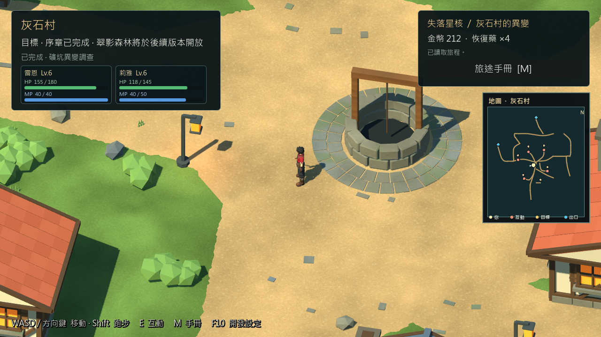
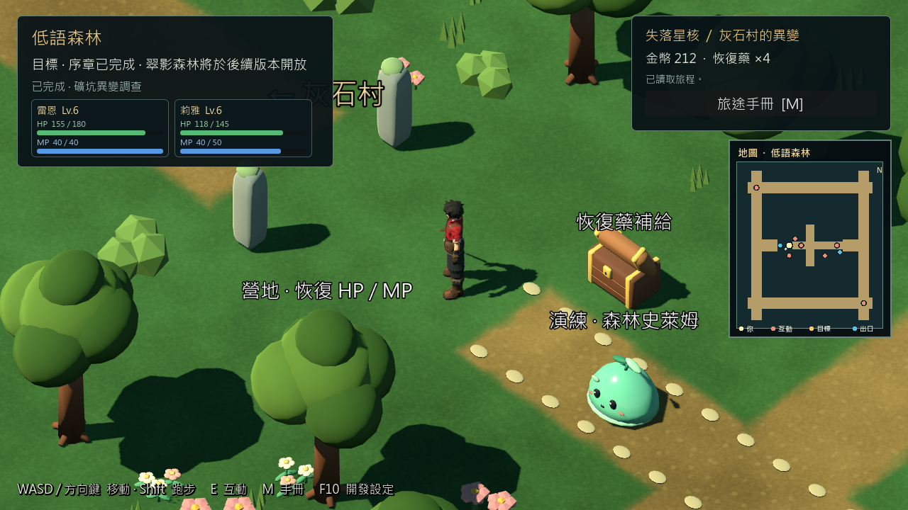
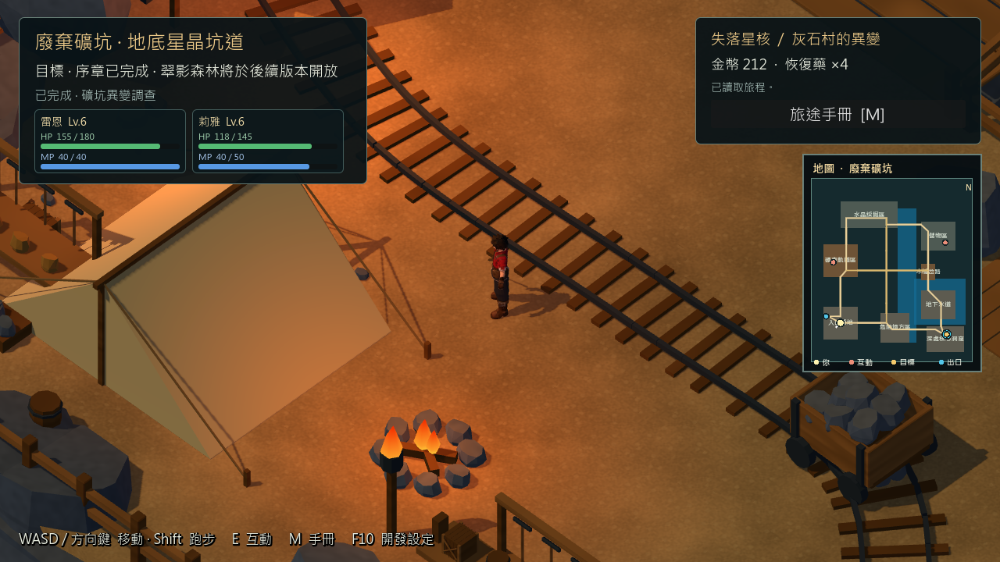

# 序章 RC3 圖形自動長測 — 2026-10-29

## 結果與範圍

固定 RC3 的原生圖形自動長測完成 **1812.761 秒（30 分 12.8 秒）**，27 輪灰石村／低語森林／礦坑往返、81 次切換，終端 **1264 checks／0 failures**；獨立新程序讀長測存檔 **25／0**。沒有崩潰、SCRIPT ERROR 或 ERROR。完成實際 InputMap 移動、NPC 對話、商店購買、旅館恢復、主線戰鬥及反覆一般遭遇、保存／重讀與單次星印／任務獎勵檢查。

這是 Windows Godot 4.7.2 完整引擎掛載固定 QA PCK 的圖形自動驗證，`debug_build=true`，不是獨立 Release EXE 效能數字，也不是人工 30 分鐘遊玩。自動路段會先定位再行走，不能代表自由探索每個角落。正式 v0.6.1、舊 RC2、RC3 candidate／QA PCK、ZIP 與使用者存檔均保留。

- 來源：`52c7f1d187c4e4f4039657f0be46b08c09351300`；包版本 `0.6.1-prologue-rc3-20261028`。
- 引擎：`4.7.2.stable.official.ed1daf0bf`，Compatibility，RTX 3080，1280×720，60 FPS 上限，關閉 VSync。
- QA PCK SHA256：`be1754532783552a0dfb4ff09f2831823cb0af6168a1f5d7bce52e6def5253dd`。
- 完整本機證據：`builds/prologue-candidate/rc3-20261028/acceptance/soak-20261028-231343-405/`。
- 追蹤摘要：[summary.json](evidence/prologue_rc3_soak_20261028/summary.json)、[原始指標](evidence/prologue_rc3_soak_20261028/metrics.json)、[程序／包身分](evidence/prologue_rc3_soak_20261028/run.json)、[終端結果](evidence/prologue_rc3_soak_20261028/terminal_results.txt)。實際存檔與完整日誌不提交。

## 幀時間與 Draw Calls

| 階段 | FPS | 平均 ms | P95 ms | P99 ms | 最大 ms | Draw Calls 範圍 |
| --- | ---: | ---: | ---: | ---: | ---: | ---: |
| 灰石村探索 | 59.82 | 16.718 | 16.763 | 16.956 | 85.241 | 776–1043 |
| 低語森林探索 | 59.91 | 16.692 | 16.746 | 16.936 | 60.375 | 288–334 |
| 礦坑探索 | 60.00 | 16.668 | 16.736 | 16.933 | 84.737 | 184–207 |
| 一般遭遇戰鬥 | 57.34 | 17.441 | 16.845 | 51.679 | 222.692 | 101–333 |
| NPC／商店／旅館 | 55.03 | 18.170 | 19.099 | 69.817 | 216.046 | 953–1213 |
| 場景切換期間 | 56.61 | 17.664 | 27.082 | 68.082 | 74.070 | 175–1194 |
| 啟動及首次序章 | 26.65 | 37.518 | 18.160 | 212.521 | 7542.169 | 0–1302 |

FPS 為主迴圈牆鐘取樣率，不是 GPU 計時；Draw Calls 含 UI／陰影等 pass。首次序章包括初始化、主線及診斷截圖，7.542 秒最大間隔不能直接稱為純 GPU 或磁碟瓶頸。81 次完整切換的平均耗時 343.151 ms、最長 358.861 ms，包含淡出淡入與等待；這與表內切換期間最大單幀 74.070 ms 是不同量。

一般探索接近 60 FPS，但戰鬥 P99 51.679 ms、交易 P99 69.817 ms，最大仍約 216～223 ms，因此**尚未通過全程無明顯卡頓的品質目標**。本輪只取得分區證據，沒有 CPU／GPU 細分 profiler trace，不能把材質數或 Draw Calls 猜成已確診瓶頸。下一步應在獨立 Release 上重現服務／讀檔及戰鬥切換並細分計時，確認耗時來源後再修正。

## 記憶體與診斷修正

- 引擎配置量峰值 **409.81 MiB**（429713519 bytes）。
- 實際遊戲程序已取樣 299 筆：Working Set 峰值 **933.08 MiB**，Private Bytes 峰值 **2152.21 MiB**；程序生命週期 Peak Working Set **968.82 MiB**。
- 初始採樣錯誤地讀到 console 啟動器 PID 19776，約 6 MiB 的 `soak-process.csv` **不可作為遊戲記憶體數據**。檢查後附加至真正遊戲 PID 12040，取樣自啟動後 356.838 秒至 1850.568 秒；前約 6 分鐘沒有有效的連續程序曲線。保留原失誤，不補造數據。[實際取樣](evidence/prologue_rc3_soak_20261028/soak-game-process.csv)／[取樣器紀錄](evidence/prologue_rc3_soak_20261028/game-sampler.json)。
- 同地圖節點數穩定為灰石村 4716、森林 862、礦坑 920；首末引擎配置約增加 1.1～1.2 MiB，包含診斷陣列／報告資料成長，不足以宣稱無記憶體洩漏。切換後立即取樣的 28 個 orphan 不單獨代表洩漏；獨立重啟測試延後 3 幀後 21→0。
- 新增 `tools/test_prologue_soak.ps1`，驗證包 SHA、隔離存檔、記錄實際渲染子程序，沒有採樣時拒絕通過；逾時只結束自己啟動的遊戲與 wrapper。正常探針實際 PID 15760／wrapper 27300，3 筆採樣且 exit 0；逾時探針確實拒絕、兩個自啟動程序都結束。[正常探針](evidence/prologue_rc3_soak_20261028/sampler_probe.json)／[逾時探針](evidence/prologue_rc3_soak_20261028/sampler_timeout.json)。這些短探針僅驗證採樣／清理，不另算長測。

原始完整報告是在最後時長斷言之前寫入，因此 JSON 是 1263 checks，終端為 1264，兩者都零失敗。已調整後續測試寫入順序，使最終報告包含時長斷言；原始報告及本次執行腳本 SHA 保留，沒有竄改成新版本跑過 30 分鐘。採樣修正與寫入順序修正尚未再跑第二次 30 分鐘。

## 實際圖形檢視

已檢視第 26 輪三區原生圖；人物、地表、HUD、小地圖與道路顯示正常，未見長測造成的模型消失。這三張定點圖不代表完整美術驗收，森林規則道路、礦坑小地圖文字密度仍有修整空間。





## 重現與未完成

```powershell
# 必須有可用的 Windows 圖形顯示，約需 31 分鐘。
.\tools\test_prologue_soak.ps1 -Root D:/RPGGAME/builds/prologue-candidate/rc3-20261028
```

wrapper 直接檢查相符 Godot 引擎／固定包內容，另複製診斷腳本到新 acceptance 目錄；不用來源遊戲場景覆寫包內容。每次建立獨立 profile，不寫正式存檔。長測結果依真實 `soak_seconds >= 1800`、圖形模式、零失敗及包 SHA 驗證，短測不能通過。

未完成：獨立 Release 效能剖析與尖峰修正、莉雅新造型拓樸／貼圖／綁骨驗收、人工美術與實體輸入終驗。人工、Android／iOS、第一章繼續暫停；不標記序章最終發布或 G08 全部通過。
