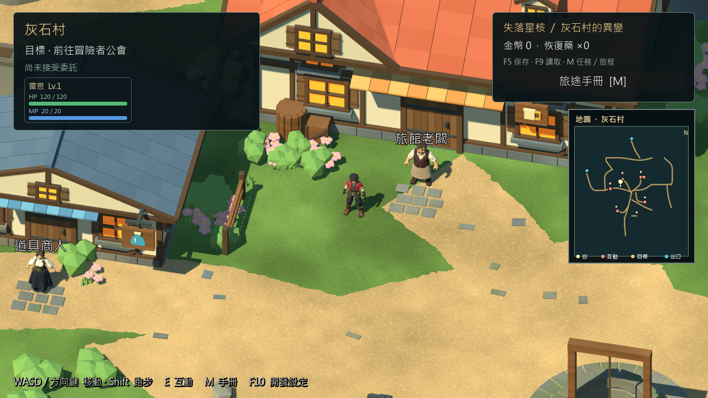
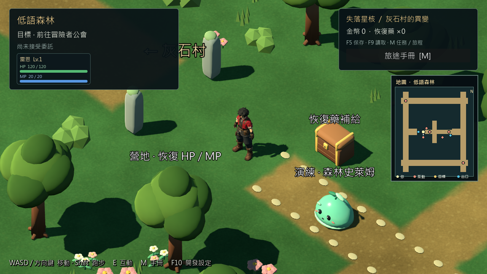
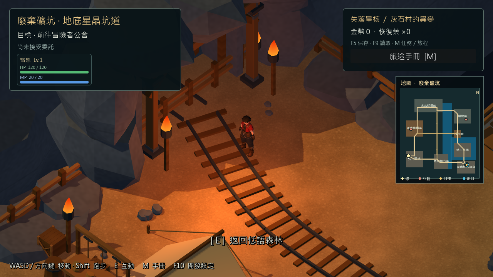

# 序章 RC4 修正版交付 — 2026-10-29

2026-10-29後續結果：本固定RC4已完成1812.101秒圖形自動長測1264／0＋重啟25／0，[新報告](PROLOGUE_RC4_SOAK_REPORT.md)。下方「長測進行中」為打包當時紀錄；包及ZIP不改。森林標籤另於來源修正，[標籤報告](FOREST_LABEL_LAYOUT_REPORT.md)，未回填固定包。

## 目前狀態

新RC4已匯出、包內功能／回歸及公開啟動器通過，包含56cd9a2的讀檔碰撞快照修正。**不是完整序章最終驗收通過**：RC4長測已啟動但本報告提交時尚未完成；新莉雅美術缺陷、森林標籤與HUD重疊、人工驗收仍待。

- 固定遊戲來源：`222cc5a059360ab392e47a91761319917a2c8699`，分支feature/greystone-g06。
- 版本：`0.6.1-prologue-rc4-20261029`；Godot及Windows x64 Release模板4.7.2.stable.official.ed1daf0bf。
- 玩家啟動：`D:/RPGGAME/builds/prologue-candidate/rc4-20261029/candidate/start_prologue_candidate.cmd`。
- ZIP：`D:/RPGGAME/builds/prologue-candidate/rc4-20261029/ProjectCrystal-0.6.1-prologue-rc4-Windows.zip`，385,129,526bytes。
- 本包存檔隔離於candidate/user_test，不搬動使用者正式存檔。正式v0.6.1、舊RC3及其存檔保留。
- 新包使用最新版灰石村、低語森林、礦坑、可玩雷恩及既有可玩莉雅；新莉雅失敗候選沒有偷偷替換。

## 本輪實作

只提升候選feature版本及匯出路徑；正式版本及主入口不變。Git archive取固定提交，排除工作目錄中未完成的美術修改。驗收工具增加包內碰撞快照對照；資源稽核新增快照腳本必需項。

讀檔修正原始證據見[碰撞快照效能報告](PROLOGUE_VALIDATION_PERFORMANCE_REPORT.md)。其36.610→8.809ms是隔離驗證場景建立／初始化的中位數，**不是整個讀檔時間或本RC4長測數字**。

## 實際包內驗收

`acceptance/run-20261029-094820-967/`。引擎掛載包時工作目錄為匯出目錄，不從未提交來源載入場景。合計**20983個斷言／0失敗，另23個礦坑邊緣實走案例／0新缺口**。

| 檢查 | 結果 | 執行類型 |
|---|---:|---|
| E001–E009、兩場主線戰鬥、回村單次獎勵 | 93／0 | 原生圖形Release QA EXE |
| 關閉後新程序讀檔 | 25／0 | 原生圖形Release QA EXE |
| 三區導航／地圖來源 | 31／0 | 圖形Godot掛載QA PCK |
| 展開地圖／三種視窗尺寸／焦點 | 77／0 | 圖形Godot掛載QA PCK |
| 礦坑橋階邊緣 | 23案例／0新缺口 | 真實Player、InputMap自動實走 |
| 正式P5舊檔前置 | 69／0 | 無頭QA PCK |
| G06遷移前置 | 51／0 | 無頭QA PCK |
| 新候選遷移／無效位置拒絕 | 91／0 | 無頭QA PCK |
| 遷移後新程序讀檔 | 6／0 | 無頭QA PCK |
| 商店／旅館／帳本 | 50／0 | 無頭QA PCK |
| 交易後新程序讀檔 | 5／0 | 無頭QA PCK |
| 完整地圖與碰撞快照差異 | 20485／0 | 無頭物理對照；不是行走實測 |
| 玩家EXE啟動 | exit0 | 圖形180幀自動退出 |
| 真實.cmd公開啟動器 | exit0，12.195秒 | 同樣180幀短啟動，非長測 |

未將自動InputMap操作或短啟動當作人工鍵鼠／Xbox通關。

## 包內容與完整性

空白宿主稽核candidate／qa，**1094個runtime項目SHA一致**。僅排除兩包必要不同的project.binary、global_script_class_cache.cfg、uid_cache.bin；玩家包未包含tests、tools、docs、source_assets、artifacts或builds內容。必需資源包含新快照腳本、區域地圖、序章入口及兩主角。

ZIP只含EXE、PCK、啟動器、README、manifest，逐個解壓串流雜湊5／5吻合，沒有測試存檔與日誌。測試會產生candidate/user_test，本資料夾不在ZIP白名單。匯出檔留在ignored builds，不上傳Git。

| 產物 | SHA256 |
|---|---|
| RC4玩家EXE | `d34d36f3be1a6c49c56525ae86469b92e4f417ddf0b43cf00dd80c385c4b0562` |
| RC4玩家PCK | `9e97987e919b089e9e3ed347dc04d7ae0ecbf63620bb1ac8e05af5ccf42ef78f` |
| RC4 QA PCK | `e8e8ae0b2d873321e231e61033b19530fc548631b9a78bf666a60548b668d7de` |
| RC4 ZIP | `beeb47d59b6ef7fa777a934b546a59ced454b3be5f497ab853a7c2baf5239d05` |
| 保留RC3 PCK | `b4bce35e15b9cfdf7fd642552a381de04e23045a21691f2ea98a9dcd3b56d607` |

## 畫面檢視與限制

已查看本輪三區1280×720原生畫面：新版村莊／主角、小地圖、森林道路與礦坑入口可見，未發現此三個站位缺失模型。森林的「←灰石村」路牌文字被左上HUD部分遮住，營地／補給／演練標籤偏密；列為後續介面與標籤修整，不宣稱畫面全數合格。這三張站位圖不是整張地圖逐角度美術驗收。





## 進行中與後續

- 已於2026-10-29啟動`acceptance/soak-20261029-095509-801`，測試至少1800秒圖形探索、交易、戰鬥、存讀檔及新程序重讀；本報告未取得終態，不標記通過。
- 方法為完整Godot引擎掛載固定QA PCK，debug_build=true；即使長測通過，也不能當作獨立Release效能或人工30分鐘遊玩。
- 尚有初始載入／讀檔尖峰；RC3長測及先前Release短測不可代替RC4長測。
- 接續新莉雅領口／手腕／衣襬拓樸修整，以及森林標籤／HUD配置；完成後需新的來源與對應包回歸。
- 人工美術／實體輸入維持使用者指定暫停；Android／iOS與第一章不開始。

重跑時須使用既有包的新evidence目錄，不刪除固定包：

```powershell
./tools/verify_prologue_package.ps1 -Root D:/RPGGAME/builds/prologue-candidate/rc4-20261029
./tools/compare_prologue_packs.ps1 -Root D:/RPGGAME/builds/prologue-candidate/rc4-20261029
# 長測已在運行，先確認既有程序終態，不要重複啟動。
./tools/test_prologue_soak.ps1 -Root D:/RPGGAME/builds/prologue-candidate/rc4-20261029
```

[驗收摘要](evidence/prologue_rc4_20261029/summary.json)／[交付雜湊](evidence/prologue_rc4_20261029/delivery.json)／[包內容比對](evidence/prologue_rc4_20261029/pack_comparison.json)。本輪修改project.godot、export_presets.cfg、兩項驗收工具、TASKS／CHANGELOG／README及本報告與證據；沒有修改遊戲模型、數值或存檔Schema。
