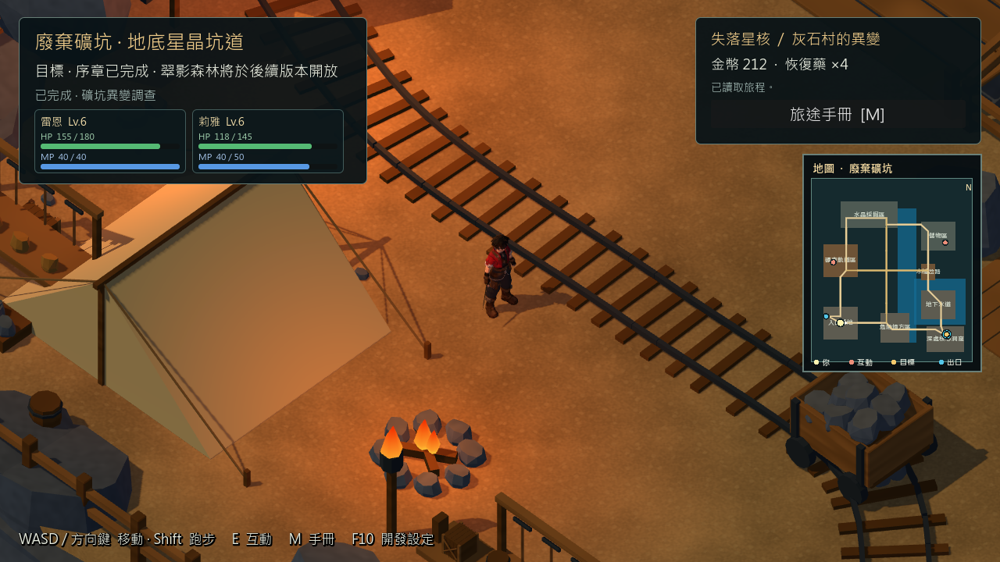

# 序章讀檔碰撞驗證效能修正 — 2026-10-29

## 結果與範圍

分支 feature/greystone-g06；基線 `7e5e6564b8e5802f0eeddf3bf2ef49555183556f`。修正讀檔驗證重建完整美術場景的成本，保留審核 R1–R4 已完成的修正。沒有修改地圖、角色模型、數值、劇情／任務／獎勵、存檔 Schema 或正式 v0.6.1 入口。

固定序章 RC3 **不含本輪優化**，本輪 EXE 是獨立效能診斷包，不是玩家候選包。人工、Android／iOS、第一章仍暫停。

## 量測方法

Godot 4.7.2.stable.official.ed1daf0bf、Windows x64 原生 Release 模板、RTX3080、Compatibility、1280×720／60FPS 上限。從 git archive 建立隔離來源，僅覆蓋明列檔案；對四個正式方法插入時間戳，工具確認移除時間戳後與原方法逐字一致。build_receipt.json 記錄來源提交、overlay／方法／EXE／PCK SHA。

兩次皆先完成真實序章，再做三輪三區切換、NPC 服務、存讀檔、可選戰鬥及返回；各168／0，基線51.525秒、修正51.756秒。驗證完整狀態一致及單次星印／E008收據。取樣期間不截圖，結束後才讀回畫面。已查看前後原生圖片，人物、HUD、小地圖及礦坑正常存在；不代表全部美術合格。

**短時自動圖形診斷，不是30分鐘測試或人工操作。** CPU牆鐘跨度不是GPU耗時；Performance的CPU欄位在Release可為0，不據此推論GPU瓶頸。兩次單次採樣相隔約3小時，沒有交錯重複對照；不把小幅差異視為統計上穩定的改善。

```powershell
python tools/profile_prologue_release.py --output builds/prologue-profile-20261029/baseline
./tools/run_prologue_profile.ps1 -Build builds/prologue-profile-20261029/baseline
python tools/profile_prologue_release.py --output builds/prologue-profile-20261029/optimized --overlay scripts/core/exploration_game.gd --overlay scripts/save/location_collision_snapshot.gd
./tools/run_prologue_profile.ps1 -Build builds/prologue-profile-20261029/optimized
```

輸出目錄必須不存在。以上基線命令於所列基線提交執行；在新HEAD重跑第一個命令也會包含優化，不能稱歷史未修正版。各run隔離APPDATA與存檔；runner檢查退出碼、錯誤訊息、Release／Windows身分、報告，240秒逾時清理自己的程序。

## 實作與資料安全

ExplorationGame在地圖ready後、套用莉雅狀態前，按精確PackedScene保存靜態碰撞快照。形狀深複製、保留碰撞層／遮罩、形狀擁有者變換／停用設定，不保留現場節點、模型、材質或動畫。候選莉雅旗標仍控制其碰撞層。

未到訪／舊版本／不支援的地圖回原完整場景驗證；非靜態物理身體、非預期父層變換拒絕擷取。仍在隔離物理世界等待兩個物理幀，執行相同玩家膠囊與地面射線。沒有改用粗界、接受結果快取或放寬SaveCodec。快照只存當次遊戲記憶體，正式v0.6.1（greystone_enabled=false）不啟用。

## 數據

每次 create_ms＋ready_ms 的中位數如下。**不含物理等待、切圖、淡入淡出或磁碟IO，不能視為整體讀檔時間。**

| 地圖 | 樣本／版本 | 前 ms | 後 ms |
|---|---:|---:|---:|
| 灰石村 | 7 | 36.610 | 8.809 |
| 低語森林 | 6 | 5.442 | 0.827 |
| 礦坑 | 7 | 16.719 | 1.671 |

整個讀檔仍會重新載入可見地圖，因此尚有尖峰；物理同步等待也保留。

| 階段 | 平均 ms 前／後 | P95 ms 前／後 | P99 ms 前／後 | 最大 ms 前／後 | Draw Calls 前／後 |
|---|---|---|---|---|---|
| 村莊讀檔 | 17.913 / 17.405 | 58.496 / 18.386 | 62.296 / 60.465 | 66.649 / 60.734 | 1041–1041 / 1041–1041 |
| 森林讀檔 | 17.244 / 17.014 | 39.009 / 17.354 | 45.960 / 46.107 | 49.110 / 46.641 | 290–291 / 290–291 |
| 礦坑讀檔 | 16.666 / 16.664 | 21.292 / 18.017 | 23.464 / 22.375 | 27.432 / 23.583 | 178–207 / 178–207 |
| NPC／交易 | 17.139 / 16.964 | 17.960 / 17.698 | 56.644 / 59.096 | 63.053 / 60.929 | 953–1213 / 953–1213 |
| 森林戰鬥 | 16.667 / 16.667 | 16.791 / 16.852 | 21.104 / 21.558 | 21.104 / 21.558 | 290–741 / 290–741 |
| 礦坑戰鬥 | 16.667 / 16.665 | 16.710 / 16.717 | 19.154 / 19.330 | 28.670 / 28.853 | 101–212 / 101–212 |

Draw Calls含UI／陰影／過渡，不是模型數。每5秒程序採樣：基線11點，修正11點；working set取樣峰值835.04→836.82MiB，private bytes 2063.91→2045.22MiB。不是瞬時最高值或洩漏證明；本輪未採引擎static memory，不推測。

## 回歸

`tools/godot.ps1 -Mode TestLocationCollisionSnapshot`：**20485／0**。三張真實場景與快照對照地面高度／存在性、玩家膠囊／站立支撐；涵蓋莉雅入隊前後、互動點、停用形狀、深複製隔離及動態物件回退。身體數1518／37／4，礦坑為少數身體內多個形狀，並非只有四個碰撞形狀。此為無頭物理測試，不冒充實際行走。

另依序執行工具模式，共**285／0**：

| Mode | 通過／失敗 |
|---|---:|
| TestPhase5 | 69／0 |
| TestPhase5Reload | 7／0 |
| TestG06 | 51／0 |
| TestG06Reload | 6／0 |
| TestPrologueMigration | 91／0 |
| TestPrologueMigrationReload | 6／0 |
| TestPrologueCommerce | 50／0 |
| TestPrologueCommerceReload | 5／0 |

包括舊版本來源驗證、原檔／備份保留、未來layout拒絕、水中／岩內／無支撐座標拒絕、背包／裝備／旗標／單次獎勵及獨立程序讀檔。

## 限制及下一步

- 原engine＋PCK長測216～223ms戰鬥／交易尖峰未在本輪Release無截圖短測重現，不能宣稱已修好該歷史尖峰；戰鬥程式未修改。
- 初始序章階段最大7845.716→7997.372ms，包含資源／測試場景初始化，不是玩家穩態FPS。讀檔／交易仍約61ms尖峰。
- 未來加入移動實體、破壞地形或其他劇情碰撞時，需要擴充快照失效／重建契約或停用該圖快照；目前只針對現有靜態圖及莉雅狀態驗證。
- 新莉雅領口／手腕／衣料拓樸仍失敗，未替換可玩模型；美術和人工終驗未完成。
- 下一步以本修正提交建立新候選包，重跑包內回歸及長測；不覆蓋RC3、不挪用RC3長測當作本優化通過。

## 修改檔案與證據

Runtime：scripts/core/exploration_game.gd、scripts/save/location_collision_snapshot.gd（含UID）。
測試：tests/location_collision_snapshot_test.gd、tests/prologue_performance_probe.gd、tests/prologue_profile_trace.gd（含UID）。
工具：tools/profile_prologue_release.py、tools/run_prologue_profile.ps1、tools/godot.ps1。
文件：本報告、TASKS、CHANGELOG、GREYSTONE_G07_REPORT、ARCHITECTURE、SAVE_FORMAT、PROLOGUE_RC3_SOAK_REPORT。

[完整比較](evidence/prologue_validation_perf_20261029/comparison.json)／[回歸命令與結果](evidence/prologue_validation_perf_20261029/regression.json)／[碰撞對照](evidence/prologue_validation_perf_20261029/collision_snapshot.json)。資料夾內保留測試紀錄、包雜湊及畫面；完整原生日誌、二進位及存檔留在ignored builds/artifacts，不提交。


