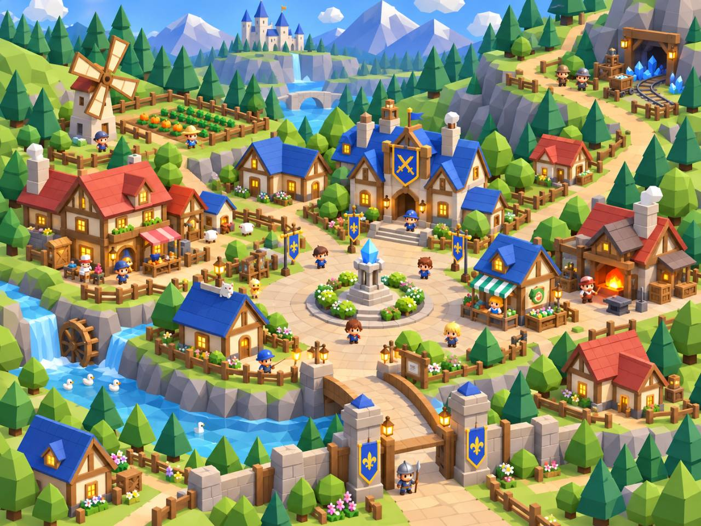

# 場景方向：歷史 0.6.1 參考

> **2026-10-14 正文合併更新（優先於本檔較早條款）**：新企劃已由使用者貼文取得，不再待正文。灰石村採 120×120m、Q 版低面數切面、北側公會/西北農田/東北礦坑/東河/南入口/西出口；平台 Windows + Android，iOS 預留。執行以 [GREYSTONE_VILLAGE_SPEC.md](GREYSTONE_VILLAGE_SPEC.md) 與 [GREYSTONE_BUILD_TASKS.md](GREYSTONE_BUILD_TASKS.md) 為準。G01 獨立佔位預覽，不替換正式0.6.1存檔；G06再遷移位置及串接劇情/觸控。本檔舊「待正文」、PC限定、圖片未列公會、固定舊碰撞等描述保留為歷史，不是目前限制。

**已被 2026-10-14 新圖取代為主要場景依據。** 最新設計見 [灰石村九區階梯礦村](GRAYSTONE_VILLAGE_V3.md)：水井廣場取代晶柱廣場，旅館／兩店與自然崖壁取代藍頂公會／方框圍牆。下文保存前一輪設計和已完成的 0.6.1 範圍，不再作為新版衝突裁決依據。

來源：使用者於 2026-10-13 提供的場景參考圖。灰石村第一輪已套用於 **0.6.1**，實作與驗收見 [VILLAGE_ART_REPORT](VILLAGE_ART_REPORT.md)。以下保留整體方向，森林／礦坑延伸尚待下一輪。

## 採用的重點

- 斜 45 度的立體村落，中央水晶廣場是地標；道路形成清楚的環形連接。
- 公會是藍色屋頂的主要建築；住宅、商店、工坊以屋頂色、棚布、招牌和門口道具區分。
- 場景有三層：前景橋梁／入口、中景可走動的村落、遠景山谷／林地／礦坑。遠景城堡可作背景，不增加新地區或新任務。
- 暖色窗燈、燈柱、花箱、柵欄、攤位和植被聚落，讓場景更豐富，也讓入口容易辨識。
- 河流、瀑布、水車與岩壁補充空間層次；礦坑入口用坑木、礦車及藍晶標示。
- 延續既有圓潤可愛角色、樹冠與柔和材質，不直接改成圖中尖銳的三角樹木。

## 先做灰石村

1. 將公會、中央廣場、森林出口安排為主要視線動線，維持公會長與莉雅的互動可達性。
2. 增加原創水晶底座、環形鋪路、商店棚布、入口橋與村外河道；優先利用現有模型組裝，再製作缺少的部件。
3. 建築補屋簷／窗框／煙囪／花箱，街道補成組而非零散的燈柱、柵欄與花圃。
4. 裝飾高低差先放在不可走區；新增碰撞不能堵住既有出生點、讀檔落點或任務路線。
5. 完成村莊後，再把相同的石材、木材、植被與路標語彙延伸至森林和礦坑入口。

## 實作與驗收限制

目前 SaveCodec v1 限制地圖座標與安全落點；如果改動可走範圍或舊存檔落點的碰撞，必須更新相容處理及舊檔回歸，不能只改圖面。此輪不因參考圖加入商店交易、居民 AI、城堡可探索區或額外故事章節。

鏡頭須能看見角色與互動提示；1280×720／960×540 比較地標、遮擋、色彩層次和文字。實際走通公會長→莉雅→森林出口，檢查橋樑、坡面及地圖邊界，重測任務、保存／讀取與村莊效能。

圖像只作使用者提供的設計參考，未當作遊戲貼圖、模型或商店素材使用；遊戲內部件採原創製作。文件圖片不包含在 Windows PCK。

## 0.6.1 範圍

已實作公會／住宅外觀、分區圓形廣場、晶柱、石板路、低矮花草、村牆、暖色燈具、河道／小瀑布／靜態水車、村外橋與山谷住宅／風車。晶柱使用原 Trunk1 的碰撞位置，廣場因此位於主路東南側；未強行重排原劇情座標。保持固定 45 度鏡頭，村莊視野由 17 調到 21，其他地圖保留原設定。橋在森林互動出口之外，只作景觀。參考圖中的可探索城堡、農田玩法、商店交易與居民行為未加入。
