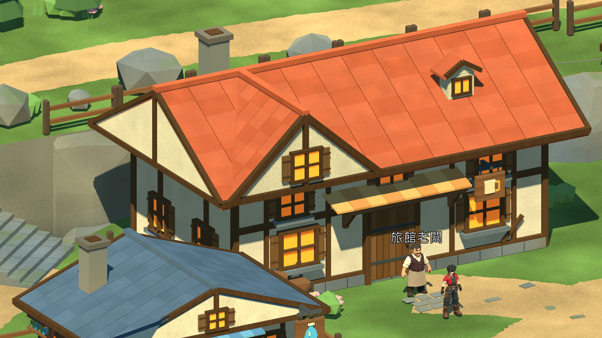

# 灰石村建築材質細節 — 2026-11-09

## 實際完成

候選序章六棟建築增加灰泥細粒與抹面起伏、木框／門窗的柔和木紋、紅瓦與藍灰瓦的粗糙度及細微表面起伏。沿用原有配色、建築幾何與位置，不增添貼圖或三角面。材質以顏色及類型共用，僅覆蓋候選村莊的指定材質，原始GLB與Blender主檔保留。

本次為Godot等效材質細節，不是重新完成模型或全場景參考圖還原。Blender程序材質無法直接經GLB傳入的部分由共享Shader表現。木紋採世界座標細紋，尚非逐根橫梁專用UV；已按近景將第一版過強、方向規律的條紋調淡。

## 畫面對照

修改前：


修改後：



已查看本輪六張實際圖形畫面：玩家視角、旅館中景／近景、道具店、武器店及廣場。牆面、瓦面細節可見，未見缺失材質；沒有因此宣稱建築模型精細度或整個場景均已達標。屋簷既有細碎陰影／接縫、植栽與崖壁輪廓、角色表面修整仍可改善。

## 實測

Godot 4.7.2／Compatibility／RTX3080，1920×1080，60FPS上限；每個固定建築視角120個frame_post_draw間隔，截圖後先等待10幀，不將讀回圖片成本混入取樣。這是開發引擎圖形短測，不是Release長測或實體操作驗收。

| 視角 | 修改前／後平均ms | 修改前／後P99 ms | Draw Calls前／後 |
|---|---:|---:|---:|
| 旅館 | 16.666／16.667 | 18.117／16.753 | 1958／1958 |
| 旅館近景 | 16.666／16.666 | 16.833／16.772 | 982／982 |
| 道具店 | 16.666／16.667 | 16.799／16.693 | 1584／1584 |
| 武器店 | 16.667／16.666 | 16.696／16.934 | 1747／1747 |
| 廣場 | 16.666／16.666 | 16.730／16.704 | 3691／3691 |

上限幀率可能掩蓋GPU餘裕，不能宣稱材質沒有GPU成本。廣場多物件與陰影的繪製次數仍高，須在固定玩家包長測與後續優化中評估。

- Check通過，圖形三輪皆正常退出，日誌沒有Script／Shader／ERROR訊息。
- 地形、道路、離線碰撞、建築擺放及正式main入口的前後SHA相同；沒有改動可走幾何、NPC位置或存檔格式。
- 本次沒有重跑完整序章及30分鐘長測；之前碰撞版169／0的Release結果屬於材質修整前，不能冒稱這份美術版本的完整驗收。
- 人工終驗仍依使用者指示暫停。既有RC5固定玩家包未更新。

重現命令（專案根目錄，Godot console的實際位置見tools/godot.ps1）：

```powershell
& $godot --path . --script res://tests/village_material_detail_capture.gd --log-file artifacts/logs/material-refined-20261109.log
./tools/godot.ps1 -Mode Check
```

`-- --before`只指定輸出資料夾名稱，不會停用材質；真正修改前畫面是在變更Shader前從b8addcb來源拍攝。不可在新來源加該參數後冒稱得到舊版對照。

## 檔案與下一步

- assets/shaders/greystone/building_detail.gdshader：原創程序表面，無外部素材授權。
- scripts/world/reference_village_surfaces.gd：共用材質接入；未修改輸入、RPG狀態或地形。
- tests/village_material_detail_capture.gd：固定前後鏡頭、效能取樣與幾何／入口雜湊。
- 本報告與evidence/village_materials_20261109保存結果；完整六視圖在artifacts/village_materials_20261109。

下一批處理角色衣物／臉側／持物表面，再以固定新包進行1080p長測。序章仍未正式終驗完成，Android／iOS已永久取消。
